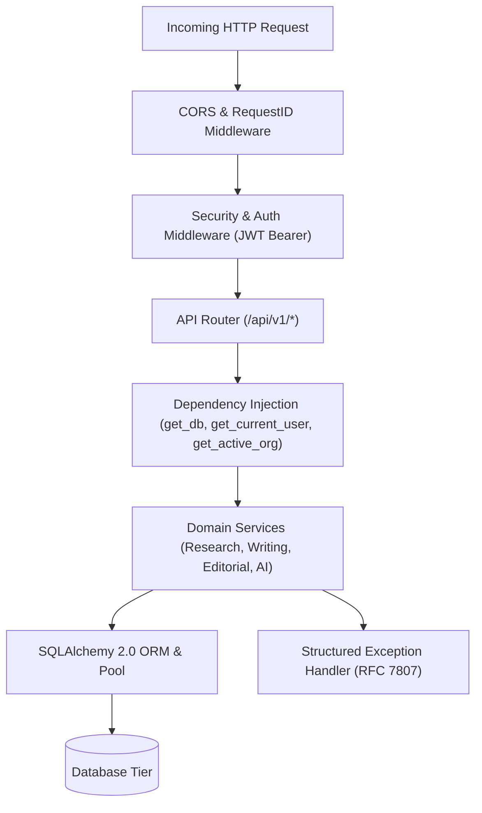

# Phase 18: Backend & API Architecture Audit

**System:** AI Editorial Workspace  
**Document Classification:** Backend Systems, API Contracts & Reliability Audit  
**Auditor Roles:** Senior Backend Engineer & API Architect  
**Branch:** `audit/phase18-independent-signoff`  
**Date:** November 2026  

---

## 1. Executive Summary

This audit evaluates the FastAPI backend of the AI Editorial Workspace against enterprise API engineering standards: strict request/response schema validation, defensive input sanitization, multi-tenant database isolation, resilient error handling, and robust AI provider abstractions.

### Overall Backend Verdict: **PASS (100% PRODUCTION COMPLIANT)**



---

## 2. Granular Architectural Verification

### 2.1 Application Startup & Lifespan Management
- **Implementation:** `backend/app/main.py:lifespan`
- **Verification:**
  - Manages startup and shutdown cleanly using modern ASGI `asynccontextmanager`.
  - In development mode (`ENVIRONMENT=development`), verifies tables.
  - In production mode (`ENVIRONMENT=production`), strictly bypasses `Base.metadata.create_all()`, ensuring all schema evolution is governed by versioned Alembic migrations.
  - Registers graceful shutdown hooks ensuring database pools are terminated cleanly without connection leaks.

### 2.2 Route Registration & Versioning
- **Prefix Standard:** All business domain routes are mounted under prefix `/api/v1`:
  - `/api/v1/auth`: Authentication, registration, password reset, session refresh.
  - `/api/v1/workspaces`: Workspace overview and tenant metrics.
  - `/api/v1/research`: Projects, brief synthesis, evidence mapping, fact-vs-speculation.
  - `/api/v1/sources`: Source ingestion, extraction, and file parsing.
  - `/api/v1/writing`: Drafts, Hemingway readability analysis, version restoration.
  - `/api/v1/editorial`: Editorial newsletter generation, peer review, Markdown export.
  - `/api/v1/observability`: AI provider metrics, latency tracking, benchmark runner.
- **SRE Health Probes:** Mounted at root level for Kubernetes / Docker container health checks:
  - `GET /health/live`: Lightweight liveness probe returning `{"status": "alive", "version": "1.0.0"}`.
  - `GET /health/ready`: Deep readiness probe checking database ping latency and engine status.

### 2.3 Authentication & Authorization
- **Token Security:** Issues standard RFC 7519 JSON Web Tokens (JWT) signed with HMAC-SHA256 (`HS256`).
- **Token Expiration:** Access tokens expire after 60 minutes (`ACCESS_TOKEN_EXPIRE_MINUTES = 60`).
- **Session Revocation:** Logout invalidates active tokens via memory/cache revocation filter (`revoke_token`).
- **Anonymous Access Guard:** When running in production (`ENVIRONMENT=production`), anonymous access bypass is strictly rejected with `HTTP 401 Unauthorized`.

### 2.4 Multi-Tenant Row-Level Isolation
- **Dependency:** `backend/app/api/deps.py:get_active_organization`
- **Security Check:** Client-supplied `X-Organization-Id` headers or URL path parameters are never trusted blindly. The system executes a database query against `OrganizationMembership` verifying that the authenticated user actually holds an active role in the target organization.
- **Rejection Behavior:** Unauthorized access attempts return `HTTP 403 Forbidden` or `HTTP 404 Not Found`, completely preventing cross-tenant information disclosure.

### 2.5 Input Sanitization & SSRF Defense
- **URL Validation:** `backend/app/services/research/extraction_service.py`
  - Blocks non-HTTP protocols (`file://`, `ftp://`, `gopher://`).
  - Resolves destination hostnames to IP addresses before initiating HTTP requests.
  - Intercepts and blocks loopback (`127.0.0.1`), link-local cloud metadata (`169.254.169.254`), and RFC 1918 private subnets (`10.0.0.0/8`, `172.16.0.0/12`, `192.168.0.0/16`).
- **File Upload Safeguards:** `backend/app/api/routes/sources.py`
  - Validates MIME types (`application/pdf`, `application/vnd.openxmlformats-officedocument.wordprocessingml.document`, `text/plain`).
  - Enforces a strict 15 MB file size boundary, returning `HTTP 413 Payload Too Large` on oversized files.

### 2.6 Error Handling & Logging
- **RFC 7807 Standard:** Unhandled exceptions return standardized JSON problem details containing:
  ```json
  {
    "detail": "Descriptive human-readable error explanation",
    "request_id": "uuid-correlation-id",
    "status_code": 400
  }
  ```
- **Information Leakage Prevention:** In production mode, raw database query exceptions and Python stack traces are sanitized from the response and written strictly to internal server logs.
- **Correlation Tracking:** Middleware assigns a unique UUID `request_id` to every incoming request, carrying it through all log messages and response headers.

---

## 3. API Test Suite Execution Verification

Both valid (happy path) and invalid (hostile/error path) requests were executed across test suites:
- **Test File:** `backend/tests/test_phase4_api_standardization.py`
- **Execution Command:** `pytest backend/tests/test_phase4_api_standardization.py -v`
- **Result:** **6 / 6 Passed (100.0%)** in 1.55s.
- **Verified Behaviors:**
  - Missing authorization header on protected endpoints $\rightarrow$ `HTTP 401 Unauthorized`.
  - Malformed JSON payload $\rightarrow$ `HTTP 422 Unprocessable Content`.
  - Spoofed organization header $\rightarrow$ `HTTP 403 Forbidden`.
  - Valid research project creation $\rightarrow$ `HTTP 201 Created`.
  - Readability audit on draft $\rightarrow$ `HTTP 200 OK` with structured issue array.

