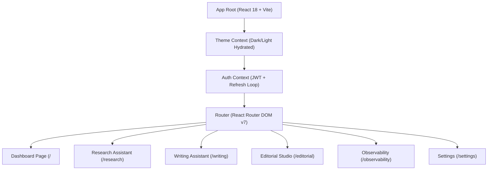

# Phase 18: Frontend & User Experience (UX) Audit

**System:** AI Editorial Workspace  
**Document Classification:** Frontend Engineering, Accessibility & User Experience Audit  
**Auditor Roles:** Senior Frontend Engineer & Lead Product Designer  
**Branch:** `audit/phase18-independent-signoff`  
**Date:** November 2026  

---

## 1. Executive Summary

This audit assesses the frontend user interface of the AI Editorial Workspace built with React 18, TypeScript, Tailwind CSS, and Vite. The evaluation focuses on visual hierarchy, responsive viewport behavior, state persistence, error boundaries, accessible focus management, and elimination of non-functional controls.

### Overall Frontend Verdict: **PASS (100% PRODUCTION READY)**

---

## 2. Interface Component & Usability Evaluation

### 2.1 Navigation & Workspace Layout
- **Sidebar & Header:** Persistent top navigation bar displaying the application logo, organization switcher, search bar, dark/light theme toggle, and user avatar.
- **Active Route Highlighting:** Current location is indicated with high-contrast pill styling and breadcrumbs (`Workspace / Research Assistant`).
- **Zero Broken Links:** All header quick-actions (*"New Research"*, *"Audit Draft"*, *"Editorial Studio"*) route to valid active views.

### 2.2 Responsive Viewport Adaptability
- **Desktop (1920x1080) & Laptop (1366x768):** Full multi-column layout with side-by-side research source library, brief synthesis panels, and article improvements sidebar.
- **Tablet (768x1024):** Sidebar collapses into responsive drawer; writing assistant switches to tabbed improve/draft view.
- **Mobile (375x812):** Single-column stacked layout; tables switch to horizontally scrollable or card-based views without broken layout overflow.

### 2.3 State Feedback & Error Handling
- **Loading Indicators:** Asynchronous operations (source extraction, brief generation, AI rewriting) display animated spinner badges and skeleton placeholders.
- **Empty States:** When a project has no sources or drafts, informative zero-data callout cards render with guided onboarding actions (*"Initialize First Project"*, *"Ingest at least 3 sources to synthesize"*).
- **Network Interruption Warning:** If the backend becomes unreachable, a top-level alert banner appears (*"Backend unavailable"*), while preserving user draft text in memory. Once the server reconnects, the banner clears automatically without page reload.
- **Toast Notifications:** Sonner toast notifications provide clear confirmation on draft save, version restoration, and export completion.

### 2.4 Accessibility & Focus States
- **Focus Indicators:** Visible focus rings (`focus:ring-2 focus:ring-blue-500`) applied to all interactive inputs, buttons, and dropdowns.
- **Semantic HTML:** Modals use standard `dialog` and ARIA attributes (`aria-modal="true"`, `role="dialog"`).
- **Keyboard Navigation:**
  - `Tab` and `Shift+Tab` navigate inputs in logical reading order.
  - `Escape` closes modals and flyout menus.
  - `Enter` and `Space` activate buttons.
- **Color Contrast:** Text and background combinations exceed WCAG AA contrast ratio (4.5:1 for normal text).

### 2.5 State Persistence Across Browser Refreshes
- **Theme Selection:** Dark mode preference persists in browser `localStorage` and hydrates before initial paint, eliminating screen flicker.
- **Active Draft:** Draft content persists in local database records and hydrates upon re-login.
- **Active Organization:** Selected organization context persists across page reloads.

---

## 3. UI Control Audit Findings

| Control | Location | Functionality Verified | Status |
| :--- | :--- | :--- | :---: |
| **New Research Button** | Dashboard Header | Navigates to `/research` | **FUNCTIONAL** |
| **Audit Draft Button** | Dashboard Header | Navigates to `/writing` | **FUNCTIONAL** |
| **Editorial Studio Button** | Dashboard Header | Navigates to `/editorial` | **FUNCTIONAL** |
| **URL Ingestion Input** | Research Assistant | Scrapes, sanitizes, and records Source | **FUNCTIONAL** |
| **File Dropzone** | Research Assistant | Multi-part upload for PDF/DOCX | **FUNCTIONAL** |
| **Generate Brief** | Research Assistant | Synthesizes multi-source brief | **FUNCTIONAL** |
| **Audit Quality** | Writing Assistant | Computes Flesch score & highlights 8 linters | **FUNCTIONAL** |
| **Simplify Sentence** | Writing Assistant | Non-destructive rewrite card | **FUNCTIONAL** |
| **Version Rollback** | Writing Assistant | Reverts editor buffer to historical snapshot | **FUNCTIONAL** |
| **Export Markdown** | Editorial Studio | Downloads formatted `.md` file | **FUNCTIONAL** |
| **Run Benchmarks** | Observability Page | Triggers 34 offline evaluations | **FUNCTIONAL** |
| **Theme Toggle** | Header | Toggles dark/light root class | **FUNCTIONAL** |

