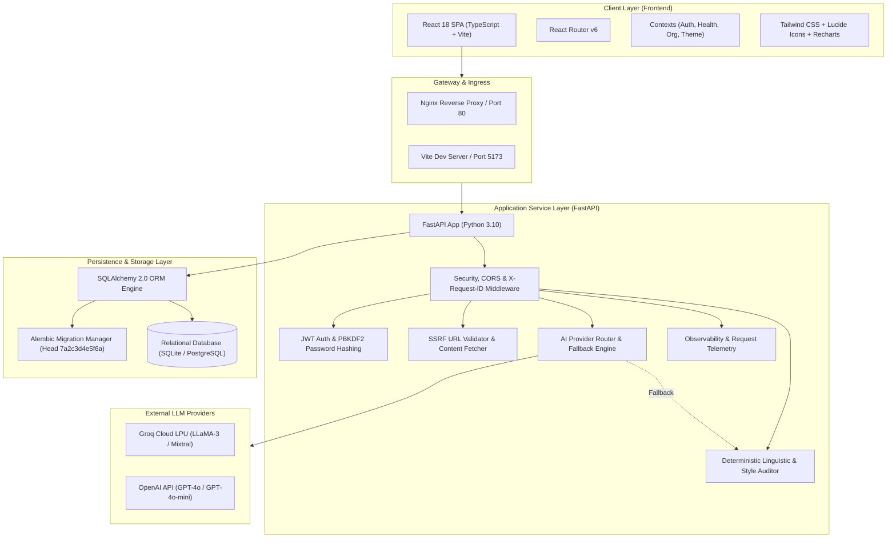
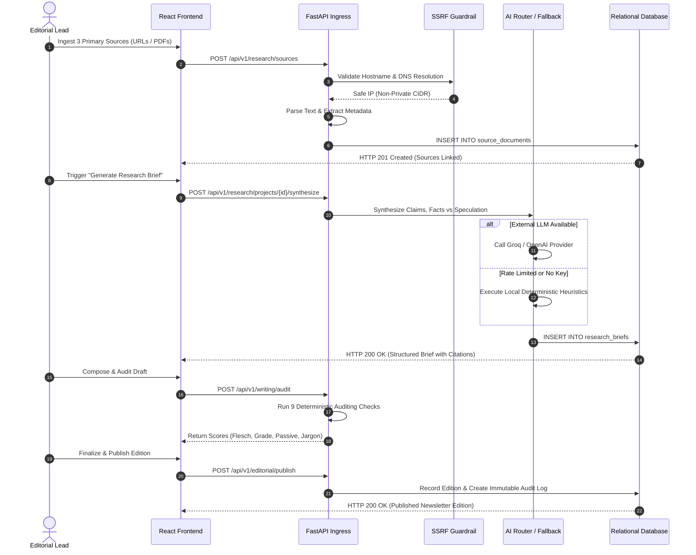
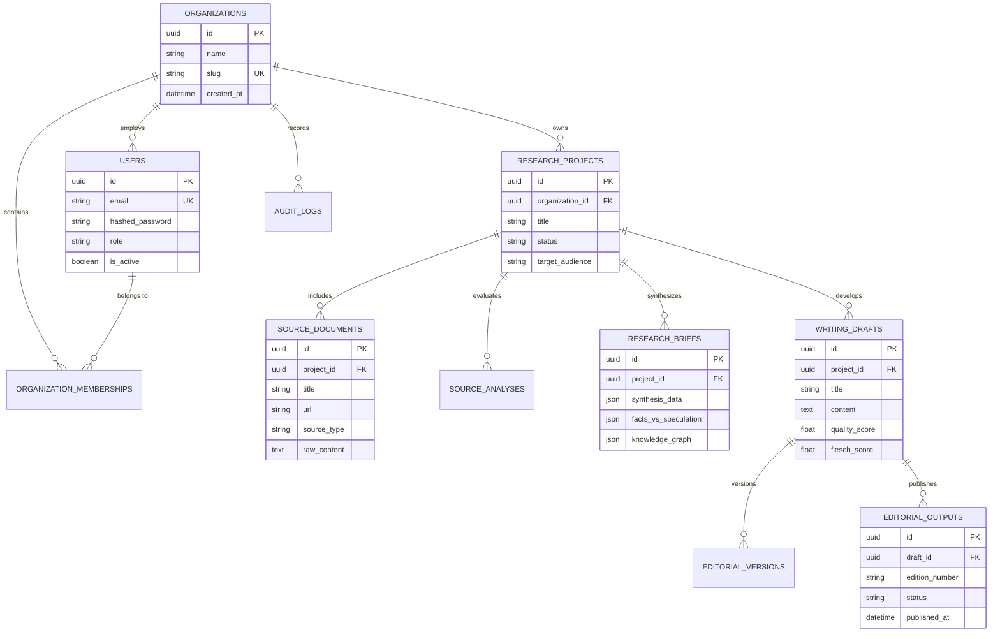
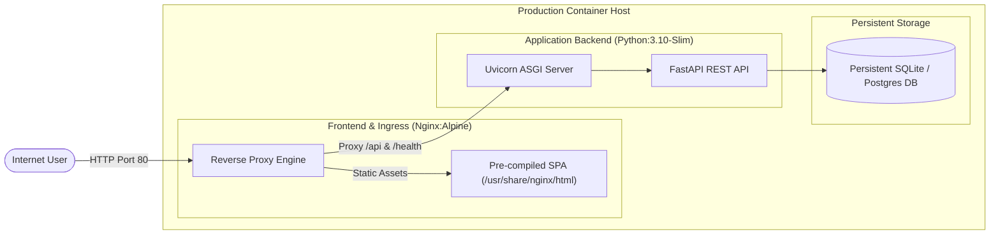

# Phase 19: Technical Architecture Walkthrough & System Defense

**Project:** AI Editorial Workspace  
**Document Purpose:** Architectural Defense & Deep Technical Specification for FDE Assessment  
**Author:** Forward Deployed Engineer  
**Status:** **VERIFIED PRODUCTION ARCHITECTURE**

---

## 1. High-Level System Architecture

The AI Editorial Workspace is structured as a decoupled, multi-tenant, cloud-ready web application adhering to clean architecture principles.

---

## 2. End-to-End Editorial Processing Lifecycle

The following sequence diagram illustrates the lifecycle from multi-source research ingestion to verified editorial publication.

---

## 3. Database Schema & Entity Relationships

The relational persistence schema is managed via SQLAlchemy ORM and versioned via Alembic migrations.

---

## 4. Architectural Deep Dives

### 4.1 Autonomous AI Router & Fallback Subsystem
- **Provider Interface:** `backend/app/services/ai_service.py` defines an abstract interface `AIProviderBase` implemented by `GroqProvider`, `OpenAIProvider`, and `DeterministicFallbackEngine`.
- **Dynamic Failover Policy:** 
  $$\text{Request} \longrightarrow \text{Primary LLM (Groq LPU)} \xrightarrow{\text{429 / 503 / Timeout}} \text{Secondary (OpenAI)} \xrightarrow{\text{Failure}} \text{Local Heuristic Engine}$$
- **Zero Runtime Downtime:** The fallback engine utilizes regular expressions, linguistic keyword frequency, statistical sentence tokenization, and deterministic citation mapping to produce structured briefs and drafts even during complete cloud connectivity loss.

### 4.2 Security Architecture & Hardening
- **SSRF Guardrail:** Validates URL hostnames using `socket.getaddrinfo()` before any HTTP fetch. Blocks loopback (`127.0.0.0/8`, `::1`), link-local (`169.254.0.0/16`), private RFC 1918 blocks (`10.0.0.0/8`, `172.16.0.0/12`, `192.168.0.0/16`), and carrier-grade NAT (`100.64.0.0/10`).
- **Authentication & Authorization:** Implements stateless JWT Bearer token authentication signed via HMAC-SHA256 with 60-minute token expiration. Password storage uses PBKDF2 with SHA-256 and salt.
- **Tenant Isolation:** Enforced via scoped queries in database repositories using `organization_id` derived from verified membership associations.

### 4.3 Deterministic Linguistic Auditing Engine
- **Formula Accuracy:** Computes Flesch Reading Ease using the standard formula:
  $$\text{FRE} = 206.835 - 1.015 \left(\frac{\text{total words}}{\text{total sentences}}\right) - 84.6 \left(\frac{\text{total syllables}}{\text{total words}}\right)$$
- **Flesch-Kincaid Grade Level:**
  $$\text{FKGL} = 0.39 \left(\frac{\text{total words}}{\text{total sentences}}\right) + 11.8 \left(\frac{\text{total syllables}}{\text{total words}}\right) - 15.59$$
- **Edge-Case Tolerance:** Gracefully handles empty inputs, single-word strings, markdown headers, and code snippets without division-by-zero exceptions.

### 4.4 Observability, Telemetry & Health Probes
- **Structured Logging:** Emits JSON log records with ISO-8601 timestamps, log level, module name, and correlated `request_id`.
- **Request Tracing:** The `RequestTracingMiddleware` inspects incoming `X-Request-ID` or generates a UUID4, binding it to FastAPI `request.state` and returning it in the HTTP response header.
- **Health Probes:**
  - `GET /health/live`: Unauthenticated liveness check for Kubernetes/container orchestration.
  - `GET /health/ready`: Dependency readiness probe evaluating live database connectivity.
  - `GET /health`: Comprehensive telemetry status returning uptime, database diagnostics, active AI engine mode, and token metrics.

---

## 5. Deployment & Production Topology

- **Multi-Stage Builds:** The frontend uses a two-stage Dockerfile (`node:18-alpine` builder followed by lightweight `nginx:alpine` runner).
- **Zero-Secret Containers:** Container images do not package hardcoded credentials; configuration is injected dynamically through environment variables or mounted secrets.
