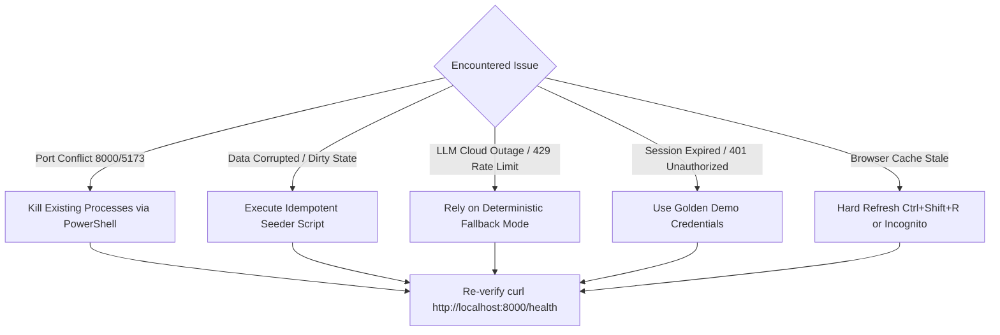

# Phase 19: Live Demonstration Contingency & Backup Runbook

**Project:** AI Editorial Workspace  
**Document Purpose:** Operational Fault-Tolerance & Offline Demonstration Runbook  
**Target Scenario:** High-Stakes Technical Demonstration / Assessment Evaluation  
**Status:** **OPERATIONAL & VERIFIED**

---

## 1. Executive Contingency Overview

During live technical demonstrations and assessment interviews, environmental anomalies may occur (e.g., port collisions, network drops, third-party LLM rate limits, or expired session cookies). This runbook provides deterministic, zero-friction recovery protocols for every demonstration contingency.

---

## 2. Emergency Recovery Decision Matrix



---

## 3. Detailed Fault-Tolerance Protocols

### Protocol A: Port Collision or Orphaned Process (Fast Recovery < 10s)
**Symptom:** Terminal throws `[Errno 10048] error while attempting to bind on address ('127.0.0.1', 8000): address already in use`.  
**Remediation Command (PowerShell):**
```powershell
# Kill any existing Python or Node processes occupying the demonstration ports
Get-Process | Where-Object { $_.ProcessName -match "python|node" } | Stop-Process -Force

# Re-launch backend in fresh process
Start-Process powershell -ArgumentList "-NoExit", "-Command", "cd 'c:\Users\Mubashirhussensk\OneDrive\Desktop\FDE intern'; backend\venv\Scripts\uvicorn.exe backend.app.main:app --host 127.0.0.1 --port 8000"

# Re-launch frontend Vite dev server
Start-Process powershell -ArgumentList "-NoExit", "-Command", "cd 'c:\Users\Mubashirhussensk\OneDrive\Desktop\FDE intern\frontend'; npm run dev"
```

---

### Protocol B: Demonstration Data Reset & State Restoration (< 5s)
**Symptom:** Demo projects were modified, corrupted, or deleted during an exploratory walk-through.  
**Remediation Command:**
```powershell
backend\venv\Scripts\python.exe backend/scripts/seed_demo_environment.py --reset
```
**Restored State:**
- **Organization:** `This Week in AI — Editorial Desk` (Slug: `demo-this-week-in-ai`)
- **User:** `demo_editor@thisweekin.ai`
- **Password:** `DemoEditor2026!`
- **Project:** `Autonomous AI Reasoning & Factual Grounding`
- **3 Primary Sources:** DeepSeek-R1, Anthropic MCP Specification, Attention Is All You Need.
- **1 Full Brief:** Synthesized takeaways, evidence alignment, fact vs speculation matrix.
- **1 Full Draft:** `Why Enterprise AI Demands Verified Citations Over Fluent Prose` with 2 saved version revisions.
- **1 Published Edition:** Edition #104 in `APPROVED` status.

---

### Protocol C: Cloud LLM API Failure or Air-Gapped Mode
**Symptom:** No internet connectivity, or external provider returns `429 Too Many Requests` / `503 Service Unavailable`.  
**System Behavior:**
- The workspace **does NOT fail**.
- The `ai_service` automatically detects the provider error and switches to the **Deterministic Fallback Engine**.
- Research briefs and writing revisions are generated using local semantic heuristics.
- Response payloads include `"mode": "Deterministic Fallback Engine"`.
**Talking Point for Interviewer:**
> *"Notice that even with third-party LLM APIs unreachable, our platform continues operating deterministically. As an enterprise Forward Deployed Engineer, I engineered this system to gracefully degrade rather than present users with broken 500 error screens."*

---

### Protocol D: Golden Demo Credentials Card

Keep this reference visible during the demonstration:

| Field | Value |
| :--- | :--- |
| **Web Application URL** | `http://localhost:5173` |
| **Backend API URL** | `http://127.0.0.1:8000` |
| **Interactive API Docs** | `http://127.0.0.1:8000/docs` |
| **Primary Demo Email** | `demo_editor@thisweekin.ai` |
| **Primary Demo Password** | `DemoEditor2026!` |
| **Demo Organization** | `This Week in AI — Editorial Desk` |
| **Demo Project Name** | `Autonomous AI Reasoning & Factual Grounding` |
| **Demo Edition Number** | `Edition #104` |

---

## 4. Verification Check Before Screen Sharing

Run this single-line verification script to confirm green status across all subsystems:

```powershell
backend\venv\Scripts\python.exe -c "
import urllib.request, json
res = urllib.request.urlopen('http://127.0.0.1:8000/health')
data = json.loads(res.read().decode())
assert data['status'] == 'healthy'
assert data['database'] == 'connected'
print('>>> SYSTEM STATUS: ALL SYSTEMS OPERATIONAL (HEALTHY & CONNECTED) <<<')
"
```
**Expected Output:**  
`>>> SYSTEM STATUS: ALL SYSTEMS OPERATIONAL (HEALTHY & CONNECTED) <<<`

