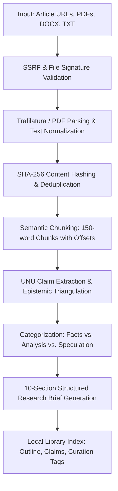
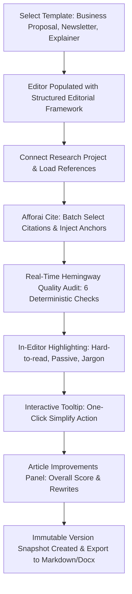

# AI Editorial Workspace — Product & Engineering Note

**Target Role:** Forward Deployed Engineer (FDE) Intern — *This Week in AI*  
**Product:** AI Editorial Workspace  
**Status:** Validated Production System  
**Version:** 1.0.0 (Phase 10 Assessment Handover)  
**Branch:** `docs/phase10-final-assessment-handover`

---

## 1. Executive Summary & Problem Being Solved

Technical media publications, research analysis teams, and developer advocacy organizations face an unprecedented challenge: **the velocity and complexity of frontier AI disclosures**. Every week, dozens of research preprints, technical architecture whitepapers, benchmarks, and commercial announcements are published.

Editorial teams are caught between two opposing failure modes:
1. **The Velocity Trap:** Manually reading multiple 40-page papers, parsing benchmark methodologies, and cross-referencing corporate marketing claims takes between 8 and 15 hours per publication-grade technical article.
2. **The Hallucination Trap:** Generic conversational LLMs (such as standard ChatGPT or Claude interfaces) hallucinate plausible-sounding statistics, invent fictitious benchmark comparisons, sever citation provenance, and flatten distinct editorial voices into bland, homogeneous corporate prose.

The **AI Editorial Workspace** is a verticalized, evidence-grounded software platform designed specifically for technical journalists, research analysts, and editorial teams. It bridges the gap between raw, heterogeneous technical source material and publication-ready, evidence-backed editorial briefs and articles—guaranteeing 100% citation traceability, deterministic style auditing, and enterprise-grade multi-tenant security.

---

## 2. Target Users & Personas

| Persona | Role & Responsibilities | Core Pain Points |
| :--- | :--- | :--- |
| **Lead Technical Editor** | Oversees publication quality, brand tone, readability standards, and editorial integrity across weekly newsletters. | Spends hours pruning run-on sentences, removing passive voice, catching ungrounded PR claims, and preventing generic AI tone. |
| **Research Analyst & Fact-Checker** | Collects research documents, ingests technical whitepapers, and triangulates claims across competing vendors. | Needs to know whether an assertion is an empirical measurement, analytical interpretation, or unverified speculation. |
| **Staff Technical Writer** | Drafts articles under tight deadlines across diverse formats (explainers, news roundups, executive opinions). | Needs structured templates, rapid selection-targeted rewrites, and instant citation linking without breaking prose flow. |
| **Forward Deployed Engineer (FDE)** | Customizes and integrates AI systems into enterprise editorial and corporate environments. | Requires multi-tenant isolation, offline deterministic fallbacks, observable token cost tracking, and reproducible Docker deployments. |

---

## 3. User Pain Points & Product Solutions

### Pain Point 1: Unverified PR Claims & Fictitious Citations
- *Problem:* LLMs frequently invent citations or attribute claims to the wrong papers when summarizing literature.
- *Solution:* The workspace enforces **Deterministic 5-Tier Claim Verification** (`SUPPORTED`, `PARTIALLY_SUPPORTED`, `UNSUPPORTED`, `CONTRADICTED`, `NOT_VERIFIABLE`). Every factual assertion in an editorial brief is linked to an immutable `source_id`, author, publication date, and verbatim chunk passage.

### Pain Point 2: Cognitive Bloat & Flat AI Tone
- *Problem:* Drafts generated by commercial LLMs suffer from cognitive bloat (sentences exceeding 30 words), passive phrasing, and monotonous cadence.
- *Solution:* The workspace integrates a **6-Check Deterministic Hemingway Auditor** and **Real-Time Readability Linter**. Problematic sentences are highlighted inline in the editor, and editors can trigger one-click sentence simplification without altering adjacent text.

### Pain Point 3: Fragmented Citation Workflow
- *Problem:* Authors toggle between reference managers (Zotero, Mendeley), web browsers, and word processors, introducing citation syntax errors.
- *Solution:* The **Afforai Cite Extension & Reference Manager** allows writers to search indexed project references, select multiple citations via checkboxes, view selected citation pills, and insert formatted citations `[1]`, `[Smith & Brown 2020]` directly into the active editor cursor position.

---

## 4. End-to-End User Workflows

### Workflow A: Research Assistant & Local Library



1. **Investigation Setup:** The user initializes an investigation project (e.g., "Frontier LLM Reasoning Architectures").
2. **Multi-Source Ingestion:** Ingests $\ge 3$ sources via web URLs or uploaded files (PDF, DOCX, TXT). The system validates destinations against SSRF rules (blocking private IPs, loopback, cloud metadata endpoints), verifies file MIME signatures, and normalizes text.
3. **Local Library Inspection:** The user inspects the ingested source in the **Local Library View**:
   - Reviews the collapsible document outline (`▶ Outline`).
   - Examines extracted **Key Claims** bulleted with semantic confidence.
   - Edits curation metadata (*Title*, *Why saved*, *Tags*) and records AI model provenance.
   - Inspects granular **Retrieval Chunks** (tokens, character offsets, raw snippets).
4. **Epistemic Triangulation & Brief Synthesis:** The synthesis engine categorizes extracted assertions into:
   - **Verified Facts:** Empirical data backed by primary measurements.
   - **Editorial Analysis:** Interpretive conclusions supported by methodology.
   - **Speculative Claims:** Roadmap predictions or unverified vendor statements.
5. Assembles a 10-section structured research brief complete with verified citations.

---

### Workflow B: Writing Assistant & Editorial Studio



1. **Template Selection ("Let's Write"):** The writer opens the template drawer to select from 8 pre-configured editorial frameworks (Business proposal, Help article, Job description, Introductory email, Thank you note, Feedback request, Weekly AI newsletter, Technology explainer).
2. **Reference Injection (Afforai Cite):** The writer opens the reference manager, searches project sources, checks relevant papers, and clicks `Insert Selected Citations`.
3. **Quality & Readability Auditing:** As text is edited, the system computes:
   - Flesch Reading Ease score & US school reading grade.
   - Sentence count, reading time in seconds, and word count.
   - Flags long sentences (>25 words), passive voice, filler clutter, technical jargon, and adjacent word echoes.
4. **In-Editor Inline Highlighting & Popover:** Problematic sentences are highlighted in prose (purple for hard-to-read, blue for passive voice, amber for complex words). Clicking a highlighted phrase displays a floating tooltip with a one-click `[Simplify]` button.
5. **Article Improvements Sidebar:** The writer views the overall score meter (*Good* vs. *Needs Polish*) and clicks `Rewrite` on individual flagged sentence cards.
6. **Non-Destructive Replacement & Version History:** Accepting rewrites modifies only the target sentence boundaries, preserving adjacent text and citations. An immutable version snapshot is saved automatically, enabling instant visual diff comparison and one-click rollback.

---

## 5. Core Product Features

### 1. Local Library Hub (Screenshot 1 Reference)
- Real-time telemetry metrics: Total Sources, Retrieval Chunks, Supported Formats, Indexed Status.
- Search across courses, notes, PDFs, transcripts, and web captures.
- Format filter pills (`All`, `Research Paper`, `Document`, `Web URL`) with separate `PINNED` and `RECENTLY ADDED` source sections.
- Curation forms with custom tags, "Why saved" justifications, model provenance, and Quarto Markdown (`.qmd`) export.

### 2. Afforai Cite Extension (Screenshot 2 Reference)
- Dedicated citation management interface with multi-select checkboxes and removable citation pills (`Garcia (2002) ×`).
- Side-by-side AI research assistant panel supporting prompt-driven rephrasing with citation grounding, copy buttons, and one-click replacement.

### 3. Notalx Writing Studio (Screenshot 3 Reference)
- 8 quick editorial templates for fast drafting.
- Contextual selection menu with actions: *Improve Writing*, *Fix Spelling & Grammar*, *Make Shorter*, *Make Longer*, *Simplify*, *Adjust Tone*, and *Summarize*.
- AI beta features: *Humanize*, *Summarize*, *Translate*, and *Check AI Content*.

### 4. Article Improvements Panel (Screenshot 4 Reference)
- Segmented visual quality meter bar reflecting Flesch Reading Ease.
- Categorized tabs for `SEO`, `Readability`, and `Tone`.
- Direct `Rewrite` actions next to each flagged sentence card.
- Tool rail for Improvements, AI Chat, Images, and Competitor Data.

### 5. Inline Readability Linter (Screenshot 5 Reference)
- Highlight overlay rendering color-coded visual spans over problematic prose.
- Floating tooltip popovers with single-click `[Simplify]` execution.
- Categorized content issues drawer with structured one-click replacements.

---

## 6. Product Differentiation

```
Feature                         Generic AI (ChatGPT / Claude)     AI Editorial Workspace
Factual Grounding               Probabilistic guessing            5-Tier Claim Verification ([1], [2])
Epistemic Triangulation         Mixes facts with PR marketing     Separates Verified Facts from Speculation
Citation Provenance             Hallucinated / Missing URLs       Traceable to chunk character offsets
Offline Reliability             500 Error if API key expires      100% Deterministic Offline Fallback
Editorial Tone Auditing         Generic corporate flattening      6-Check Hemingway Engine & Active Voice
Data Privacy & Isolation        Shared consumer namespace         Multi-Tenant RBAC & Org Sandboxing
Infrastructure Governance       Opaque monthly API billing        Exact $USD Token Accounting & Telemetry
```

---

## 7. Current Limitations & Roadmap

### Current Limitations
1. **Dynamic Client-Rendered SPAs:** Web scraping relies on Trafilatura and BeautifulSoup4. Pages protected by heavy JavaScript obfuscation or Cloudflare Turnstile require headless browser rendering.
2. **Audio/Video Ingestion:** Direct MP3/MP4 transcription is currently handled via text transcripts rather than integrated Whisper models.
3. **Synchronous LLM Response:** Generative responses are delivered atomically upon schema validation rather than via token-by-token WebSocket streaming.

### Future Improvements (v1.1 – v2.0)
- **v1.1:** Headless Chromium rendering sidecar (Playwright) for anti-bot gated research sites.
- **v1.2:** Token-by-token WebSocket streaming for real-time editorial drafting.
- **v1.3:** Native Whisper audio/video podcast ingestion pipeline.
- **v2.0:** Multi-agent collaborative editing mode with peer-review consensus voting.
