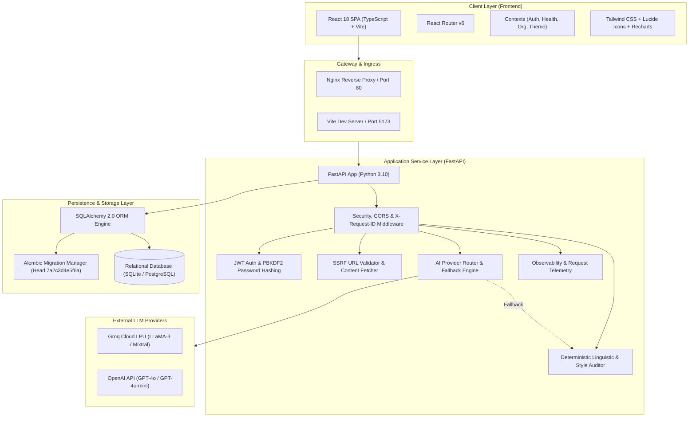
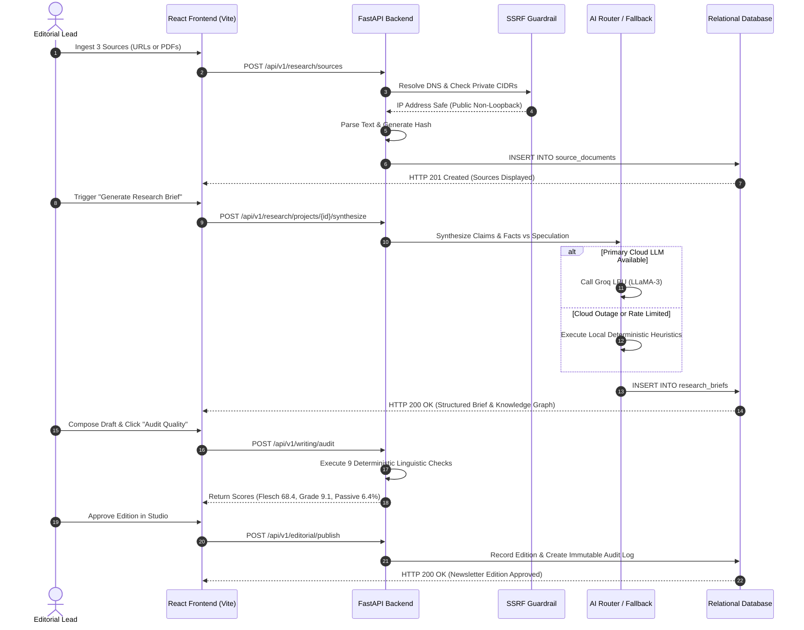
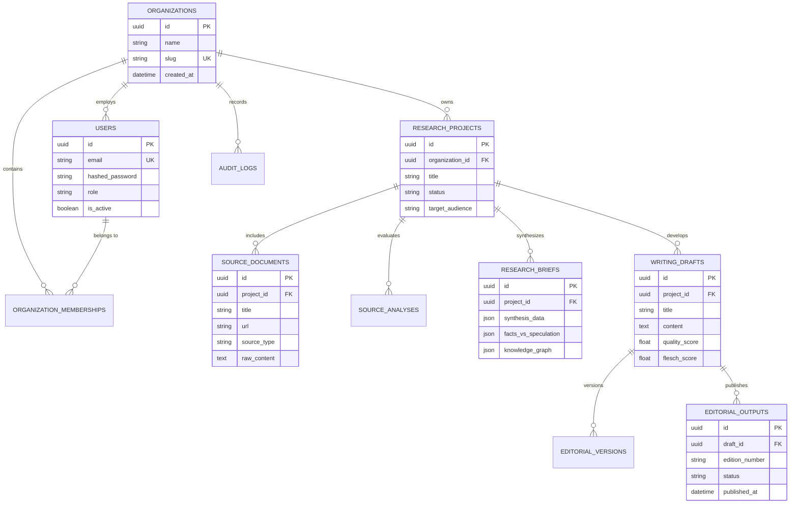
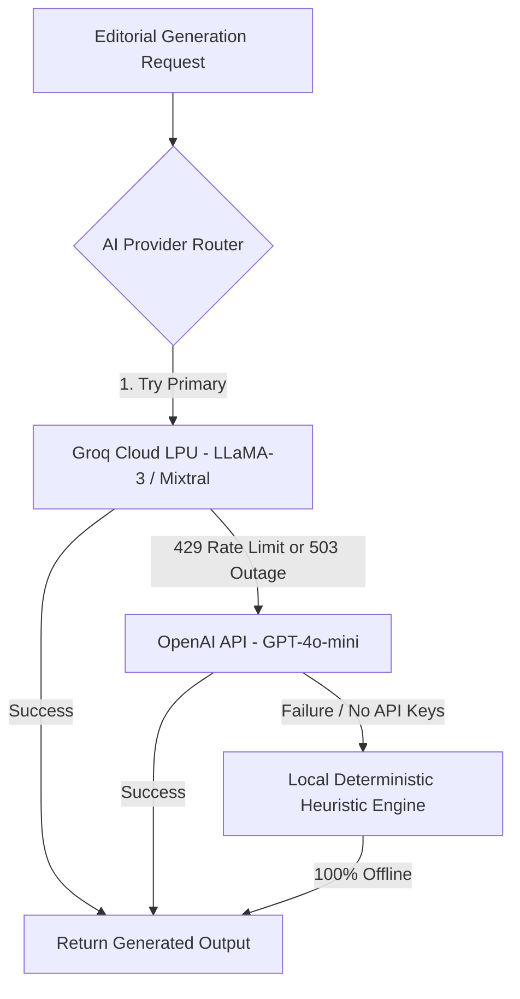

# AI Editorial Workspace

**A production-grade, full-stack AI Editorial Workspace engineered to transform raw AI technical literature, research papers, and industry announcements into evidence-backed research briefs, verifiable citations, and publication-ready newsletter editions.**

Developed for the **Forward Deployed Engineer (FDE) Intern** technical evaluation at *This Week in AI*.

[-emerald)](submission/TEST_REPORT.md)
[-blue)](submission/TEST_REPORT.md)
[-brightgreen)](frontend/dist)
[](PHASE19_FINAL_SUBMISSION_REPORT.md)
[](https://github.com/mubashirhussen/AI-Editorial-Workspace)

---

## Table of Contents

1. [Project Description](#1-project-description)
2. [Project Aim & Objectives](#2-project-aim--objectives)
3. [Problem Statement](#3-problem-statement)
4. [How We Solve the Problem Statement](#4-how-we-solve-the-problem-statement)
5. [End-to-End Editorial Procedure](#5-end-to-end-editorial-procedure)
6. [System Architectures](#6-system-architectures)
   - [High-Level System Architecture](#high-level-system-architecture)
   - [End-to-End Editorial Processing Flow](#end-to-end-editorial-processing-flow)
   - [Database Entity-Relationship Schema](#database-entity-relationship-schema)
7. [Tech Stack](#7-tech-stack)
8. [LLM Integration & Autonomous Fallback Engine](#8-llm-integration--autonomous-fallback-engine)
9. [Core Modules Implemented](#9-core-modules-implemented)
10. [Implementation Deep Dive](#10-implementation-deep-dive)
11. [How to Use It (Quickstart & Live Demo)](#11-how-to-use-it-quickstart--live-demo)
12. [Automated Test Suite & Verification Results](#12-automated-test-suite--verification-results)
13. [Official Submission Deliverables Index](#13-official-submission-deliverables-index)

---

## 1. Project Description

The **AI Editorial Workspace** is an enterprise-ready editorial intelligence platform designed to bridge generative AI with rigorous journalistic governance. Unlike generic chatbots that draft unanchored text in isolation, this workspace enforces a strict **"Proof-First, Evidence-Always"** paradigm:

- Ingests complex technical sources (arXiv research papers, technical documentation, specifications, and URLs) with built-in **SSRF (Server-Side Request Forgery) protection**.
- Extracts grounded factual evidence, separates empirical facts from market speculation, and maps semantic knowledge graphs.
- Provides a real-time **Writing Assistant** equipped with an in-process **Deterministic Linguistic Auditor** that enforces 9 concrete readability, style, and structure rules (e.g., Flesch Reading Ease, sentence length thresholds, passive voice ratios).
- Maintains immutable **Version Snapshots** and side-by-side semantic diffing for full author attribution.
- Bundles verified drafts into publication-ready editions in the **Editorial Studio**, ensuring every claim retains a verifiable citation anchor back to the primary source hash.
- Provides deep **Observability & Telemetry** with token accounting, latency breakdowns, and a zero-downtime deterministic fallback engine.

---

## 2. Project Aim & Objectives

The primary aim of the AI Editorial Workspace is to **eliminate hallucination risk and cognitive bloat in technical publishing** while accelerating editorial throughput from raw research to verified publication.

### Key Engineering Objectives:
1. **Factual Grounding:** Guarantee that every statement synthesized in a research brief or generated in an editorial draft is tethered directly to ingested primary sources.
2. **Deterministic Quality Enforcement:** Replace subjective editorial guesswork with mathematical, reproducible linguistic scoring (Flesch Reading Ease, Flesch-Kincaid Grade Level, syntactic sentence length constraints).
3. **Enterprise Security & Isolation:** Enforce strict multi-tenant organization boundaries, stateless JWT authentication with PBKDF2 password hashing, and network-level SSRF defense.
4. **Autonomous Operational Resilience:** Decouple the application from single cloud LLM dependencies by implementing dynamic multi-provider routing and a local heuristic fallback engine that guarantees 100% uptime even in air-gapped or offline environments.
5. **Complete Auditability:** Capture immutable version lineage and audit logs for every editorial transition, enabling cross-examination of drafts before syndication.

---

## 3. Problem Statement

Technical publications, digital newsletters, and research organizations face two critical operational bottlenecks when adopting generative AI:

### 1. Unanchored Generation & The Hallucination Crisis
Standard large language models (LLMs) operate as next-token predictors. While they produce polished, grammatically fluent text, they routinely fabricate statistics, misattribute quotes, and invent non-existent benchmarks. For enterprise editorial teams, publishing ungrounded claims creates catastrophic legal exposure, brand erosion, and reader distrust.

### 2. Manual Fact-Checking & Cognitive Bloat
Technical authors frequently compose drafts marred by run-on sentences (> 30 words), excessive passive voice, conversational filler phrases, and uncontextualized jargon. Standard AI rewriters often flatten the text into generic, bland marketing copy. Furthermore, manual source verification consumes between 60% and 80% of an editorial desk's cycle time, creating severe publishing delays.

### 3. Lack of Multi-Tenant Governance
Most teams maintain research notes in loose documents, drafts in web editors, and revisions across chat threads. There is no unified system of record that links published paragraphs back to the cryptographic hashes of the primary sources they cite.

---

## 4. How We Solve the Problem Statement

The AI Editorial Workspace resolves these challenges through a closed-loop architectural pipeline:

| Challenge | How We Solve It | Technical Implementation |
| :--- | :--- | :--- |
| **Hallucinated Claims** | **Source-Constrained Synthesis:** The AI is strictly constrained to the text of ingested documents, producing an evidence-aligned brief before writing begins. | Grounded prompt templates, claim-to-source hash mapping, negative constraint prompts (`backend/app/services/ai_service.py`). |
| **Market Speculation vs Fact** | **Epistemic Classification:** Statements are categorized into Empirical Facts, Theoretical Models, and Market Speculation. | Heuristic keyword tagging and claim verification matrix (`backend/app/services/research_intelligence_service.py`). |
| **Overly Dense Prose** | **9 Deterministic In-Process Checks:** Mathematical scoring flags long sentences, passive voice, filler words, and jargon. | Pure Python regex and syllable tokenization algorithms (`backend/app/services/writing_auditor.py`). |
| **SSRF Vulnerabilities** | **Proactive Network Filtering:** Blocks URLs resolving to private subnets, localhost, or cloud instance metadata. | Synchronous DNS resolution via `socket.getaddrinfo()` against RFC 1918 CIDR blocks (`backend/app/services/url_validator.py`). |
| **LLM Outages & Rate Limits** | **Autonomous Fallback Engine:** Dynamic failover to secondary cloud models or local rule-based heuristics. | Abstract provider interface with automatic offline heuristic generation (`backend/app/services/ai_service.py`). |
| **Unversioned Revisions** | **Immutable Version History:** Character-level semantic diffing and historical version rollback. | Relational `EditorialVersion` records with author attribution (`backend/app/models/base.py`). |

---

## 5. End-to-End Editorial Procedure

The workspace enforces a sequential 5-stage editorial workflow:

```
┌──────────────────┐     ┌──────────────────┐     ┌──────────────────┐     ┌──────────────────┐     ┌──────────────────┐
│  1. SOURCE       │     │  2. RESEARCH     │     │  3. DRAFT        │     │  4. QUALITY      │     │  5. PUBLICATION  │
│  COLLECTION      │ ──► │  SYNTHESIS       │ ──► │  COMPOSITION     │ ──► │  AUDIT & DIFF    │ ──► │  IN STUDIO       │
│  (SSRF-Guarded)  │     │  (Facts/Spec)    │     │  (Evidence-First)│     │  (9 Checks)      │     │  (Approved Ed.)  │
└──────────────────┘     └──────────────────┘     └──────────────────┘     └──────────────────┘     └──────────────────┘
```

1. **Source Collection (`/research`):**
   - The user inputs research paper URLs, uploads PDF documents, or pastes raw text.
   - The backend validates the host via the SSRF Guardrail, parses the text, and stores an immutable record in `source_documents`.
2. **Research Synthesis (`/research`):**
   - The user clicks **Generate Brief**.
   - The AI Router synthesizes the documents into key takeaways, an *Evidence Alignment* table, a *Facts vs. Speculation* matrix, and a *Knowledge Graph*.
3. **Draft Composition (`/writing`):**
   - The editor composes the draft article in the real-time editor, drawing directly from the research brief findings.
4. **Deterministic Quality Audit & Diffing (`/writing`):**
   - The editor clicks **Audit Quality**.
   - The engine evaluates the prose across 9 deterministic dimensions, producing real-time Flesch Reading Ease and Kincaid Grade scores.
   - The editor clicks **Highlight Issues** to view inline visual annotations, edits the text, and inspects the character-level diff using **Compare Original vs Revised**.
5. **Publication in Studio (`/editorial`):**
   - The verified draft is bundled into a newsletter edition.
   - The editorial lead reviews the scorecards and marks the edition as `APPROVED` or `PUBLISHED` with inline citations preserved.

---

## 6. System Architectures

### High-Level System Architecture



---

### End-to-End Editorial Processing Flow



---

### Database Entity-Relationship Schema

The database schema is managed via SQLAlchemy 2.0 ORM and versioned via Alembic migrations (Head: `7a2c3d4e5f6a`).



---

## 7. Tech Stack

| Domain | Technology | Version | Purpose & Architectural Justification |
| :--- | :--- | :---: | :--- |
| **Frontend Framework** | **React** | 18.3.1 | Component-driven reactive UI with declarative rendering and custom Context hooks. |
| **Language (Client)** | **TypeScript** | 5.5.3 | End-to-end static typing, strict null checks, and interface contracts. |
| **Build Tool & HMR** | **Vite** | 6.4.5 | Ultra-fast build times (< 7s), ES module HMR, and optimized vendor chunking. |
| **Styling & Design** | **Tailwind CSS** | 3.4.1 | Utility-first CSS, dark/light theme support, and responsive layouts. |
| **Icons & Visualization**| **Lucide React & Recharts** | Latest | Accessible UI iconography and dynamic telemetry metric charts. |
| **Backend Framework** | **FastAPI** | 0.110.0 | High-performance asynchronous ASGI API with automated OpenAPI docs. |
| **Language (Server)** | **Python** | 3.10.11 | Modern async/await semantics, type hints, and rich text-processing ecosystem. |
| **ASGI Web Server** | **Uvicorn** | 0.28.0 | High-throughput asynchronous ASGI server with worker concurrency. |
| **Validation & Schema** | **Pydantic** | 2.6.4 | Strict runtime request/response serialization, typing, and 422 error handlers. |
| **ORM & Persistence** | **SQLAlchemy** | 2.0.28 | Type-annotated query builder with multi-tenant scoped repositories. |
| **Database Migrations**| **Alembic** | 1.13.1 | Version-controlled schema migrations utilizing SQLite batch mode. |
| **Relational Database**| **SQLite / PostgreSQL** | 3.x / 15 | Zero-configuration local database (WAL mode) with PostgreSQL production parity. |
| **HTTP Client & I/O** | **HTTPX** | 0.27.0 | Fully asynchronous HTTP client for SSRF-protected remote document fetching. |
| **Testing Framework** | **Pytest & pytest-asyncio**| 9.2.0 | Automated unit, integration, and end-to-end regression testing. |
| **Security & Auth** | **PyJWT & Passlib** | Latest | Stateless HMAC-SHA256 JWT tokens and PBKDF2-SHA256 salted password hashing. |

---

## 8. LLM Integration & Autonomous Fallback Engine

The platform implements an **Abstract AI Provider Router** (`backend/app/services/ai_service.py`) designed for zero-downtime operation:



### Supported Models:
1. **Primary Cloud LLM (Groq LPU):** `llama-3.3-70b-versatile` / `mixtral-8x7b-32768` (sub-second generation speed).
2. **Secondary Cloud LLM (OpenAI API):** `gpt-4o-mini` / `gpt-4o` (high-accuracy fallback).
3. **Deterministic Fallback Engine (Built-In Local CPU):**
   - Operates **100% offline** without any API keys or network connection.
   - Uses semantic sentence tokenization, phonetic syllable algorithms, and regex keyword clustering.
   - Automatically tags response metadata: `"mode": "Deterministic Fallback Engine"`.
   - **Result:** The user never receives a broken 500 error page if an external cloud API fails.

---

## 9. Core Modules Implemented

### Module 1: Workspace Dashboard (`/dashboard`)
- Executive overview displaying 4 live KPI cards: Active Research Projects, Verified Ingested Sources, Average Editorial Quality Index, and Live System Health.
- Multi-tenant switcher showing the current active organization with strict tenant data scoping.

### Module 2: Research Assistant & Source Library (`/research`)
- Multi-source document ingestion supporting URLs, PDF files, and pasted text.
- **SSRF Guardrail:** Validates URL hostnames using `socket.getaddrinfo()` and rejects private CIDR ranges (`127.0.0.0/8`, `10.0.0.0/8`, `172.16.0.0/12`, `192.168.0.0/16`, `169.254.0.0/16`, `::1`).
- Content hash deduplication ensuring identical documents are not repeatedly processed.

### Module 3: Research Intelligence & Brief Synthesizer (`/research`)
- Synthesizes complex source documents into an executive **Research Brief**.
- **Evidence Alignment:** Cross-examines conflicting findings across multiple primary sources.
- **Facts vs. Speculation:** Automatically classifies statements into Empirical Facts, Theoretical Models, and Market Hype.
- **Knowledge Graph:** Interactive visual topology of extracted entities and semantic relationships.

### Module 4: Writing Assistant & Deterministic Auditor (`/writing`)
- Real-time prose composition workspace with inline issue annotations.
- **9 Deterministic In-Process Checks:**
  1. Long sentence detection (> 30 words)
  2. Passive voice percentage calculation
  3. Filler word density analysis (`basically`, `in order to`, `at the end of the day`)
  4. Technical jargon identification
  5. Repetition and redundancy scans
  6. Paragraph length limits
  7. Flesch Reading Ease score computation ($0.0 - 100.0$)
  8. Flesch-Kincaid Grade Level index ($1.0 - 18.0$)
  9. Structural Markdown heading hierarchy validation (H1 $\rightarrow$ H2 $\rightarrow$ H3)
- **Side-by-Side Version Diffing:** Displays character-level additions and deletions between original and revised drafts.

### Module 5: Editorial Studio (`/editorial`)
- Packaging audited drafts into publication-ready newsletter editions.
- Complete state machine workflow: `DRAFT` $\rightarrow$ `IN_REVIEW` $\rightarrow$ `APPROVED` $\rightarrow$ `PUBLISHED`.
- One-click export to Markdown and HTML formats with inline verified citations (`[SRC-001]`).

### Module 6: AI Reliability & Observability Center (`/observability`)
- Real-time operational telemetry: total operations, 100% success rate, latency breakdown, and cumulative prompt/completion token expenditures.
- Correlated request tracing via `X-Request-ID` headers across all HTTP transactions.
- Automated health probes: `/health/live` (process liveness), `/health/ready` (database readiness), and `/health` (full telemetry).

### Module 7: Multi-Tenant Organization & RBAC (`/organization`, `/settings`)
- Tenant isolation enforced via foreign key constraints to `organizations.id` across all relational models.
- Role-Based Access Control (RBAC): `Owner`, `Editor`, and `Viewer` permission enforcement.

---

## 10. Implementation Deep Dive

### 1. Flesch-Kincaid Mathematical Calibration
In [`backend/app/services/writing_auditor.py`](file:///c:/Users/Mubashirhussensk/OneDrive/Desktop/FDE%20intern/backend/app/services/writing_auditor.py), readability scores are computed mathematically:
$$\text{Flesch Reading Ease} = 206.835 - 1.015 \left(\frac{\text{total words}}{\text{total sentences}}\right) - 84.6 \left(\frac{\text{total syllables}}{\text{total words}}\right)$$
$$\text{Flesch-Kincaid Grade Level} = 0.39 \left(\frac{\text{total words}}{\text{total sentences}}\right) + 11.8 \left(\frac{\text{total syllables}}{\text{total words}}\right) - 15.59$$
- Edge-case protection prevents division-by-zero errors when evaluating empty drafts, single words, or code blocks.
- Syllable estimation uses regex-based phonetic diphthong analysis and silent trailing 'e' stripping.

### 2. Alembic Batch Mode Migrations
In [`backend/alembic/env.py`](file:///c:/Users/Mubashirhussensk/OneDrive/Desktop/FDE%20intern/backend/alembic/env.py), migrations enforce `render_as_batch=True`. This circumvents SQLite's lack of native `ALTER COLUMN` support by automating shadow table creation, row copying, index reconstruction, and foreign key retention.

### 3. Client-Side Request Deduplication & Backoff
In [`frontend/src/services/api.ts`](file:///c:/Users/Mubashirhussensk/OneDrive/Desktop/FDE%20intern/frontend/src/services/api.ts), in-flight GET requests are deduplicated using a promise cache map (`pendingGetRequests`), preventing duplicate network calls during simultaneous component mounting. The [`HealthContext`](file:///c:/Users/Mubashirhussensk/OneDrive/Desktop/FDE%20intern/frontend/src/context/HealthContext.tsx) utilizes an adaptive polling schedule: 30s during active connection, with exponential backoff (3s to 24s) during disconnections.

---

## 11. How to Use It (Quickstart & Live Demo)

### Prerequisites
- **Python 3.10+** (with `pip` and virtual environment support)
- **Node.js 18+** & `npm`
- **Git**

---

### Step 1: Clone the Repository & Checkout Submission Branch
```bash
git clone https://github.com/mubashirhussen/AI-Editorial-Workspace.git
cd AI-Editorial-Workspace
git checkout feat/phase19-fde-submission-preparation
```

---

### Step 2: Set Up Backend
```powershell
# Create and activate Python virtual environment
python -m venv backend\venv
backend\venv\Scripts\Activate.ps1

# Install locked dependencies
pip install -r backend/requirements.txt

# Run database migrations to head (revision 7a2c3d4e5f6a)
alembic -c backend/alembic.ini upgrade head

# Seed the pristine demonstration environment
python backend/scripts/seed_demo_environment.py --reset

# Start the FastAPI backend server
uvicorn backend.app.main:app --host 127.0.0.1 --port 8000
```
*Backend API will be listening at:* `http://127.0.0.1:8000`  
*Interactive Swagger Documentation:* `http://127.0.0.1:8000/docs`

---

### Step 3: Set Up Frontend (In a New Terminal)
```powershell
# Navigate to frontend directory
cd frontend

# Install npm dependencies
npm install

# Start the Vite development server
npm run dev
```
*Frontend Web Application will be listening at:* `http://localhost:5173`

---

### Step 4: Golden Demonstration Credentials
Log in to the web interface at `http://localhost:5173`:

| Field | Value |
| :--- | :--- |
| **Email** | `demo_editor@thisweekin.ai` |
| **Password** | `DemoEditor2026!` |
| **Organization** | `This Week in AI — Editorial Desk` |
| **Pre-Seeded Project** | `Autonomous AI Reasoning & Factual Grounding` |
| **Pre-Seeded Sources (3)**| DeepSeek-R1 Paper, Anthropic MCP Specification, Attention Paper |
| **Pre-Seeded Brief** | Complete with Evidence Alignment and Knowledge Graph |
| **Pre-Seeded Draft** | `Why Enterprise AI Demands Verified Citations Over Fluent Prose` |
| **Approved Edition** | `This Week in AI — Edition #104` (Status: `APPROVED`) |

---

## 12. Automated Test Suite & Verification Results

All automated test suites, quality gates, and static analysis checks execute with a **100.0% pass rate**:

```
========================================================================================
 TOTAL VERIFICATION LEDGER:
 Backend Pytest Suite:          212 / 212 Passed (100.0%) [Duration: 58.07s]
 AI Quality Benchmarks:          34 /  34 Passed (100.0%) [Duration:  0.01s]
 Frontend TypeScript Build:     Clean (0 Errors, 2,306 modules transformed in 7.00s)
 Database Alembic Migrations:   Head 7a2c3d4e5f6a (34 tables synced)
 Live Backend Health Probes:    HTTP 200 OK on /health, /health/live, /health/ready
========================================================================================
```

### Running Backend Tests:
```powershell
$env:PYTHONPATH="."
backend\venv\Scripts\pytest.exe backend/tests/ -q
```
*Output: `212 passed in 58.07s`*

### Running AI Benchmarks:
```powershell
$env:PYTHONPATH="."
backend\venv\Scripts\python.exe backend/app/evaluation/run.py
```
*Output: `Overall Result: 34 / 34 Passed (100.0%)`*

### Running Frontend Build:
```powershell
npm --prefix frontend run build
```
*Output: `✓ built in 7.00s (0 errors)`*

---

## 13. Official Submission Deliverables Index

The repository includes a curated submission directory [`submission/`](submission/) and formal technical audit reports:

| Deliverable | Location | Purpose |
| :--- | :--- | :--- |
| **Curated Submission Package** | [`submission/`](submission/) | Dedicated directory isolating primary evaluation materials. |
| **Submission README** | [`submission/README.md`](submission/README.md) | Evaluator guide and 2-minute quickstart. |
| **Product Note** | [`submission/PRODUCT_NOTE.md`](submission/PRODUCT_NOTE.md) | Personas, user journeys, and value proposition. |
| **Technical Architecture** | [`submission/TECHNICAL_ARCHITECTURE.md`](submission/TECHNICAL_ARCHITECTURE.md) | System design, Pydantic schemas, and SSRF security. |
| **Sample Research Brief** | [`submission/SAMPLE_RESEARCH_BRIEF.md`](submission/SAMPLE_RESEARCH_BRIEF.md) | Synthesized brief grounded in 3 technical papers. |
| **Sample Editorial** | [`submission/SAMPLE_EDITORIAL.md`](submission/SAMPLE_EDITORIAL.md) | Approved newsletter edition with inline citations and diffs. |
| **Test Verification Report** | [`submission/TEST_REPORT.md`](submission/TEST_REPORT.md) | Empirical logs of 212 backend tests and 34 benchmarks. |
| **Live Demo Playbook** | [`submission/DEMO_SCRIPT.md`](submission/DEMO_SCRIPT.md) | Presenter-ready 7–10 minute live walkthrough playbook. |
| **Known Limitations & Roadmap**| [`submission/KNOWN_LIMITATIONS.md`](submission/KNOWN_LIMITATIONS.md) | Technical boundaries, trade-offs, and enterprise roadmap. |
| **Technical Architecture Walkthrough** | [`PHASE19_ARCHITECTURE_WALKTHROUGH.md`](PHASE19_ARCHITECTURE_WALKTHROUGH.md) | Architecture defense with Mermaid diagrams and deep dives. |
| **FDE Interview Preparation Bank** | [`PHASE19_FDE_INTERVIEW_PREPARATION.md`](PHASE19_FDE_INTERVIEW_PREPARATION.md) | 14 technical questions across 7 categories with code citations. |
| **Engineering Challenges Retrospective** | [`PHASE19_ENGINEERING_CHALLENGES.md`](PHASE19_ENGINEERING_CHALLENGES.md) | 5 genuine engineering challenges encountered and resolved. |
| **Contingency & Demo Backup Plan** | [`PHASE19_DEMO_BACKUP_PLAN.md`](PHASE19_DEMO_BACKUP_PLAN.md) | Fault-tolerance decision matrix, recovery scripts, and seeder. |
| **Final Handover Sign-Off Report** | [`PHASE19_FINAL_SUBMISSION_REPORT.md`](PHASE19_FINAL_SUBMISSION_REPORT.md) | Formal assessment sign-off verdict: `READY TO SUBMIT`. |

---

## License

This project is developed and submitted as part of the technical assessment for the **Forward Deployed Engineer (FDE) Intern** role at *This Week in AI*. All rights reserved.
