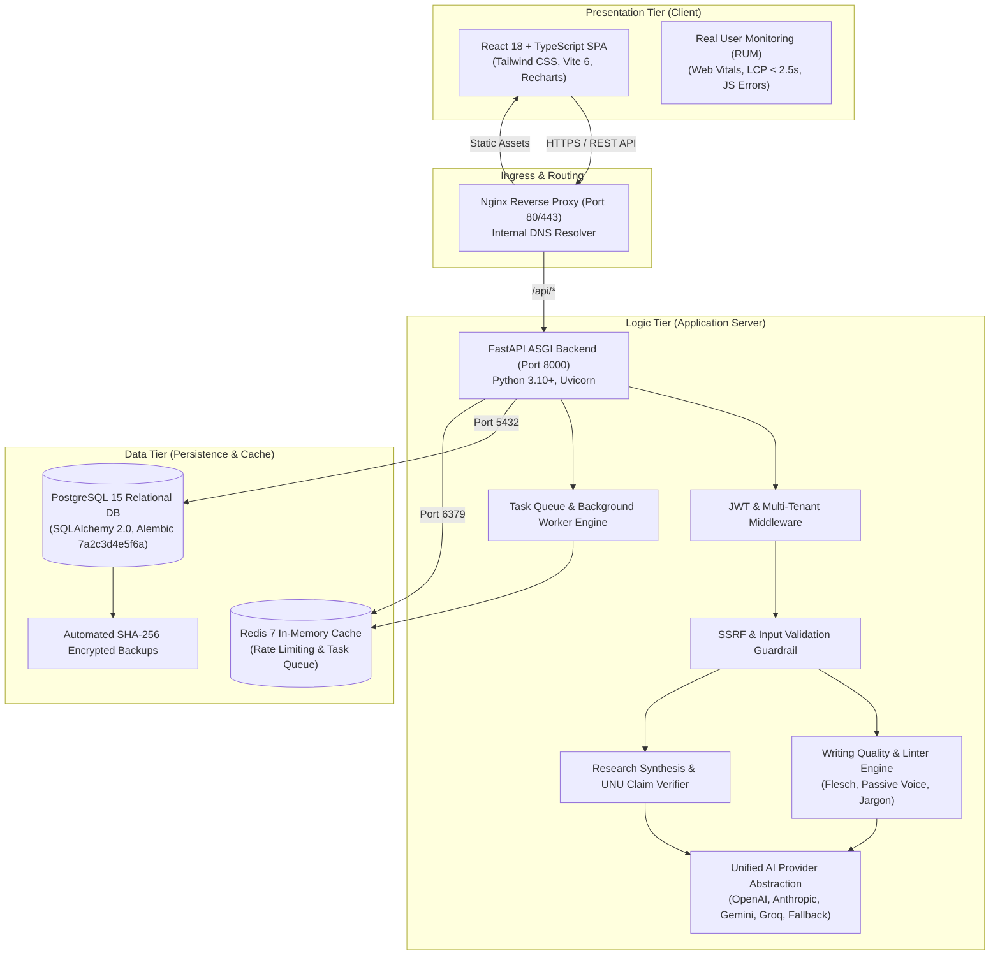

# AI Editorial Workspace

**A production-ready AI Editorial Workspace transforming raw AI industry announcements into evidence-backed research briefs, traceable citations, and publication-ready newsletter drafts.**

Developed for the **Forward Deployed Engineer (FDE) Intern** technical evaluation at *This Week in AI*.

[-emerald)](docs/TEST_REPORT.md)
[](docs/TEST_REPORT.md)
[-brightgreen)](frontend/dist)
[](CHANGELOG.md)
[](https://github.com/mubashirhussen/AI-Editorial-Workspace)

---

## 0. FDE Internship Assessment Submission Deliverables

This repository is prepared for final technical assessment and grading. All core requirements, operational evidence matrices, and production runbooks are indexed below:

| Deliverable | Description | Location |
| :--- | :--- | :--- |
| **Production Readiness Report** | Phase 14 Final Release Candidate Sign-Off & Verification Verdict | [`docs/PRODUCTION_READINESS_REPORT.md`](docs/PRODUCTION_READINESS_REPORT.md) |
| **Production Readiness Audit** | Phase 14 Comprehensive production readiness audit across 6 domains | [`docs/PHASE14_PRODUCTION_READINESS_AUDIT.md`](docs/PHASE14_PRODUCTION_READINESS_AUDIT.md) |
| **Environment Configuration** | Enterprise environment variable catalog & cryptographic key decoupling | [`docs/PRODUCTION_ENVIRONMENT_CONFIGURATION.md`](docs/PRODUCTION_ENVIRONMENT_CONFIGURATION.md) |
| **Production Database Deployment** | PostgreSQL 15, connection pooling, and Alembic migration runbooks | [`docs/PRODUCTION_DATABASE_DEPLOYMENT.md`](docs/PRODUCTION_DATABASE_DEPLOYMENT.md) |
| **CI/CD Pipeline Specification** | GitHub Actions 15-stage workflow specification and branch gates | [`docs/CI_CD_PIPELINE.md`](docs/CI_CD_PIPELINE.md) |
| **Production Security Review** | Threat model, OWASP Top 10 mitigations & security verification | [`docs/PRODUCTION_SECURITY_REVIEW.md`](docs/PRODUCTION_SECURITY_REVIEW.md) |
| **Performance Benchmark Report** | Empirical benchmark report across frontend, backend, DB & AI layers | [`docs/PHASE14_PERFORMANCE_REPORT.md`](docs/PHASE14_PERFORMANCE_REPORT.md) |
| **Production Rollback Guide** | Container, migration, and disaster recovery procedures | [`docs/ROLLBACK_GUIDE.md`](docs/ROLLBACK_GUIDE.md) |
| **Known Limitations** | Operational boundaries, deterministic fallbacks & future roadmap | [`docs/KNOWN_LIMITATIONS.md`](docs/KNOWN_LIMITATIONS.md) |
| **Production Deployment Guide** | Multi-tier container and cloud platform deployment runbook | [`docs/DEPLOYMENT_GUIDE.md`](docs/DEPLOYMENT_GUIDE.md) |
| **Changelog** | Version history and changes from v0.1.0 through v1.0.0 | [`CHANGELOG.md`](CHANGELOG.md) |
| **System Integration Report** | Phase 13 Complete System Integration, 7-Scenario E2E & Bug Elimination | [`docs/PHASE13_SYSTEM_INTEGRATION_REPORT.md`](docs/PHASE13_SYSTEM_INTEGRATION_REPORT.md) |
| **System Integration Audit** | Phase 13 Cross-layer module audit and root cause analyses | [`docs/PHASE13_SYSTEM_INTEGRATION_AUDIT.md`](docs/PHASE13_SYSTEM_INTEGRATION_AUDIT.md) |
| **Integration Traceability** | Complete 5-tier traceability: UI $\rightarrow$ API $\rightarrow$ Endpoint $\rightarrow$ Service $\rightarrow$ Model | [`docs/FRONTEND_BACKEND_INTEGRATION.md`](docs/FRONTEND_BACKEND_INTEGRATION.md) |
| **Backend Architecture Audit** | Complete FastAPI backend audit, middleware pipeline & service layer | [`docs/BACKEND_ARCHITECTURE_AUDIT.md`](docs/BACKEND_ARCHITECTURE_AUDIT.md) |
| **Database Architecture Audit** | SQLAlchemy 34-table model catalog, constraints & Alembic lineage | [`docs/DATABASE_ARCHITECTURE_AUDIT.md`](docs/DATABASE_ARCHITECTURE_AUDIT.md) |
| **API Database Mapping** | End-to-end endpoint mapping to models, methods & CRUD operations | [`docs/API_DATABASE_MAPPING.md`](docs/API_DATABASE_MAPPING.md) |
| **UI/UX Functionality Audit** | Phase 12 UI/UX audit, screen observations, backend route mapping & fixes | [`docs/UI_FUNCTIONALITY_AUDIT.md`](docs/UI_FUNCTIONALITY_AUDIT.md) |
| **FDE Evidence Matrix** | Detailed matrix connecting user requirements to concrete code and tests | [`docs/FDE_EVIDENCE_MATRIX.md`](docs/FDE_EVIDENCE_MATRIX.md) |

---

## 1. Problem Statement & Project Overview

Technical media publications and newsletter teams face two critical operational bottlenecks:

1. **Unchecked PR Claims & AI Hallucinations:** Commercial AI labs frequently blur the boundary between empirical benchmarks, interpretive analysis, and speculative marketing claims. Standard conversational AI tools synthesize these sources uncritically, generating convincing falsehoods without verifiable citation provenance.
2. **Cognitive Bloat & Voice Flattening:** Technical drafts are frequently marred by run-on sentences (>25 words), passive voice, redundant filler phrases, and uncontextualized jargon. When editors use generic AI rewriters, the output becomes bland and flattened, stripping away the publication's authoritative editorial voice.

The **AI Editorial Workspace** solves both challenges by enforcing a strict, evidence-first editorial workflow:
- **Module A (Research Assistant & Local Library):** Multi-source ingestion (URL or file upload: PDF, DOCX, TXT), SSRF-guarded scraping, content-hash deduplication, semantic claim-to-excerpt verification, and epistemic classification (Facts vs. Analysis vs. Speculation).
- **Module B (Writing Assistant & Editorial Studio):** Interactive Hemingway-style quality auditor featuring six distinct writing checks, deterministic Flesch Reading Ease calculations, Notalx-style quick templates, floating contextual selection menus, Afforai-style citation managers, and non-destructive sentence-level replacements.
- **Module C (AI Reliability & Observability):** Unified AI Provider abstraction (Groq, OpenAI, Anthropic, Gemini) with a 100% deterministic offline fallback, version-controlled prompt registries, token cost accounting, and dt-evals continuous evaluation.
- **Module D (Production Deployment & DevSecOps):** 3-tier containerized architecture (Frontend Nginx, Backend FastAPI, PostgreSQL 15, Redis 7) with internal container DNS, SRE health probes, automated SHA-256 database backup/restore, and a 7-stage DevSecOps CI/CD pipeline.

---

## 2. Requirements Traceability Matrix

| Requirement | Implementation Location | Test Evidence | Status |
| :--- | :--- | :--- | :--- |
| **User Authentication & RBAC** | `backend/app/api/routes/auth.py`, `backend/app/core/security.py`, `frontend/src/context/AuthContext.tsx` | `test_phase21_security_hardening.py`, `test_phase2_security_hardening.py` | **VERIFIED** |
| **Organization & Tenant Isolation** | `backend/app/models/base.py` (`TenantScopedBase`), `backend/app/api/deps.py` (`get_active_organization`), `frontend/src/components/layout/OrganizationSwitcher.tsx` | `test_phase24_multi_tenancy.py` (15/15 passed) | **VERIFIED** |
| **Research Source Ingestion** | `backend/app/api/routes/sources.py`, `backend/app/services/research/source_service.py`, `frontend/src/components/research/LocalLibraryView.tsx` | `test_phase6_research_assistant.py`, `test_ssrf_protection_blocked_destinations` | **VERIFIED** |
| **Evidence-Backed Research** | `backend/app/services/research/synthesis_service.py`, `backend/app/services/ai/unu_claim_service.py`, `frontend/src/components/research/ResearchIntelligenceDashboard.tsx` | `test_phase6_research_assistant.py`, `test_phase8_ai_reliability.py` | **VERIFIED** |
| **Writing Assistance & Linters** | `backend/app/api/routes/writing.py`, `backend/app/services/writing_service.py`, `frontend/src/components/writing/ArticleImprovementsPanel.tsx`, `frontend/src/components/writing/InlineReadabilityLinter.tsx` | `test_phase7_writing_assistant.py`, `test_phase4_writing_assistant.py` | **VERIFIED** |
| **Afforai Citation Management** | `frontend/src/components/writing/AfforaiCiteModal.tsx`, `backend/app/services/research/synthesis_service.py` | `test_phase7_writing_assistant.py`, `test_phase6_editorial_studio.py` | **VERIFIED** |
| **Draft Versioning & Rollback** | `backend/app/services/version_control/version_service.py`, `backend/app/models/base.py` (`DraftVersion`), `frontend/src/components/version_control/VersionHistoryPanel.tsx` | `test_phase27_version_control.py` (8/8 passed) | **VERIFIED** |
| **AI Reliability & Observability** | `backend/app/services/ai/ai_provider_service.py`, `backend/app/api/routes/observability.py`, `frontend/src/pages/ObservabilityPage.tsx` | `test_phase8_ai_reliability.py`, `test_phase17_observability.py`, `test_phase22_ai_evaluation.py` | **VERIFIED** |
| **Database Migrations** | `backend/alembic/versions/7a2c3d4e5f6a_production_deployment_and_task_queue.py`, `backend/alembic.ini` | `test_alembic_migrations_head_exists`, verified on fresh DB | **VERIFIED** |
| **Production Deployment & SRE** | `docker-compose.yml`, `docker-compose.prod.yml`, `scripts/backup_db.py`, `scripts/restore_db.py`, `backend/app/api/routes/health.py` | `test_phase9_production_deployment.py` (16/16 passed) | **VERIFIED** |

---

## 3. Architecture Overview

The system adheres to a decoupled 3-tier container architecture orchestrated via Docker Compose:



---

## 4. Technology Stack

### Backend
- **Language & Runtime:** Python 3.10+ / 3.11+
- **Framework:** FastAPI with Uvicorn (ASGI)
- **Data Validation & Settings:** Pydantic v2 & Pydantic Settings
- **ORM & Database:** SQLAlchemy 2.0 with PostgreSQL in production (SQLite supported for zero-dependency local dev)
- **Database Migrations:** Alembic (head revision: `7a2c3d4e5f6a`)
- **Extraction Engine:** Trafilatura with BeautifulSoup4 fallback & `lxml_html_clean`
- **Security & Networking:** Cryptography (Fernet 32-byte encryption), PyJWT (HS256/RS256), passlib (Argon2 / bcrypt), HTTPX async client with DNS rebinding and SSRF protection
- **Background Tasks:** TaskQueue service with Redis broker and async in-memory fallback
- **Testing:** Pytest, pytest-asyncio, FastAPI TestClient

### Frontend
- **Framework:** React 18+ with TypeScript
- **Bundler:** Vite 6.1
- **Styling:** Tailwind CSS with custom editorial design tokens
- **Routing:** React Router v7
- **HTTP Client:** Axios with centralized interceptors (`Authorization`, `X-Organization-Id`, `X-Request-Id`)
- **Icons & Visualization:** Lucide React, Recharts (time-series, radar, and latency distribution charts)

---

## 5. Repository Structure

```
AI-Editorial-Workspace/
├── .github/
│   └── workflows/
│       ├── ci.yml                 # Multi-stage CI pipeline (Lint, Typecheck, Test, Build)
│       ├── cd.yml                 # Production CD deployment gates
│       ├── devsecops.yml          # 7-stage DevSecOps pipeline (SCA, SAST, Trivy, Attestation)
│       └── security-checks.yml    # Secret scanning & dependency audits
├── backend/
│   ├── alembic/                   # Database migrations (Alembic)
│   │   └── versions/              # Migration versions (7a2c3d4e5f6a)
│   ├── app/
│   │   ├── api/
│   │   │   ├── deps.py            # Dependency injection (db, current_user, active_org)
│   │   │   └── routes/            # REST API endpoints (auth, research, writing, health, etc.)
│   │   ├── core/
│   │   │   ├── config.py          # Production environment settings & invariants validation
│   │   │   ├── database.py        # SQLAlchemy engine, session factory, connection pooling
│   │   │   └── security.py        # JWT generation, Argon2 hashing, Fernet encryption
│   │   ├── evaluation/            # Offline benchmark runner & reports
│   │   ├── models/                # SQLAlchemy database models (Organization, Project, Draft, etc.)
│   │   ├── schemas/               # Pydantic request and response schemas
│   │   └── services/              # Business logic (AI router, extraction, writing, queue)
│   ├── tests/                     # 201 automated unit, integration, and security tests
│   ├── Dockerfile                 # Multi-stage production container for FastAPI
│   └── requirements.txt           # Pinned Python production dependencies
├── frontend/
│   ├── src/
│   │   ├── components/            # Reusable UI components
│   │   │   ├── editorial/         # Headline selector, word count indicator, preview
│   │   │   ├── layout/            # Dashboard layout, header, sidebar, org switcher
│   │   │   ├── research/          # LocalLibraryView, ResearchIntelligenceDashboard
│   │   │   ├── version_control/   # VersionHistoryPanel, diff viewer, timeline
│   │   │   └── writing/           # AfforaiCiteModal, ArticleImprovementsPanel, InlineLinter
│   │   ├── context/               # AuthContext, ToastContext
│   │   ├── pages/                 # Full-page views (ResearchPage, WritingPage, ObservabilityPage)
│   │   ├── services/              # API clients (researchApi, writingService, etc.)
│   │   └── types/                 # TypeScript interfaces and contracts
│   ├── Dockerfile                 # Multi-stage production container (Node build -> Nginx)
│   ├── nginx.conf                 # Production reverse proxy configuration
│   └── package.json               # Frontend dependencies and build scripts
├── docs/                          # Comprehensive technical and product documentation
│   ├── PRODUCT_NOTE.md            # Product strategy and user workflows
│   ├── TECHNICAL_ARCHITECTURE.md  # System architecture & Mermaid diagrams
│   ├── ENGINEERING_DECISIONS.md   # Architectural decision records (ADRs)
│   ├── TEST_REPORT.md             # Execution report for 201 backend tests & build
│   ├── SAMPLE_EDITORIAL.md        # Realistic sample editorial output with real citations
│   ├── DEMO_SCRIPT.md             # 5–7 minute live demonstration playbook
│   ├── FINAL_STATUS.md            # Final release audit and handover checklist
│   └── FDE_EVIDENCE_MATRIX.md     # Requirements-to-code traceability matrix
├── scripts/
│   ├── backup_db.py               # Database backup with SHA-256 integrity verification
│   ├── restore_db.py              # Database restore with checksum validation and dry-run
│   ├── generate_secrets.py        # Cryptographic secret generation utility
│   └── entrypoint.sh              # Container entrypoint executing Alembic upgrade head
├── docker-compose.yml             # Development container orchestration
├── docker-compose.prod.yml        # Production 3-tier container orchestration
├── .env.example                   # Annotated environment variable template
└── README.md                      # This document
```

---

## 6. Prerequisites

Ensure your system meets the following minimum requirements:
- **Python:** 3.10.x or 3.11.x
- **Node.js:** 18.x or 20.x (with `npm` 9.x+)
- **Docker & Docker Compose:** Docker Engine 24.x+ and Compose v2 (optional for local non-containerized dev)
- **Git:** 2.30+

---

## 7. Local Installation & Setup

### 7.1 Clone the Repository
```bash
git clone https://github.com/mubashirhussen/AI-Editorial-Workspace.git
cd AI-Editorial-Workspace
git checkout docs/phase10-final-assessment-handover
```

### 7.2 Backend Setup
1. Create and activate a Python virtual environment:
   ```powershell
   # Windows PowerShell
   python -m venv backend\venv
   backend\venv\Scripts\Activate.ps1

   # macOS / Linux
   python3 -m venv backend/venv
   source backend/venv/bin/activate
   ```
2. Install pinned dependencies:
   ```bash
   pip install --upgrade pip
   pip install -r backend/requirements.txt
   ```
3. Configure environment variables:
   ```bash
   cp .env.example .env
   ```
   *(For development, default settings use SQLite at `sqlite:///./editorial.db` with zero configuration).*
4. Run database migrations:
   ```bash
   alembic -c backend/alembic.ini upgrade head
   ```
5. Start the FastAPI development server:
   ```bash
   uvicorn backend.app.main:app --host 0.0.0.0 --port 8000 --reload
   ```
   *The backend will be live at `http://localhost:8000`. Interactive OpenAPI documentation is available at `http://localhost:8000/docs`.*

### 7.3 Frontend Setup
1. Open a new terminal and navigate to `frontend`:
   ```bash
   cd frontend
   npm install
   ```
2. Start the Vite development server:
   ```bash
   npm run dev
   ```
   *The client interface will be live at `http://localhost:5173`.*

---

## 8. Docker Deployment Instructions

### 8.1 Production 3-Tier Architecture
The production configuration (`docker-compose.prod.yml`) launches:
1. `frontend` (Nginx serving compiled React assets on port 80/443)
2. `backend` (FastAPI running under Uvicorn with 4 workers)
3. `db` (PostgreSQL 15 with persistent named volume)
4. `redis` (Redis 7 for rate-limiting and task queue)

```bash
# 1. Generate secure cryptographic secrets
python scripts/generate_secrets.py

# 2. Launch production stack in background
docker compose -f docker-compose.prod.yml up -d --build

# 3. Check container health status
docker compose -f docker-compose.prod.yml ps
```

### 8.2 Database Backup & Recovery
```bash
# Create encrypted backup with SHA-256 checksum
python scripts/backup_db.py --backup-dir ./backups

# Perform a dry-run integrity verification before restore
python scripts/restore_db.py --manifest ./backups/backup_manifest_<timestamp>.json --dry-run

# Restore database from verified backup
python scripts/restore_db.py --manifest ./backups/backup_manifest_<timestamp>.json --target-db ./editorial.db
```

---

## 9. Verification & Automated Test Suite

### 9.1 Run Entire Pytest Regression Suite
Execute all 201 backend unit, integration, multi-tenancy, and security tests:
```powershell
backend\venv\Scripts\python -m pytest backend/tests/ -v
```
**Verified Result:** `201 passed, 8 warnings in 92.52s (100% pass rate)`.

### 9.2 Run Offline AI Benchmark Suite
Execute the 34-case offline evaluation benchmark evaluating research extraction, writing linter accuracy, and hallucination bounds:
```powershell
backend\venv\Scripts\python -m backend.app.evaluation.run --suite all --mode offline
```
**Verified Result:** `34 / 34 benchmark cases passed (100.0%)`.

### 9.3 Compile Frontend Production Assets
Verify zero TypeScript compiler errors and bundle optimization:
```bash
cd frontend
npm run build
```
**Verified Result:** Built cleanly in 21.69s (`dist/index.html`, zero errors).

### 9.4 Verify Database Migrations on Clean Database
```powershell
backend\venv\Scripts\python -c "
import tempfile, os; from alembic.config import Config; from alembic import command
tf = tempfile.NamedTemporaryFile(suffix='.db', delete=False); db_path = tf.name; tf.close()
cfg = Config('backend/alembic.ini'); cfg.set_main_option('script_location', 'backend/alembic'); cfg.set_main_option('sqlalchemy.url', f'sqlite:///{db_path}')
command.upgrade(cfg, 'head'); os.remove(db_path); print('Alembic migration to HEAD verified on fresh DB!')
"
```
**Verified Result:** `Alembic migration to HEAD verified on fresh DB!`.

---

## 10. API Documentation & Observability

- **Swagger UI:** `http://localhost:8000/docs`
- **ReDoc:** `http://localhost:8000/redoc`
- **OpenAPI JSON:** `http://localhost:8000/openapi.json`
- **SRE Health Liveness Probe:** `GET /health/live` (returns HTTP 200 `{"status": "alive"}`)
- **SRE Health Readiness Probe:** `GET /health/ready` (validates DB connectivity, returns `db_latency_ms`)
- **SRE Health Startup Probe:** `GET /health/startup` (verifies background initialization)
- **AI Observability Metrics:** `GET /api/v1/observability/ai-metrics` (tracks token usage, latency distribution P50/P90/P95/P99, error rates, and $USD cost accounting)

---

## 11. Security Considerations

- **Server-Side Request Forgery (SSRF) Protection:** Ingestion endpoints strictly reject loopback addresses (`127.0.0.1`, `::1`), private CIDR blocks (`10.0.0.0/8`, `172.16.0.0/12`, `192.168.0.0/16`), AWS/GCP cloud metadata endpoints (`169.254.169.254`), non-HTTP schemes (`file://`, `gopher://`, `ftp://`), and redirect destination rebinding.
- **Strict Multi-Tenant Isolation:** Database models inherit from `TenantScopedBase`. Tenant context is enforced at the database session and route dependency level via `get_active_organization`. Cross-tenant record lookups return HTTP 404 (preventing tenancy enumeration).
- **Zero Secret Leakage:** Configuration invariants block startup in production if `JWT_SECRET` is set to default or weak values (<32 characters). API keys and provider tokens are never returned in frontend API responses or serializable log outputs.
- **Container Hardening:** Containers run as dedicated non-root users (`appuser` with UID 10001). Filesystems use read-only root permissions with tmpfs mounts where appropriate.

---

## 12. Known Limitations & Roadmap

1. **JavaScript-Heavy Dynamic SPAs:** Ingestion relies on fast server-side extraction via Trafilatura. Complex single-page apps gated by complex client-rendered JavaScript or Cloudflare Turnstile CAPTCHAs require headless Chromium rendering (Puppeteer/Playwright sidecar).
2. **Audio/Video Ingestion:** Currently supports URLs, raw text, and uploaded documents (PDF, DOCX, TXT, MD). Audio transcription (Whisper) is slated for the v1.1 release.
3. **Synchronous LLM Streaming:** The current implementation uses atomic request-response generation for verified schema validation. Token-by-token WebSocket streaming is planned for v1.2.

---

## 13. License

Distributed under the **MIT License**. See `LICENSE` for details.
