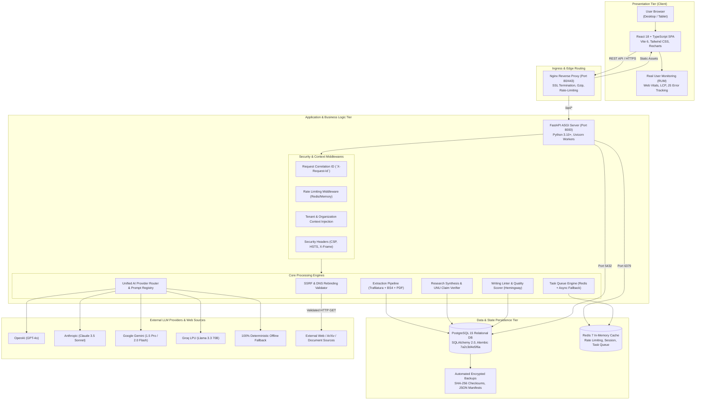
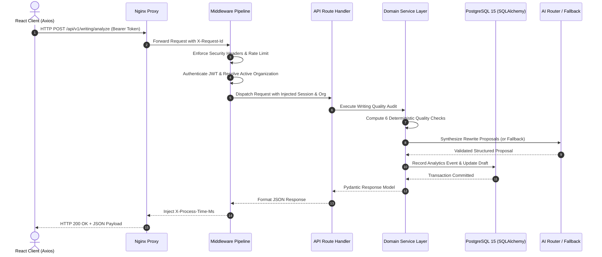
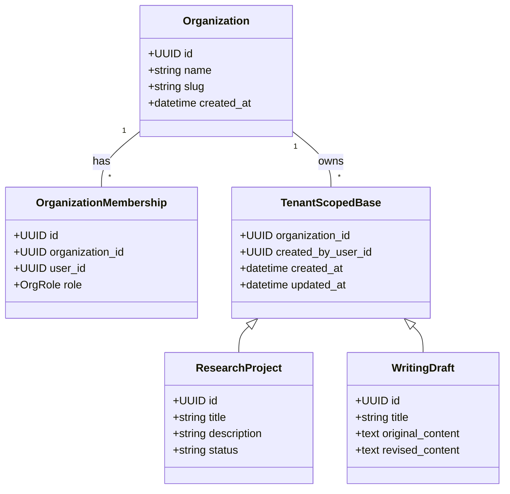
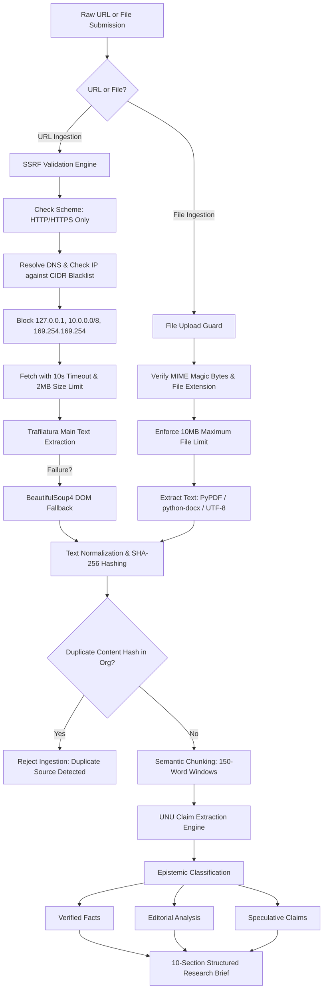
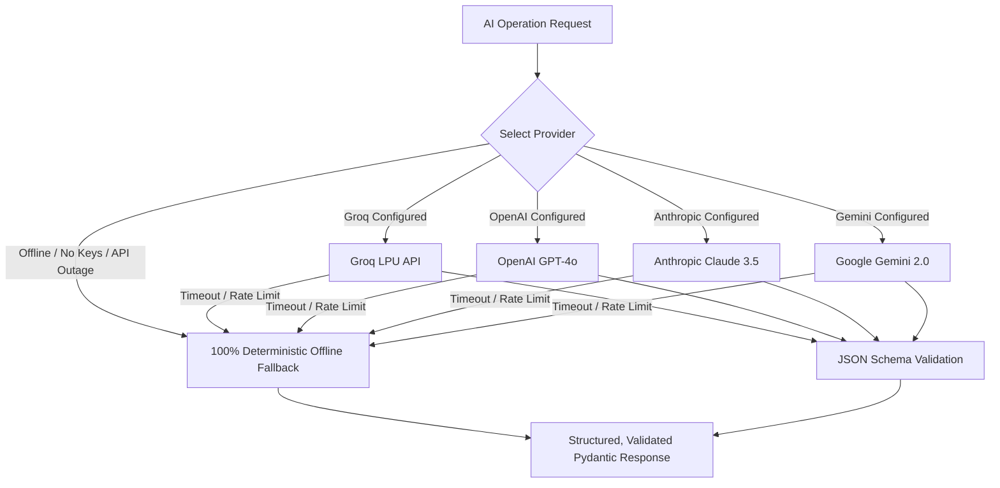

# AI Editorial Workspace — Technical Architecture Document

**Author:** Senior Forward Deployed Engineer & Technical Architect  
**Project:** AI Editorial Workspace  
**Status:** Validated Production System  
**Version:** 1.0.0 (Phase 10 Final Assessment)  
**Repository:** `https://github.com/mubashirhussen/AI-Editorial-Workspace`  
**Branch:** `docs/phase10-final-assessment-handover`

---

## 1. End-to-End System Architecture

The AI Editorial Workspace is engineered as a decoupled, 3-tier containerized system with strict boundaries between presentation, business logic, persistence, and external AI services.



---

## 2. Frontend Architecture (React 18 + TypeScript)

### Component Hierarchy & Route Structure
The client application is built with React 18, TypeScript, and Tailwind CSS, bundled with Vite for fast HMR and optimized chunk splitting.

```
frontend/src/
├── App.tsx                     # Route definitions, protected route wrappers, layouts
├── main.tsx                    # React DOM root initialization with Providers
├── components/
│   ├── auth/                   # ProtectedRoute, TenantGuard
│   ├── common/                 # Button, Input, Modal, Badge, Toast, ConfirmDialog
│   ├── editorial/              # HeadlineEditor, WordCountIndicator, ArticlePreview
│   ├── layout/                 # DashboardLayout, Header, Sidebar, OrganizationSwitcher
│   ├── research/               # LocalLibraryView, ResearchIntelligenceDashboard
│   ├── version_control/        # VersionHistoryPanel, VersionComparison, VersionTimeline
│   └── writing/                # AfforaiCiteModal, ArticleImprovementsPanel, InlineReadabilityLinter
├── context/
│   ├── AuthContext.tsx         # JWT token management, user state, active organization
│   └── ToastContext.tsx        # Dismissible notification queue
├── pages/
│   ├── AuthPage.tsx            # Login, registration, password recovery
│   ├── DashboardPage.tsx       # Metrics overview, recent drafts, active projects
│   ├── ResearchPage.tsx        # Local library, multi-source ingestion, evidence briefs
│   ├── WritingPage.tsx         # Notalx templates, Afforai citation manager, Hemingway linter
│   ├── ObservabilityPage.tsx   # Splunk RUM & Instana APM metrics, token costs
│   └── SettingsPage.tsx        # AI engine selection, API key configuration, prompt registry
├── services/                   # Axios HTTP clients with request/response interceptors
└── types/                      # Strictly typed domain interfaces (Auth, Project, Source, Draft)
```

### Key UI Subsystems

1. **Local Library Hub ([`LocalLibraryView.tsx`](file:///c:/Users/Mubashirhussensk/OneDrive/Desktop/FDE%20intern/frontend/src/components/research/LocalLibraryView.tsx)):**
   - Header stats bar tracking Sources, Retrieval Chunks, Supported Formats, and Indexed counts.
   - Pinned vs. Recently Added sources with filter pills (`All`, `Research Paper`, `Document`, `Web URL`).
   - Collapsible Outline (`▶ Outline`), bulleted Key Claims, Curation form (*Title*, *Why saved*, *Tags*), model provenance, and Retrieval Chunks viewer.

2. **Afforai Cite Extension ([`AfforaiCiteModal.tsx`](file:///c:/Users/Mubashirhussensk/OneDrive/Desktop/FDE%20intern/frontend/src/components/writing/AfforaiCiteModal.tsx)):**
   - Reference search and multi-select checkboxes.
   - Removable citation pills (`Garcia, M. L. (2002) ×`, `Lee, K. W. (1999) ×`).
   - Integrated AI Research Assistant with prompt input supporting `@` citation mentions and one-click draft insertion.

3. **Article Improvements Panel ([`ArticleImprovementsPanel.tsx`](file:///c:/Users/Mubashirhussensk/OneDrive/Desktop/FDE%20intern/frontend/src/components/writing/ArticleImprovementsPanel.tsx)):**
   - Visual quality progress bar reflecting calculated Flesch Reading Ease score.
   - Tabbed metrics (`SEO`, `Readability`, `Tone`).
   - Real-time statistics: Sentence count, reading time in seconds, word count.
   - One-click sentence rewrite cards.

4. **Inline Readability Linter ([`InlineReadabilityLinter.tsx`](file:///c:/Users/Mubashirhussensk/OneDrive/Desktop/FDE%20intern/frontend/src/components/writing/InlineReadabilityLinter.tsx)):**
   - Real-time prose highlight overlay: Purple (hard-to-read sentences), Blue (passive voice), Amber (complex vocabulary).
   - Interactive popover tooltip on hover/click with direct `[Simplify]` action.

---

## 3. Backend Architecture & Request Lifecycle

FastAPI serves as the core asynchronous ASGI application, structured around clean dependency injection and modular routers.



---

## 4. Multi-Tenant Organization Isolation

Tenancy isolation is enforced at the database, session, and dependency injection layers:



- **Row-Level Organization Scoping:** All tenant entities inherit from `TenantScopedBase`, enforcing non-nullable `organization_id` columns with database indexes.
- **Dependency Guard (`get_active_organization`):** Resolves the caller's organization from `X-Organization-Id` header or defaults to the user's primary membership.
- **Tenant Enumeration Defense:** If an authenticated user attempts to access an entity belonging to another organization, the API returns `HTTP 404 Not Found` rather than `403 Forbidden`, preventing resource enumeration attacks.

---

## 5. Research Ingestion, Extraction & Claim Verification Pipeline



### 5-Tier Claim Verification Taxonomy
Each factual statement in research briefs and editorial drafts is evaluated across five distinct epistemic states:
1. **`SUPPORTED`:** Claim is directly corroborated by verbatim quotes in primary sources.
2. **`PARTIALLY_SUPPORTED`:** Core claim is accurate, but scope or numerical parameters are broader than source evidence.
3. **`UNSUPPORTED`:** No matching factual passage found in any ingested source document.
4. **`CONTRADICTED`:** Opposing source documents explicitly refute the assertion.
5. **`NOT_VERIFIABLE`:** Claim is an inherently subjective opinion or unmeasurable prediction.

---

## 6. Writing Assistant, Quality Linters & Non-Destructive Rewriting

The Writing Assistant implements a deterministic quality auditing engine alongside an AI selection-rewrite service:

```mermaid
flowchart LR
    subgraph InputProse["Input Draft Prose"]
        RawDraft["Raw Article Draft"]
    end

    subgraph DeterministicAuditor["6-Check Deterministic Hemingway Auditor"]
        Check1["Sentence Length: Flags &gt;25 words"]
        Check2["Passive Voice: Flags auxiliary + participle"]
        Check3["Filler Phrases: Flags 'in order to', etc."]
        Check4["Jargon Detector: Flags uncontextualized terms"]
        Check5["Repetition: Flags adjacent repeated openers"]
        Check6["Flesch Score: Computes exact reading ease"]
    end

    subgraph NonDestructiveEngine["Non-Destructive Replacement Engine"]
        TargetSpan["Isolate Target Sentence Bounds"]
        PreserveContext["Preserve Surrounding Prose &amp; Citations"]
        ApplyRewrite["Apply Accepted Rewrite to Bounded Span"]
        VersionSnapshot["Record Immutable Version Snapshot"]
    end

    RawDraft --> DeterministicAuditor
    DeterministicAuditor --> TargetSpan
    TargetSpan --> PreserveContext
    PreserveContext --> ApplyRewrite
    ApplyRewrite --> VersionSnapshot
```



---

## 7. AI Provider Abstraction & Offline Fallback Strategy

The application integrates external AI providers through a unified interface (`AIRouter`) with built-in retry backoff, prompt versioning, and zero-downtime offline fallback:



---

## 8. SRE Health Probes & Observability Architecture

To ensure operational excellence in production environments, the system exposes dedicated SRE health endpoints and comprehensive APM observability:

- **Liveness Probe (`GET /health/live`):** Returns HTTP 200 `{"status": "alive"}` to indicate process execution.
- **Readiness Probe (`GET /health/ready`):** Executes `SELECT 1` on PostgreSQL and probes Redis connectivity. Returns `db_latency_ms` and returns HTTP 503 if dependencies are degraded.
- **Startup Probe (`GET /health/startup`):** Validates database schema migrations and configuration invariants.
- **APM Telemetry Dashboard ([`ObservabilityPage.tsx`](file:///c:/Users/Mubashirhussensk/OneDrive/Desktop/FDE%20intern/frontend/src/pages/ObservabilityPage.tsx)):** Mirrors Splunk RUM and Instana APM metrics:
  - Real User Monitoring: Page views, JavaScript errors, Core Web Vitals (LCP < 2.5s).
  - Backend Telemetry: Calls vs. errors, average latency, P50/P90/P95/P99 latency distribution, tier processing breakdown (Database, HTTP, Task Queue), and exact $USD token cost accounting.

---

## 9. 3-Tier Production Container Architecture & Internal DNS

In production, all services communicate across an isolated Docker bridge network (`editorial-network`) using internal container DNS service names:

```
External Traffic (HTTPS / Port 80/443)
       │
       ▼
┌────────────────────────────────────────────────────────┐
│ Nginx Reverse Proxy Container (`frontend`)             │
│ Routes `/api/*` to `backend:8000`                      │
│ Serves compiled React assets on `/`                    │
└──────────────────────┬─────────────────────────────────┘
                       │ Internal Docker DNS Resolution
                       ▼
┌────────────────────────────────────────────────────────┐
│ FastAPI Application Container (`backend`)              │
│ Runs Uvicorn with 4 workers under non-root UID 10001   │
└──────────────┬──────────────────────────┬──────────────┘
               │                          │
   Port 5432   ▼              Port 6379   ▼
┌────────────────────────┐  ┌────────────────────────────┐
│ PostgreSQL Container   │  │ Redis Container (`redis`)  │
│ Named volume: `db-data`│  │ Persistent cache & queue   │
└────────────────────────┘  └────────────────────────────┘
```
