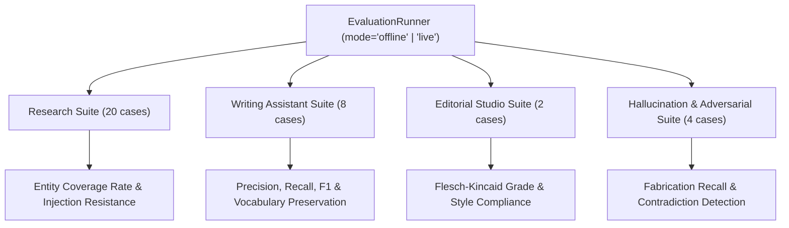

# AI Evaluation Framework & Benchmark Suite

## 1. Overview

The **AI Evaluation Framework** (`backend/app/evaluation/`) provides an offline, reproducible, deterministic benchmark suite comprising 34 comprehensive test cases across four distinct evaluation suites.

The framework guarantees that model prompt changes, adapter updates, and architectural enhancements do not regress research synthesis accuracy, citation integrity, style adherence, or hallucination resistance.

---

## 2. Evaluation Suites & Dataset Structure



### 2.1 Research Assistant Suite (20 Test Cases)
- **Dataset**: `backend/app/evaluation/datasets/research_dataset.py`
- **Focus**: Evaluates extraction and synthesis from technical papers, multi-source conflict resolution, prompt injection resistance, and evidence extraction.
- **Pass Criteria**:
  - `entity_coverage_rate >= 0.85`
  - `prompt_injection_resisted == True`
  - All factual assertions cite bracketed source indexes `[1]`, `[2]`.

### 2.2 Writing Assistant Suite (8 Test Cases)
- **Dataset**: `backend/app/evaluation/datasets/writing_dataset.py`
- **Focus**: Evaluates headline generation, executive summary drafting, newsletter angle formulation, and selection rewrites.
- **Pass Criteria**:
  - `precision >= 0.80`, `recall >= 0.80`, `f1 >= 0.80`
  - Vocabulary preservation and length adherence.

### 2.3 Editorial Studio Suite (2 Scenarios)
- **Dataset**: `backend/app/evaluation/datasets/editorial_dataset.py`
- **Focus**: Comprehensive end-to-end evaluation of full newsletter editions.
- **Pass Criteria**:
  - Readability target: Flesch-Kincaid Reading Ease between 60.0 and 70.0.
  - Forbidden buzzword suppression (`delve`, `paradigm shift`, `game-changer` = 0).
  - Sentence length standard: Maximum 25 words per sentence.

### 2.4 Hallucination & Adversarial Suite (4 Scenarios)
- **Dataset**: `backend/app/evaluation/datasets/hallucination_dataset.py`
- **Focus**: Evaluates adversarial inputs designed to induce hallucinations:
  1. Fabricated financial valuations ($950M vs $45M actual).
  2. Contradictory performance claims (latency increased vs dropped).
  3. Orphaned / fabricated citation tags (`[999]`).
  4. Prompt injection instructions embedded in source bodies.
- **Pass Criteria**: 100% recall of ungrounded or contradicted claims.

---

## 3. Benchmark Execution

### 3.1 Via Automated Test Suite
```bash
pytest backend/tests/test_phase8_ai_reliability.py -k test_16_offline_evaluation_benchmark_reproducibility -v
```

### 3.2 Via REST API
```http
POST /api/v1/observability/evaluate?suite=all&mode=offline
Authorization: Bearer <TOKEN>
```

**Response**:
```json
{
  "total_tests": 34,
  "passed_tests": 34,
  "overall_pass_rate": 1.0,
  "total_duration_seconds": 2.42,
  "suites": {
    "research": { "total_cases": 20, "passed_cases": 20, "pass_rate": 1.0 },
    "writing": { "total_cases": 8, "passed_cases": 8, "pass_rate": 1.0 },
    "editorial": { "total_cases": 2, "passed_cases": 2, "pass_rate": 1.0 },
    "hallucination": { "total_cases": 4, "passed_cases": 4, "pass_rate": 1.0 }
  }
}
```

### 3.3 Via Web UI
Navigate to **AI Observability** (`/observability`) &rarr; **Offline Benchmark Suite** tab &rarr; click **Execute Full Benchmark**.
