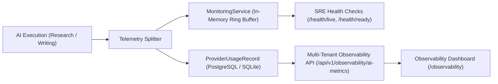

# AI Observability, Telemetry & Cost Accounting

## 1. Observability Architecture Overview

The **AI Observability Architecture** provides production SRE insights, multi-tenant accounting, and latency profiling aligned with Datadog LLM Observability and enterprise telemetry standards.

---

## 2. Telemetry Ingestion Pipeline

Every AI operation executed via `AIRouter` records telemetry through two simultaneous channels:



---

## 3. Metric Taxonomy & SLAs

| Metric | Target SLA | Aggregation | Description |
|---|---|---|---|
| **Trace Success Rate** | $\ge 95\%$ | Cumulative % | Ratio of successful operations to total requested operations |
| **Trace Error Rate** | $\le 5\%$ | Cumulative % | Ratio of unrecoverable upstream failures |
| **P50 Response Time** | $\le 2.0\text{s}$ | Median (50th percentile) | Median turnaround time for model inference |
| **P95 Response Time** | $\le 8.0\text{s}$ | 95th percentile | Tail latency threshold alerting SRE teams |
| **Token Generation Rate** | $\ge 10\text{ tokens/sec}$ | Rolling average | Tokens generated per second across active streams |
| **Cost Estimation** | Accrued USD | Sum of token pricing | Cost accounting by model provider rate cards |

---

## 4. Multi-Tenant Telemetry Isolation

All database queries against `provider_usage_records` enforce tenant boundaries:

```python
query = db.query(ProviderUsageRecord).filter(
    (ProviderUsageRecord.organization_id == org.id) | (ProviderUsageRecord.organization_id == None)
)
```

Organization A cannot access, query, or infer token consumption, cost, or prompt versions belonging to Organization B.

---

## 5. UI Operational Insights (Datadog & Context Verify)

The `/observability` route exposes a four-tab dashboard:

1. **LLM Operational Insights (Datadog View)**:
   - Active monitors status (OK / Alerting).
   - Core KPIs: Success Rate, Total Traces, Error Rate, Token Throughput, P50, and P95.
   - Model Provider distribution table and request share percentages.
   - Interactive operations audit table showing timestamp, operation, provider, version, duration, tokens, and cost.

2. **Quellen & Vertrauen (Context Verify)**:
   - Gesamtquellen (Total sources analyzed).
   - Vertrauenswürdigkeit (Trustworthiness score %).
   - Misinformations-Index (Hallucination rate %).
   - Per-source breakdown table detailing citation count, verified URLs, and attributed model.

3. **Prompt Registry & Versioning**:
   - Semantic version catalog (`v1.0.0`), variables, and injection security guards.

4. **Offline Benchmark Suite**:
   - Interactive runner executing 34 benchmark cases across research, writing, editorial, and hallucination suites.
