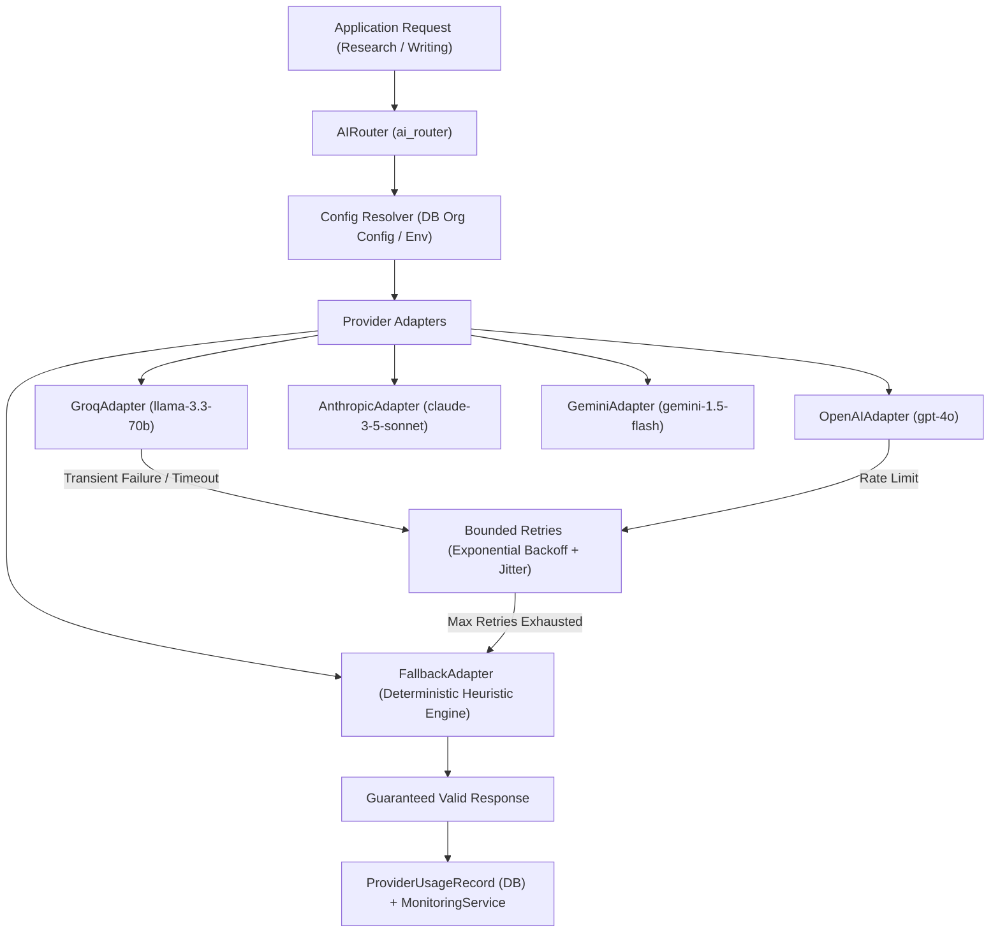

# AI Reliability & Resilience Architecture

## 1. Executive Summary

The **AI Editorial Workspace** incorporates an enterprise-grade AI Reliability and Resilience layer designed to guarantee zero-downtime execution, deterministic offline operation, prompt injection resistance, and multi-tenant telemetry isolation across all research and editorial generation workflows.

---

## 2. Centralized Provider Abstraction

All LLM and heuristic generation requests are routed through the centralized `AIRouter` (`backend/app/services/ai/router.py`) and executed via adapters derived from `BaseAIProvider`:

### Supported Adapters:
1. **GroqAdapter**: High-throughput inference powered by `llama-3.3-70b-versatile`.
2. **OpenAIAdapter**: High-fidelity structured reasoning powered by `gpt-4o`.
3. **AnthropicAdapter**: Contextual editorial drafting powered by `claude-3-5-sonnet-latest`.
4. **GeminiAdapter**: Multimodal and high-context analysis powered by `gemini-1.5-flash`.
5. **FallbackAdapter**: Guaranteed, offline deterministic synthesis and drafting engine requiring zero external internet access or API credentials.

---

## 3. Resiliency Engineering & Fault Tolerance

### 3.1 Bounded Retries with Exponential Backoff
- Every outbound model invocation is guarded by configurable bounded retries (`max_retries=2` default).
- Backoff intervals are calculated using exponential backoff with uniform random jitter:
  $$\Delta t = (0.5 \times 2^{\text{attempt}}) + \mathcal{U}(0.1, 0.4)$$
- This mitigates thundering herd problems during upstream provider rate limits or brief network blips.

### 3.2 Network and Execution Timeouts
- All calls support explicit timeout enforcement via `asyncio.wait_for(..., timeout=30.0)`.
- If an upstream provider hangs or exceeds 30 seconds, `asyncio.TimeoutError` is intercepted, logged with safe diagnostics, and the call seamlessly falls back to the deterministic engine without terminating user requests.

### 3.3 Graceful Degradation & Deterministic Failover
- In the event of upstream rate limits (HTTP 429), server downtime (HTTP 5xx), authentication expiration, or unparseable responses, the system automatically triggers `FallbackAdapter`.
- Fallback outputs provide valid research briefs and editorial drafts containing full structural compliance (executive summaries, key findings, evidence items with bracketed citation links).

---

## 4. Multi-Tenant Telemetry & Cost Accounting

Every AI request produces an audit-logged `ProviderUsageRecord` strictly scoped to the active `organization_id`:

- **Token Tracking**: Prompt tokens, completion tokens, and cumulative tokens.
- **Cost Estimation**: Per-model rate cards calculate exact USD costs (e.g. Groq \$0.59/\$0.79 per million tokens; GPT-4o \$2.50/\$10.00 per million tokens).
- **Latency Monitoring**: Durations recorded in milliseconds to measure P50, P75, P95, and P99 percentiles.
- **Prompt Versioning**: Every execution stamps the exact `prompt_version` (e.g. `v1.0.0`) used to generate the output.

---

## 5. Security & Privacy Guardrails

1. **Zero Credential Leakage**: API keys and authorization headers are never written to log files, serialized in telemetry records, or exposed to frontend clients.
2. **Encrypted Secret Storage**: Organization provider credentials stored in `ai_provider_configs` are symmetrically encrypted with Fernet AES-128 before persisting to PostgreSQL / SQLite.
3. **Defensive Source Sandboxing**: All user-uploaded or scraped source contents are enclosed inside `<source_content>...</source_content>` tags, accompanied by a system-level guardrail preventing prompt injection or instruction overriding.

