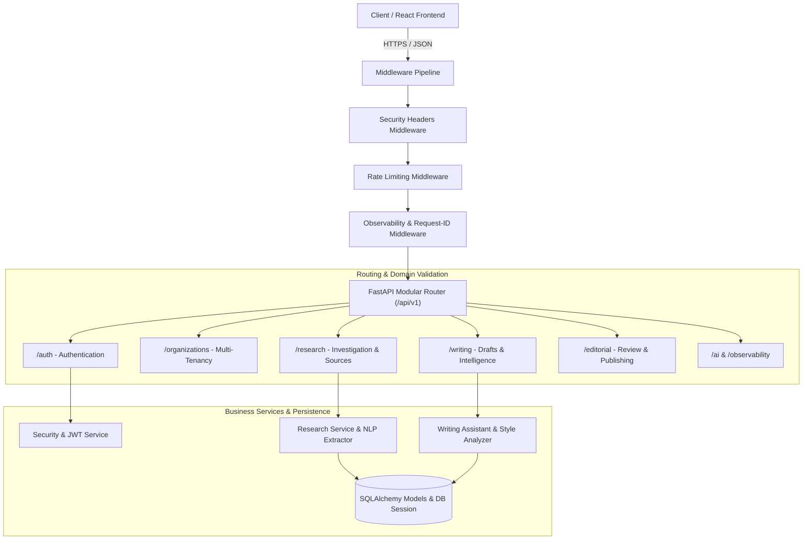

# API Architecture & Engineering Design

This document specifies the RESTful API architecture, modular router design, multi-tenant isolation, request lifecycle, validation contracts, and error management protocols for the **AI Editorial Workspace**.

---

## 1. Architectural Philosophy & Layering

The AI Editorial Workspace backend is built upon **FastAPI** following clean architectural separation between HTTP transport, domain validation, business services, and database persistence:



---

## 2. API Prefix and Resource Hierarchy

All public and internal endpoints operate under the standardized version prefix:
```text
/api/v1/
```

### Module Registry
1. **Authentication (`/api/v1/auth`)**: User registration, credential verification, JWT issuance, profile retrieval, password reset lifecycle, session revocation.
2. **Organizations (`/api/v1/organizations`)**: Multi-tenant workspace management, role assignments (`OWNER`, `ADMIN`, `EDITOR`, `VIEWER`), invitations.
3. **Research Projects (`/api/v1/research/projects` & `/api/v1/projects`)**: Investigation workspace creation, source grouping, pipeline execution.
4. **Sources & Evidence (`/api/v1/sources` & `/api/v1/research/projects/{id}/sources`)**: Document uploading (PDF, Word, TXT, OCR), URL scraping, content extraction, claim/evidence extraction.
5. **Research Intelligence (`/api/v1/research/intelligence`)**: Entity extraction, contradiction matrix, trend synthesis, angles.
6. **Writing Assistant (`/api/v1/writing`)**: Article drafting, real-time readability metrics, actionable rewrite suggestions, version snapshots, grounding audits, document export.
7. **Editorial Studio (`/api/v1/editorial`)**: Editorial reviews, comment threads, publishing approval workflows.
8. **Style Intelligence (`/api/v1/styles`)**: Tone, audience, sentence length, and vocabulary guidelines.
9. **AI Evaluation & Telemetry (`/api/v1/ai`, `/api/v1/observability`, `/api/v1/analytics`)**: Hallucination scoring, token budgets, latency metrics, conversion funnels.
10. **System Health (`/api/v1/health`, `/health/live`, `/health/ready`)**: Engine status, database connectivity, telemetry.

---

## 3. Request Lifecycle & Validation Pattern

Every inbound request undergoes standardized processing:
1. **Tracing Injection**: `ObservabilityMiddleware` extracts or generates a unique `X-Request-ID` UUID, stamped onto request state and the HTTP response header.
2. **Rate Limiting**: `InMemoryRateLimiterMiddleware` guards against burst denial-of-service and credential stuffing attacks (180 req/min per IP with automated test exemption).
3. **Authentication**: `get_current_user` decodes the Bearer JWT, validates cryptographic signature, expiration, revocation status, and resolves the database `User`.
4. **Tenant Verification**: `get_active_organization` verifies the requested `X-Organization-Id` against database `OrganizationMembership`. Unassigned cross-tenant access is rejected with `404 Not Found` (to avoid leaking resource existence).
5. **Payload Validation**: Pydantic v2 schemas validate input types, length restrictions (`min_length`, `max_length`), and allowed enum values.
6. **Service Execution**: Domain services execute transactional business logic inside atomic SQLAlchemy session blocks.
7. **Response Serialization**: Standardized Pydantic v2 response models serialize outputs, omitting sensitive fields (hashes, raw API keys).

---

## 4. Concurrency, Reliability & Transaction Boundaries

1. **Transactional Integrity**: Database modifications (`db.commit()`, `db.flush()`, `db.rollback()`) are strictly scoped within route handler lifetimes. Handlers catch exceptions and trigger rollbacks to avoid leaving sessions in invalid states.
2. **Pagination & Query Limits**: Standard query parameters `skip` ($ge 0$) and `limit` ($1 \le limit \le 100$) prevent unbounded table scans.
3. **Safe Fallback Execution**: When third-party AI provider APIs (e.g. Gemini, OpenAI, Claude) encounter rate limits, network timeouts, or unconfigured keys, the workspace falls back to deterministic heuristic evaluation without service interruption.
