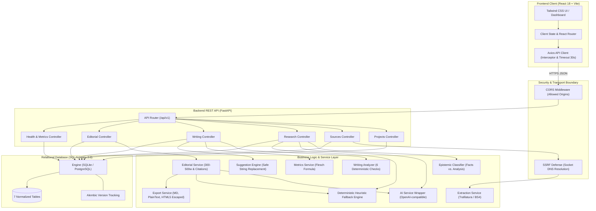
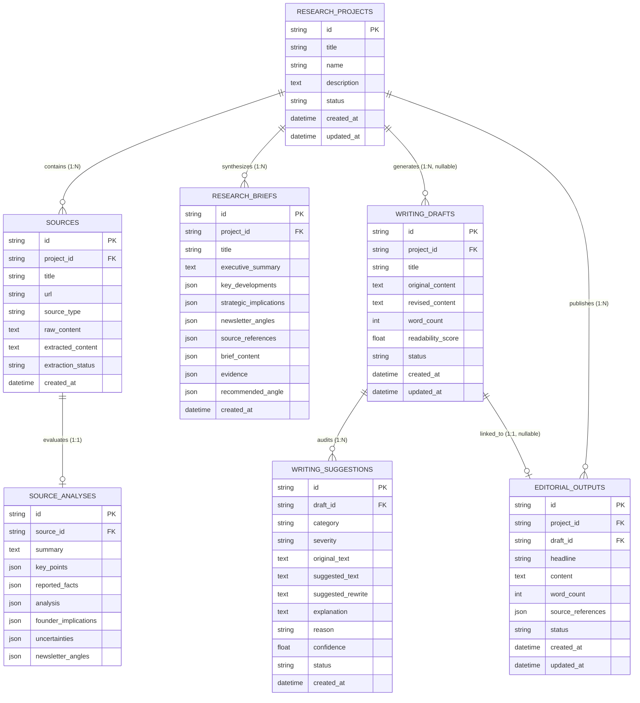
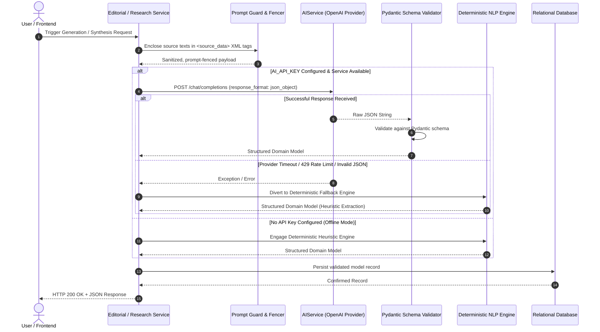
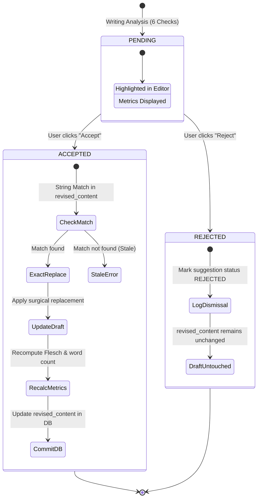

# System Architecture: AI Editorial Workspace

**System:** AI Editorial Workspace  
**Assignment:** Forward Deployed Engineer (FDE) Intern Assignment  
**Publication:** *This Week in AI*  
**Author:** Mubashir Hussain  

---

## 1. System Architecture Overview

The **AI Editorial Workspace** is a decoupled full-stack platform consisting of a React single-page application, an asynchronous FastAPI REST backend, a relational persistence layer managed via SQLAlchemy 2.0 and Alembic, and an evidence-grounded AI integration pipeline with deterministic offline fallbacks.

---

## 2. Frontend-to-Backend Communication & API Organization

The frontend communicates with the backend exclusively via typed JSON requests executed by a centralized Axios client (`frontend/src/services/api.ts`).

### Communication Characteristics
* **Base URL Resolution:** Resolved dynamically from `import.meta.env.VITE_API_BASE_URL` with a default local fallback to `http://localhost:8000/api/v1`.
* **Bounded Timeout:** All outbound requests have a strict 30-second timeout to prevent UI freezes during heavy operations.
* **Global Error Interception:** Axios response interceptors parse HTTP 400, 404, 422, and 500 error payloads (including Pydantic validation error lists) and display user-friendly toast notifications via Sonner.

### API Endpoint Hierarchy

| Route Prefix | Domain | Primary Responsibilities |
| :--- | :--- | :--- |
| `/api/v1/health` | System | Health check, live database ping (`SELECT 1`), and active AI engine mode. |
| `/api/v1/projects` | Projects | CRUD lifecycle for investigations, pagination, and status tracking. |
| `/api/v1/sources` | Sources | Ingestion (URL/Text), SSRF validation, Trafilatura extraction, and epistemic claim analysis. |
| `/api/v1/research` | Research | Multi-source triangulation, consensus/divergence synthesis, and newsletter angle generation. |
| `/api/v1/writing` | Writing | 6 deterministic writing checks, readability scoring, and non-destructive suggestion replacement. |
| `/api/v1/editorial` | Editorial | 5 headline formulas, 300–500 word draft generation, inline citation mapping, and exports. |

---

## 3. Database Entity-Relationship Model

The relational persistence layer uses 7 normalized tables mapped via SQLAlchemy 2.0 with foreign key cascades:

### Cascade & Integrity Guarantees
* **`CASCADE` Deletion:** Deleting a `ResearchProject` automatically purges child `sources`, `source_analyses`, `research_briefs`, and `editorial_outputs`. Deleting a `WritingDraft` cascades to its `writing_suggestions`.
* **`SET NULL` Preservation:** Deleting a `ResearchProject` retains standalone `writing_drafts` by nullifying `project_id`, protecting editorial work from accidental project deletion.

---

## 4. AI Request & Response Lifecycle

The AI integration layer enforces prompt fencing, schema validation, and defensive fallback:

---

## 5. Source Evidence Validation & Classification

The Research Assistant separates marketing claims from empirical reality through a three-stage epistemic validation pipeline:

1. **Extraction & Excerpt Isolation:** Trafilatura extracts clean body text. Sentence tokenization isolates atomic factual assertions.
2. **Epistemic Classification:**
   * **Verified Facts:** Empirical benchmarks (e.g. *"79.8% on AIME 2024"*), hardware clusters, pricing, and dates.
   * **Editorial Analysis:** Logical deductions regarding inference costs, architectural choices, and market implications.
   * **Speculation & Projections:** Forward-looking roadmap claims (e.g. *"will achieve human parity in 12 months"*). Flagged with warning markers.
3. **Traceability Binding:** Every item in the research brief contains an explicit `source_id`, canonical URL, and verbatim extracted quote. If a claim cannot be verified against the ingested text, it is excluded.

---

## 6. Writing Suggestion Acceptance Lifecycle

### Non-Destructive Replacement Safety
The function `replace_text_safely` guarantees:
1. **Targeted Boundary Isolation:** It replaces only the target substring within `revised_content`. Neighboring sentences, paragraphs, and inline citations (`[1]`) are preserved.
2. **Stale Suggestion Detection:** If previous edits altered the target text, the function returns an error without performing ambiguous substitutions.
3. **Immutable Baseline:** `original_content` is never modified during suggestion acceptance.

---

## 7. Error Handling & Failure Paths

| Failure Scenario | Component | Detection & Mitigation |
| :--- | :--- | :--- |
| **SSRF Ingestion Attack** | `security.py` | DNS socket resolution catches private IPs (`10.x`, `127.x`, `169.254.x`) before request. Returns HTTP 400. |
| **Blocked / Paywalled URL** | `extraction_service.py` | Caught via HTTP status or timeout (12s). Returns HTTP 400 prompting manual raw text paste. |
| **AI Provider Outage / 429** | `ai_service.py` | Catches `APIConnectionError` or `RateLimitError`. Automatically engages deterministic fallback engine. |
| **Malformed AI JSON Output** | `ai_service.py` | Regex fallback isolates JSON substring `{...}`; Pydantic parses or triggers deterministic synthesis. |
| **XSS in HTML Export** | `export_service.py` | All dynamic fields run through `html.escape()`. Malicious tags are entity-escaped. |
| **Database Transaction Failure**| `database.py` | Scoped sessions execute `db.rollback()` on exception, preventing locked tables or corrupted states. |

---

## 8. Technology Stack Justifications

### 1. Frontend: React 18 + TypeScript + Vite
* **Component-Driven State:** An editorial workspace requires complex UI states (live suggestion cards, side-by-side diff viewers, active citations, and real-time metric indicators). React's component hierarchy manages these transitions cleanly.
* **Type Safety:** TypeScript enforces domain contracts between backend schemas and frontend components, preventing runtime property mismatch errors.
* **Sub-Second Build Velocity:** Vite provides instantaneous Hot Module Replacement (HMR) and optimized production compilation (2,281 modules in under 10 seconds).

### 2. Backend: Python + FastAPI + Uvicorn
* **Asynchronous Non-Blocking I/O:** Content extraction involves concurrent external HTTP calls. FastAPI's `async/await` pipeline prevents worker thread starvation.
* **Pydantic v2 Schema Enforcement:** Automatic request validation, response serialization, and OpenAPI Swagger documentation generation.
* **Python NLP Ecosystem:** Native access to robust text extraction libraries (`trafilatura`, `beautifulsoup4`) and string processing algorithms.

### 3. Persistence: SQLAlchemy 2.0 ORM + Alembic
* **Relational Integrity:** Editorial workflows require strict entity associations (projects $\rightarrow$ sources $\rightarrow$ analyses $\rightarrow$ briefs $\rightarrow$ drafts $\rightarrow$ suggestions $\rightarrow$ outputs). Relational foreign keys and cascade rules prevent data corruption.
* **Migration Versioning:** Alembic ensures reproducible schema versioning across development, test, and production environments.

### 4. Database Engine: Dual SQLite & PostgreSQL Support
* **Zero-Friction Local Evaluation:** SQLite requires no daemon setup or external credentials, allowing evaluators to run all 25 automated tests instantly.
* **Production Scalability:** The application automatically connects to PostgreSQL via `DATABASE_URL` in production, supporting connection pooling (`pool_size=10, max_overflow=20`) and persistent multi-tenant scalability on cloud providers like Render or Supabase.

