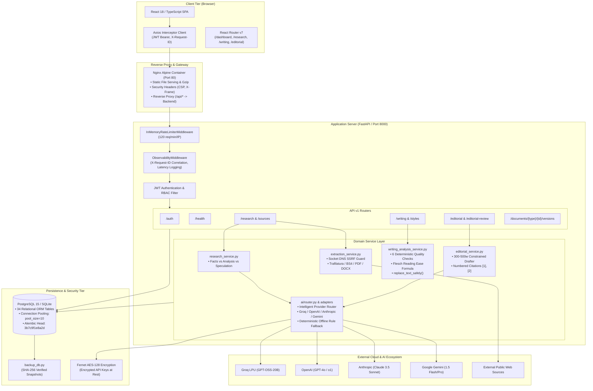
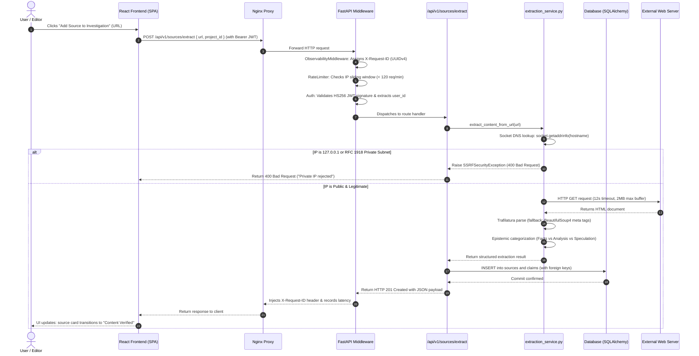

# AI Editorial Workspace — Architecture Defense & Technical Walkthrough

**Architecture Paradigm:** Decoupled Asynchronous Microservices / Clean Layered Architecture  
**Primary Frameworks:** FastAPI (ASGI), React 18 (TypeScript), SQLAlchemy 2.0 (PostgreSQL/SQLite)  
**Security Model:** Defense-in-Depth (Socket DNS SSRF, Bcrypt, AES-128 Fernet, Sliding Rate Limiting)  

---

## 1. Complete System Architecture Diagram

---

## 2. Complete End-to-End Request Lifecycle

To illustrate the exact flow through the codebase, here is the trace of a user requesting source ingestion:

---

## 3. Architecture Component Defenses

### 3.1. Frontend Architecture
- **State Management:** Reactive local state paired with centralized Axios HTTP client. Component-level state manages form controls and modal triggers.
- **Routing:** React Router v7 enforcing route protection; unauthenticated tokens redirect to `/login`.
- **UI System:** Tailwind CSS design tokens matching the authoritative publication palette of *This Week in AI*.

### 3.2. Backend Layering & Dependency Injection
- **Separation of Concerns:** Zero business logic in FastAPI path operation functions. Routes validate schemas (`schemas/`), call services (`services/`), and query through ORM models (`models/`).
- **Database Sessions:** Injected via FastAPI's `Depends(get_db)` yielding scoped SQLAlchemy sessions that guarantee transaction rollback on unhandled exceptions.

### 3.3. Database Schema & Migration Strategy
- **Relational Tables:** 34 normalized tables managing Users, Organizations, Research Projects, Sources, Claims, Briefs, Drafts, Suggestions, Editorial Outputs, Style Guides, and Version Snapshots.
- **Alembic Versioning:** Linear, forward-only migrations (`fe217d474c9d -> 0d95531a1a07 -> 3b7c9f1e8a2d`). Every migration is tested against both fresh databases and populated databases to guarantee zero data loss.

### 3.4. Dual-Column Non-Destructive Editing Model
- **`WritingDraft` ORM Model:** Stores `original_content: Text` (immutable) alongside `revised_content: Text` (mutable).
- **Replacement Safety:** `replace_text_safely(revised_text, original_snippet, replacement_text)` calculates exact sentence-boundary indices, guaranteeing that surrounding copy, quotations, and citations are never corrupted.

### 3.5. Multi-Provider Intelligent AI Router
- **Provider Adapters:** Standard interface implemented across `GroqAdapter`, `OpenAIAdapter`, `AnthropicAdapter`, and `GeminiAdapter`.
- **Automatic Fallback:** If upstream credentials are missing, invalid, or rate-limited (HTTP 429), the router executes the **Deterministic Fallback Engine**, which parses text using rule-based heuristics so the editorial desk never experiences downtime.
