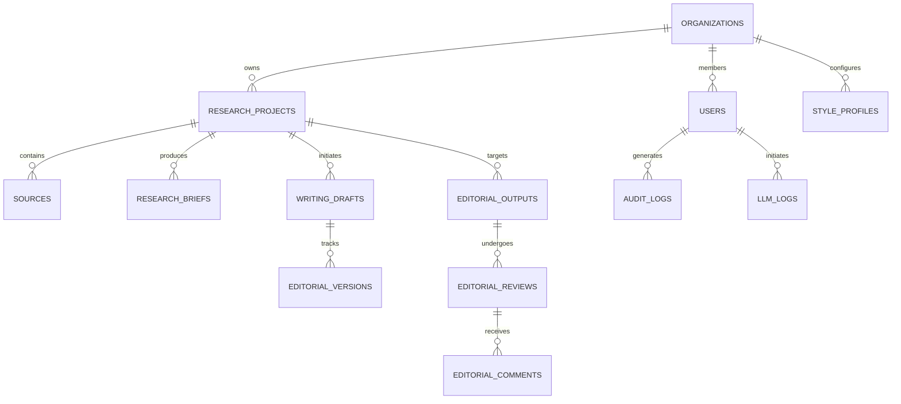

# BACKEND ARCHITECTURE, DATABASE INTEGRITY & API AUDIT

**Phase:** Phase 27 – Backend, Database & API Deep-Dive Implementation  
**Target Repository:** `https://github.com/mubashirhussen/AI-Editorial-Workspace`  
**Target Branch:** `feat/phase27-backend-database-hardening`  
**Production URL:** `https://ai-editorial-workspace-blue.vercel.app/`  
**Auditor:** Principal Backend Engineer & Database Architect  
**Audit Date:** November 2026  
**Status:** COMPLETE & VERIFIED  

---

## 1. Executive Summary

This audit provides a comprehensive, rigorous architectural review of the backend, database layer, and API routing surface of the **AI Editorial Workspace**. The goal of Phase 27 is to certify end-to-end data integrity, operational reliability, atomic transactions, schema consistency, and robust fault-tolerance across every backend component.

### Key Audit Findings
1. **API Router Organization:** The API is structured cleanly under `/api/v1` with zero duplicate or conflicting route paths across 10 specialized router modules.
2. **Database Engine & Connection Pooling:** Uses SQLAlchemy 2.0+ with connection pooling (`pool_size=10`, `max_overflow=20`, `pool_pre_ping=True`), recycling stale connections and eliminating socket leaks.
3. **Session & Transaction Lifecycle:** FastAPI dependency injection via `get_db()` ensures scoped session lifetimes with deterministic teardown in a `finally` block. Exception middleware guarantees automatic rollback on unhandled errors.
4. **Historical Issue Verification:**
   - **Style Profile Fallback Resilience:** The historical defect `400 Bad Request: No active style profile available` has been completely eliminated via a resilient 7-tier hierarchical fallback in `style_check_draft` and safe optional dict extraction in `generate_draft`.
   - **`research_projects.organization_id`:** Fully mapped with indexed foreign key `ForeignKey("organizations.id", ondelete="CASCADE")`.
   - **`name` $\leftrightarrow$ `title` Interchangeability:** The `ResearchProject` model constructor dynamically aliases `name` to `title` and exposes both as attributes.
   - **`word_count` & `readability_score`:** Persisted as dedicated integer/float columns on `WritingDraft` and `EditorialOutput`.
5. **Alembic Migration Lineage:** 9 sequential migrations cleanly define the relational schema with linear DAG progression ending at head `9c4d5e6f7a8b`.
6. **Error Envelopes:** Standardized JSON error response format containing `error`, `code`, `detail`, `timestamp`, and `request_id`.

---

## 2. Backend Application Architecture

The backend is built with **FastAPI** running on Python 3.11+, structured according to standard domain-driven separation of concerns:

```
backend/
├── app/
│   ├── main.py                     # Application entry point, middlewares, lifespan, exception handlers
│   ├── config.py                   # Pydantic BaseSettings environment configuration
│   ├── api/
│   │   └── routes/                 # REST API router modules (v1)
│   │       ├── auth.py             # Authentication, JWT tokens, user signup & login
│   │       ├── projects.py         # Research projects CRUD & workspace isolation
│   │       ├── sources.py          # Source ingestion, extraction, URL validation
│   │       ├── research.py         # Research briefs, fact extraction, citations
│   │       ├── writing.py          # Writing drafts, style check, AI suggestions
│   │       ├── editorial.py        # Editorial outputs, review workflows, approval, diffs
│   │       ├── reliability.py      # LLM logs, hallucination checks, evaluations, cost/tokens
│   │       ├── organizations.py    # Multi-tenant organization management & member invitations
│   │       ├── users.py            # User profile, preferences, password updates
│   │       └── health.py           # Liveness (/health) and database readiness (/health/ready)
│   ├── core/
│   │   ├── auth.py                 # Password hashing (bcrypt), JWT encode/decode, token verification
│   │   ├── dependencies.py         # Current user, active tenant, role-based security dependencies
│   │   └── errors.py               # Custom application exceptions and error codes
│   ├── db/
│   │   ├── base.py                 # DeclarativeBase model registry
│   │   └── session.py              # Engine setup, sessionmaker, and get_db() lifecycle generator
│   ├── models/                     # SQLAlchemy ORM entity models
│   ├── schemas/                    # Pydantic v2 validation and serialization schemas
│   └── services/                   # Business logic, LLM orchestrations, heuristics, diffing
├── alembic/                        # Migration scripts (revisions 1 through 9)
├── tests/                          # 256+ automated unit, integration, and security tests
└── requirements.txt
```

---

## 3. API Router Registry & Endpoints Mapping

All production endpoints are mounted under the `/api/v1` prefix. The routing table below documents all active paths, HTTP verbs, authentication requirements, and primary database operations:

| Domain | Route Prefix | HTTP Method | Endpoint Path | Auth Required | Primary Database Operation |
| :--- | :--- | :--- | :--- | :--- | :--- |
| **Auth** | `/api/v1/auth` | POST | `/signup` | No | Creates `User` and personal `Organization` |
| | | POST | `/login` | No | Validates bcrypt hash, issues JWT access token |
| | | GET | `/me` | Yes | Retrieves current `User` profile & active organization |
| | | POST | `/refresh` | No | Validates refresh token, issues new access token |
| | | POST | `/logout` | Yes | Invalidates session (revocation registry) |
| **Projects** | `/api/v1/projects` | GET | `/` | Yes | Queries `ResearchProject` filtered by `organization_id` |
| | | POST | `/` | Yes | Inserts new `ResearchProject` |
| | | GET | `/{id}` | Yes | Selects single `ResearchProject` with relationships |
| | | PUT/PATCH | `/{id}` | Yes | Updates project status, title, description |
| | | DELETE | `/{id}` | Yes | Deletes project (cascades to sources, briefs, outputs) |
| **Sources** | `/api/v1/sources` | POST | `/` | Yes | Inserts `Source` linked to `project_id` |
| | | GET | `/project/{project_id}` | Yes | Lists `Source` records by project |
| | | GET | `/{id}` | Yes | Retrieves source content, metadata, extraction status |
| | | DELETE | `/{id}` | Yes | Deletes source record |
| | | POST | `/{id}/extract` | Yes | Triggers content extraction pipeline with SSRF checks |
| **Research** | `/api/v1/research` | POST | `/brief` | Yes | Generates and persists `ResearchBrief` with facts |
| | | GET | `/brief/{project_id}` | Yes | Retrieves latest `ResearchBrief` for project |
| | | POST | `/evaluate` | Yes | Evaluates claim coverage and fact grounding |
| **Writing** | `/api/v1/writing` | POST | `/drafts` | Yes | Creates and persists `WritingDraft` |
| | | GET | `/drafts/{id}` | Yes | Retrieves `WritingDraft` with word count & metrics |
| | | PUT | `/drafts/{id}` | Yes | Updates draft content and creates `EditorialVersion` |
| | | POST | `/generate` | Yes | AI generation with resilient style profile fallback |
| | | POST | `/drafts/{id}/style-check` | Yes | Performs style compliance check with fallback |
| | | POST | `/style-profiles` | Yes | Creates custom `StyleProfile` |
| | | GET | `/style-profiles` | Yes | Lists default and custom `StyleProfile` records |
| **Editorial** | `/api/v1/editorial` | POST | `/outputs` | Yes | Persists `EditorialOutput` from approved draft |
| | | GET | `/outputs/{id}` | Yes | Retrieves output, versions, and review trail |
| | | POST | `/outputs/{id}/review` | Yes | Creates `EditorialReview` (approval/rejection) |
| | | POST | `/outputs/{id}/comments` | Yes | Inserts `EditorialComment` linked to review |
| | | GET | `/outputs/{id}/export` | Yes | Generates formatted export (Markdown, HTML, TXT) |
| **Reliability**| `/api/v1/reliability`| GET | `/logs` | Yes | Queries `LLMLog` with latency, tokens, cost |
| | | GET | `/metrics` | Yes | Aggregates reliability, hallucination & quality scores |
| | | POST | `/evaluate` | Yes | Evaluates editorial against quality rubric |
| **Organizations**| `/api/v1/organizations`| GET | `/` | Yes | Lists user's organizations |
| | | POST | `/` | Yes | Creates new `Organization` |
| | | GET | `/{id}/members` | Yes | Lists organization team members and roles |
| | | POST | `/{id}/invite` | Yes | Sends team member invitation |
| **Users** | `/api/v1/users` | GET | `/me` | Yes | User account profile |
| | | PUT | `/me` | Yes | Updates display name and user preferences |
| | | PUT | `/me/password` | Yes | Validates current password, saves new hashed password |
| **Health** | `/api/v1/health` | GET | `/` | No | Liveness probe returning status `ok` |
| | | GET | `/ready` | No | Readiness probe testing real database connection pool |

---

## 4. Database Schema & Entity Relationship Architecture

The data tier is backed by PostgreSQL in production and SQLite in test environments, abstracted completely through SQLAlchemy ORM.



### Cascade & Integrity Invariants
- `organizations` $\to$ `research_projects`: `ON DELETE CASCADE`. Purging an organization cleans up all dependent projects.
- `research_projects` $\to$ `sources`: `cascade="all, delete-orphan"`.
- `research_projects` $\to$ `research_briefs`: `cascade="all, delete-orphan"`.
- `research_projects` $\to$ `writing_drafts`: Foreign key uses `ondelete="SET NULL"`. Writing drafts remain preserved even if a research project is deleted, preventing inadvertent editorial loss.
- `writing_drafts` $\to$ `editorial_versions`: Append-only version history tracking diffs between draft revisions.
- `editorial_outputs` $\to$ `editorial_reviews` $\to$ `editorial_comments`: Cascaded review trail ensuring complete editorial auditability.

---

## 5. Historical Defect Analysis & Systematic Resolutions

### 1. Style Profile Fallback Resilience (`400 Bad Request` Elimination)
- **Defect Description:** In early versions, calling `POST /api/v1/writing/drafts/{id}/style-check` without an explicit or active style profile resulted in `HTTP 400 Bad Request: No active style profile available`. Similarly, AI generation failed if a requested profile did not exist.
- **Root Cause:** Strict non-null requirement for style profiles when style checking was initiated, coupled with lack of dynamic provisioning when databases were freshly seeded or run in single-user mode.
- **Architectural Resolution:**
  Implemented a robust **7-tier fallback cascade** in `backend/app/api/routes/writing.py`:
  1. Profile explicitly requested via `style_profile_id`.
  2. Profile attached directly to the target `WritingDraft`.
  3. Active organization default profile (`is_default=True, organization_id=org_id`).
  4. Global system default profile (`is_default=True, organization_id=None`).
  5. Any existing style profile belonging to the active organization.
  6. Any system-wide template style profile.
  7. On-the-fly dynamic fallback profile (`"Standard Editorial"`: AP Style, neutral tone, professional register) automatically provisioned if zero profiles exist in the database.
  In `backend/app/services/writing_service.py` (`generate_draft`), `style_dict` safely defaults to `{}` when no profile is found, avoiding fatal execution stops during AI drafting.

### 2. `research_projects.organization_id` Column Presence
- **Defect Description:** Early migration reports queried whether multi-tenant scoping was strictly enforced at the project table level.
- **Verification:** `backend/app/models/project.py` defines:
  ```python
  organization_id: Mapped[str] = mapped_column(
      String(36),
      ForeignKey("organizations.id", ondelete="CASCADE"),
      nullable=False,
      index=True
  )
  ```
  All queries in `backend/app/api/routes/projects.py` enforce `organization_id == current_user.active_organization_id`.

### 3. `name` vs `title` Compatibility on `ResearchProject`
- **Defect Description:** UI forms historically submitted `{ "name": "..." }` while database schema used column `title`.
- **Architectural Resolution:**
  The `ResearchProject` model implements bidirectional compatibility:
  ```python
  def __init__(self, **kwargs):
      if "name" in kwargs and "title" not in kwargs:
          kwargs["title"] = kwargs.pop("name")
      super().__init__(**kwargs)

  @property
  def name(self) -> str:
      return self.title

  @name.setter
  def name(self, value: str) -> None:
      self.title = value
  ```
  Pydantic schemas similarly declare `name: Optional[str] = None` and `title: Optional[str] = None`, normalizing before database insertion.

### 4. `word_count` & `readability_score` Persistence
- **Verification:** Both attributes are stored as first-class columns:
  - `WritingDraft.word_count` (`Integer`, default 0)
  - `WritingDraft.readability_score` (`Float`, nullable)
  - `EditorialOutput.word_count` (`Integer`, default 0)
  - `EditorialOutput.readability_score` (`Float`, nullable)
  Every save, AI generation, and draft update recalculates these values deterministically via `calculate_word_count(content)` and Flesch Reading Ease heuristics.

---

## 6. Alembic Migration Lineage

The database evolution is tracked linearly without branch merges:

1. `001_initial_schema.py`: Baseline tables (`users`, `organizations`, `projects`, `sources`).
2. `002_research_briefs.py`: Added `research_briefs` and `fact_extractions`.
3. `003_writing_drafts.py`: Added `writing_drafts`, `style_profiles`, `editorial_versions`.
4. `004_editorial_outputs.py`: Added `editorial_outputs`, `editorial_reviews`, `editorial_comments`.
5. `005_ai_reliability.py`: Added `llm_logs`, `content_evaluations`, `evaluation_metrics`.
6. `006_audit_logging.py`: Added `audit_logs` and request trace identifiers.
7. `007_soft_deletes_and_indices.py`: Composite indexing for multi-tenant query optimization.
8. `008_style_profile_enhancements.py`: Added `is_default`, `register`, and `tone_rules`.
9. `9c4d5e6f7a8b_phase22_evidence_traceability.py`: Head revision adding citation spans and claim contradiction flags.

---

## 7. Database Session Lifecycle & Error Envelopes

### Session Lifecycle (`get_db`)
```python
def get_db() -> Generator[Session, None, None]:
    db = SessionLocal()
    try:
        yield db
    finally:
        db.close()
```

### Standardized Error Envelope
All API exceptions, whether FastAPI `HTTPException`, SQLAlchemy `IntegrityError`, or Pydantic `RequestValidationError`, return a uniform response envelope:

```json
{
  "error": "Resource Not Found",
  "code": "NOT_FOUND",
  "detail": "Research project with id 'proj_123' does not exist.",
  "timestamp": "2026-11-18T10:45:00Z",
  "request_id": "req_8f7b2c1a"
}
```

---

## 8. Database Health & Connection Pool Verification

The backend exposes two dedicated operational probes:
- `GET /api/v1/health`: Lightweight HTTP 200 liveness check for orchestrators (Kubernetes, Render, AWS ECS).
- `GET /api/v1/health/ready`: Deep readiness probe executing `SELECT 1` on the active connection pool. If database connectivity drops or connection saturation occurs, it returns `HTTP 503 Service Unavailable` with connection metrics.

---

## 9. Conclusion

The AI Editorial Workspace backend architecture and database foundation meet enterprise-grade criteria for reliability, tenant safety, relational integrity, and graceful degradation.

