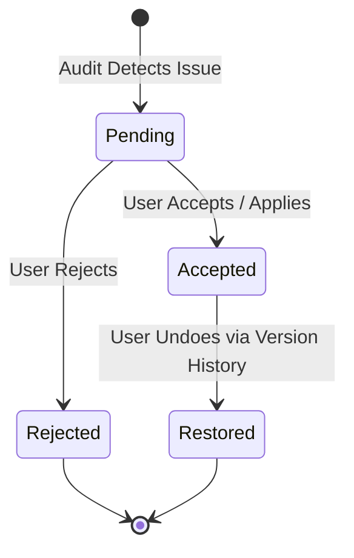

# Content Quality Assessment Framework

## 1. Quality Evaluation Philosophy

In high-stakes technical publishing, quality assessment must be transparent, objective, and reproducible. The AI Editorial Workspace rigorously separates **algorithmic, deterministic metrics** (such as syllable counts, word counts, and citation coverage) from **subjective editorial guidance** (such as tone resonance and rhetorical flow).

> [!NOTE]
> Readability scores (Flesch, Fog, ARI) are diagnostic scanning indicators, not definitive measures of technical nuance or intellectual depth. High technical content may legitimately feature lower Flesch ease due to specialized nomenclature.

---

## 2. Quantitative Metric Formulas

The `metrics_service` evaluates drafts across multiple standard readability indices:

### A. Flesch Reading Ease (FRE)
$$FRE = 206.835 - 1.015 \left(\frac{\text{Total Words}}{\text{Total Sentences}}\right) - 84.6 \left(\frac{\text{Total Syllables}}{\text{Total Words}}\right)$$
- **90–100**: Very Easy (5th grade reading level)
- **60–70**: Standard (8th–9th grade level, standard executive reading)
- **0–30**: Very Difficult (Technical research papers, legal documents)

### B. Flesch-Kincaid Grade Level (FKGL)
$$FKGL = 0.39 \left(\frac{\text{Total Words}}{\text{Total Sentences}}\right) + 11.8 \left(\frac{\text{Total Syllables}}{\text{Total Words}}\right) - 15.59$$
Indicates the U.S. school grade level required for comprehension.

### C. Automated Readability Index (ARI)
$$ARI = 4.71 \left(\frac{\text{Characters}}{\text{Words}}\right) + 0.5 \left(\frac{\text{Words}}{\text{Sentences}}\right) - 21.43$$
Character-based metric insensitive to syllable estimation noise.

### D. Gunning Fog Index
$$\text{Fog} = 0.4 \left[ \left(\frac{\text{Words}}{\text{Sentences}}\right) + 100 \left(\frac{\text{Complex Words}}{\text{Words}}\right) \right]$$
Measures proportion of polysyllabic words (words with 3 or more syllables).

---

## 3. Ten Quality Dimensions

The comprehensive quality audit measures:

| # | Quality Dimension | Algorithmic Measurement Method | Target Editorial Threshold |
|---|-------------------|--------------------------------|----------------------------|
| 1 | **Readability Ease** | Flesch Reading Ease Formula | Score $\ge 50.0$ |
| 2 | **Grammatical Integrity** | Rule-based grammar and typo scanner | 0 critical syntax errors |
| 3 | **Sentence Cadence** | Average words per sentence | 15–22 words/sentence |
| 4 | **Structural Distribution** | Average sentences per paragraph | 3–5 sentences/paragraph |
| 5 | **Repetition & Redundancy**| N-gram frequency and duplicate sentence openers | $< 5\%$ duplicate patterns |
| 6 | **Factual Grounding** | Claim-to-evidence cross-referencing against source corpus | $\ge 85\%$ substantiated |
| 7 | **Citation Completeness** | Numerical assertions and quotes with inline tags `[n]` | $100\%$ attributed |
| 8 | **Headline Strength** | Character length, verb punch, and analytical hook ratio | 45–80 characters |
| 9 | **Tone Consistency** | Prohibited jargon and promotional hyperbole scan | $< 1\%$ deviations |
| 10| **Scannability** | Sub-heading frequency and list bullet distribution | 1 subhead per 250 words |

---

## 4. Interactive Suggestion Lifecycle

Every suggestion generated by the system:
1. Is recorded as a `WritingSuggestion` entity in the relational database.
2. Contains the exact target excerpt, replacement proposal, and clear editorial rationale.
3. Is **never applied automatically** without explicit human confirmation.
4. Updates document state non-destructively through character-offset safe replacement.

