# Database Architecture & Engineering Design

This document details the database architecture, concurrency models, data isolation, and query optimization patterns implemented in the **AI Editorial Workspace**.

---

## 1. Architectural Overview & Engine Support

The AI Editorial Workspace employs a dual-engine architecture powered by **SQLAlchemy 2.x Declarative ORM** and **Alembic**:
* **Local & CI/Test Environments**: Native SQLite 3 with runtime enforcement of foreign keys (`PRAGMA foreign_keys=ON`) via SQLAlchemy connection event hooks and multithreaded access flags (`check_same_thread=False`).
* **Production Environments**: High-throughput PostgreSQL with pre-ping validation (`pool_pre_ping=True`), connection pooling (`pool_size=10`, `max_overflow=20`, `pool_timeout=30s`), and automatic recycling (`pool_recycle=1800s`).

---

## 2. Multi-Tenant Organization Isolation

Data access is partitioned at the organization level:
* Every tenant-scoped entity (`ResearchProject`, `EditorialStyleProfile`, `EditorialVersion`, `AiProviderConfig`, `IntegrationConnection`, `AuditLog`, etc.) carries an indexed `organization_id` column referencing `organizations.id` with `ON DELETE CASCADE`.
* The centralized `CRUDBase` repository enforces automatic filtering on `organization_id` when evaluating user sessions and workspace scopes.
* Cross-tenant access is prohibited at both the database foreign-key layer and the FastAPI authorization dependency layer.

---

## 3. Entity-Relationship Diagram (ERD)

```mermaid
erDiagram
    users ||--o{ organization_memberships : has
    users ||--o{ organization_invitations : invites
    users ||--o{ user_sessions : creates
    users ||--o{ password_reset_tokens : requests
    users ||--o{ email_verification_tokens : verifies
    users ||--o{ editorial_versions : creates
    users ||--o{ audit_logs : generates
    users ||--o{ notifications : receives

    organizations ||--o{ organization_memberships : contains
    organizations ||--o{ organization_invitations : issues
    organizations ||--o{ research_projects : owns
    organizations ||--o{ editorial_style_profiles : configures
    organizations ||--o{ ai_provider_configs : stores
    organizations ||--o{ integration_connections : maintains
    organizations ||--o{ background_jobs : dispatches
    organizations ||--o{ user_activity_logs : tracks
    organizations ||--o{ audit_logs : audits
    organizations ||--o{ usage_events : records

    research_projects ||--o{ sources : ingests
    research_projects ||--o{ research_briefs : synthesizes
    research_projects ||--o{ writing_drafts : drafts
    research_projects ||--o{ editorial_outputs : publishes
    research_projects ||--o{ research_entities : contains
    research_projects ||--o{ research_claims : generates
    research_projects ||--o{ research_evidence : anchors
    research_projects ||--o{ research_relationships : links
    research_projects ||--o{ research_contradictions : highlights
    research_projects ||--o{ research_trends : identifies

    sources ||--o| source_analyses : analyzes
    sources ||--o{ research_evidence : proves
    research_claims ||--o{ research_evidence : validates

    writing_drafts ||--o{ writing_suggestions : reviews
    writing_drafts ||--o{ editorial_versions : snapshots
    writing_drafts ||--o| editorial_outputs : converts_to

    editorial_outputs ||--o{ editorial_reviews : undergoes
    editorial_reviews ||--o{ editorial_comments : contains
```



---

## 4. Concurrency Control & Data Integrity

1. **Monotonic Version Numbering**:
   * Versioning for writing drafts, research briefs, and newsletter outputs uses transactional sequential increments (`latest.version_number + 1`) within atomic commit boundaries.
2. **Optimistic Guarding & Deduplication**:
   * Identical consecutive content snapshots are skipped unless explicitly forced, preventing redundant storage overhead.
3. **Soft-Deletion Protection**:
   * `ResearchProject`, `Source`, and `WritingDraft` implement soft-deletion via an indexed `deleted_at` timestamp. Standard analytical queries and workspace listings filter `deleted_at IS NULL` while preserving historical references and audit compliance.
4. **Credential Security**:
   * Integration secrets and API credentials (`encrypted_api_key`, `encrypted_secret`) are encrypted at rest using AES-128-CBC / Fernet with SHA-256 derived keys. Unmasked plaintext keys never touch logs, traces, or HTTP responses.

---

## 5. Query Optimization & Indexing Strategy

* **Composite Filtering Indexes**:
  * `ix_sources_project_created`: `(project_id, created_at)`
  * `ix_drafts_project_created`: `(project_id, created_at)`
  * `ix_editorial_versions_doc`: `(document_type, document_id, version_number)`
  * `ix_evidence_project_source`: `(project_id, source_id)`
  * `ix_usage_org_created`: `(organization_id, created_at)`
* **Eager Loading**:
  * Frequently associated relationships (`memberships`, `sources`, `briefs`, `suggestions`) leverage `lazy="selectin"` to eradicate $O(N)$ query cascades on collection endpoints.
* **Pagination**:
  * Reusable pagination pattern with bounded page sizes ($1 \le \text{page\_size} \le 100$) and deterministic `created_at DESC` ordering.


---

## 6. Migration Version History & Alembic Architecture

The database schema is strictly version-controlled via Alembic, establishing a linear, reproducible migration history across development, CI/CD, and production:

| Revision ID | Description | Down Revision | Key Schema Operations |
|---|---|---|---|
| `1a2b3c4d5e6f` | Initial baseline schema | None | Base tables: `users`, `organizations`, `research_projects`, `sources` |
| `2a4b6c8d0e1f` | Audit & performance indexes | `1a2b3c4d5e6f` | `audit_logs`, `background_jobs`, `user_activity_logs` |
| `3b7c9f1e8a2d` | Production hardening indexes | `2a4b6c8d0e1f` | Multi-tenant scoping and integrity checks |
| `4c8d1e2f3a4b` | Add missing foreign key indexes | `3b7c9f1e8a2d` | Added 14 missing FK indexes across claims, evidence, invitations, versions |
| `5e9a2f1b4c3d` (head) | Performance & composite indexes | `4c8d1e2f3a4b` | Added 75 composite/performance indexes; enforced unique constraint on `users.email` |

### Production vs Development Lifespan Policy

* **Development & Test**: Application lifespan executes `Base.metadata.create_all()` as a non-destructive convenience when `ENVIRONMENT != 'production'`.
* **Production**: Unversioned DDL calls are disabled. The application lifespan strictly logs `Production mode active: Database schema is managed strictly via Alembic migrations.` Schema changes require `alembic upgrade head`.

### Verification Commands

```bash
# Verify current migration revision:
alembic -c backend/alembic.ini current

# Run migrations to latest head:
alembic -c backend/alembic.ini upgrade head

# Rollback one migration step:
alembic -c backend/alembic.ini downgrade -1

# Create an online verified backup:
python backend/app/scripts/backup_db.py --action backup --dir backups/
```
