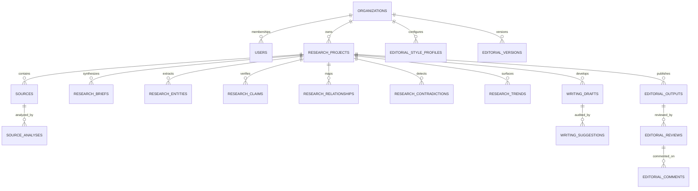

# Database Audit & Schema Verification

**Database Engine:** SQLite (Local Dev / CI) & PostgreSQL-compatible  
**ORM:** SQLAlchemy 2.0  
**Migration Tool:** Alembic  
**Current Revision:** `0d95531a1a07` (Head)  
**Down Revision:** `fe217d474c9d`  

---

## 1. Schema Overview

The database contains **20 normalized tables** organized into 6 core domains:

---

## 2. Table Catalog

| Table Name | Primary Key | Foreign Keys | Key Indexes | Nullable Protections |
| :--- | :--- | :--- | :--- | :--- |
| `users` | `id` (VARCHAR 36) | None | `ix_users_email` (UNIQUE) | `email`, `hashed_password`, `full_name` non-null |
| `organizations` | `id` (VARCHAR 36) | None | `ix_organizations_slug` (UNIQUE) | `name`, `slug` non-null |
| `organization_memberships` | `id` (VARCHAR 36) | `organization_id` &rarr; `organizations.id`, `user_id` &rarr; `users.id` | `uq_org_user` (UNIQUE) | `role` defaults to `VIEWER`, CASCADE delete |
| `organization_invitations` | `id` (VARCHAR 36) | `organization_id` &rarr; `organizations.id`, `invited_by_id` &rarr; `users.id` | `ix_organization_invitations_token` (UNIQUE) | `token` non-null, expiration check |
| `research_projects` | `id` (VARCHAR 36) | `organization_id` &rarr; `organizations.id` | `ix_research_projects_organization_id` | CASCADE on org delete |
| `sources` | `id` (VARCHAR 36) | `project_id` &rarr; `research_projects.id` | `ix_sources_project_created` | `title`, `source_type` non-null |
| `source_analyses` | `id` (VARCHAR 36) | `source_id` &rarr; `sources.id` | `ix_source_analyses_source_id` | CASCADE on source delete |
| `research_briefs` | `id` (VARCHAR 36) | `project_id` &rarr; `research_projects.id` | `ix_briefs_project_created` | `content` non-null |
| `research_entities` | `id` (VARCHAR 36) | `project_id`, `source_id` | `ix_entities_project_type` | `normalized_name`, `entity_type` non-null |
| `research_claims` | `id` (VARCHAR 36) | `project_id`, `source_id` | `ix_claims_project_classification` | `evidence_classification` non-null |
| `research_relationships` | `id` (VARCHAR 36) | `project_id`, `source_id` | `ix_relationships_project_type` | `source_entity_name`, `target_entity_name` non-null |
| `research_contradictions` | `id` (VARCHAR 36) | `project_id`, `source_a_id`, `source_b_id` | `ix_contradictions_project` | `disagreement_nature` non-null |
| `research_trends` | `id` (VARCHAR 36) | `project_id` | `ix_trends_project_cat` | `theme`, `category` non-null |
| `writing_drafts` | `id` (VARCHAR 36) | `project_id`, `style_profile_id` | `ix_drafts_project_created` | `original_content` non-null |
| `writing_suggestions` | `id` (VARCHAR 36) | `draft_id` &rarr; `writing_drafts.id` | `ix_suggestions_draft_status` | `category`, `status` non-null |
| `editorial_style_profiles` | `id` (VARCHAR 36) | `organization_id` | `ix_style_org_default` | Default seed profile auto-provisioned |
| `editorial_outputs` | `id` (VARCHAR 36) | `project_id` &rarr; `research_projects.id` | `ix_editorial_project_created` | `content` non-null |
| `editorial_reviews` | `id` (VARCHAR 36) | `editorial_id` &rarr; `editorial_outputs.id` | `ix_editorial_review_created` | `review_status` state machine |
| `editorial_comments` | `id` (VARCHAR 36) | `review_id` &rarr; `editorial_reviews.id` | `ix_editorial_comments_review` | `section_reference`, `comment` non-null |
| `editorial_versions` | `id` (VARCHAR 36) | `organization_id`, `created_by` | `ix_editorial_versions_doc` | `content_snapshot`, `document_type` non-null |

---

## 3. Migration Chain & Idempotency Guarantee

- **Revision Chain**: `base` &rarr; `fe217d474c9d` &rarr; `0d95531a1a07` (head).
- **Idempotency Strategy**: `0d95531a1a07` introspects database metadata with `sa.inspect(op.get_bind())`. Tables and columns that already exist are safely skipped, preventing `table already exists` or `duplicate column name` exceptions.
- **Rollback Capability**: `downgrade()` in `0d95531a1a07` drops created tables in inverse dependency sequence.
- **Data Preservation**: No existing records are deleted or modified during upgrades.
