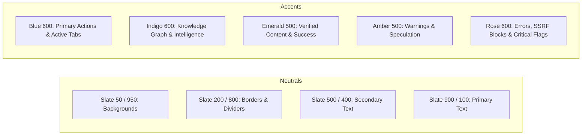

# AI Editorial Workspace Design System

**Version:** 2.0  
**Status:** Production Ready  
**Target:** Editorial SaaS, Knowledge Discovery & Fact-Checking Workspaces

---

## 1. Visual Identity & Brand Foundations

The **AI Editorial Workspace** design system is engineered specifically for journalists, editors, and research analysts. It balances high-density information architecture with clean, modern typography and restrained, authoritative styling.

### 1.1 Typography
- **Primary Interface**: Inter / -apple-system, BlinkMacSystemFont, "Segoe UI", Roboto, sans-serif.
- **Editorial Pro**: Serif typography (Georgia, Cambria, "Times New Roman") applied to long-form reading passages and executive summaries.
- **Code & Metrics**: `font-mono` (ui-monospace, SFMono-Regular, Menlo, Monaco, Consolas) applied to tokens, scores, dates, and correlation IDs.

---

## 2. Color Palette & Design Tokens

### 2.1 Functional Semantic Colors
- **Brand Primary**: Blue-600 (`#2563EB`) with indigo-600 (`#4F46E5`) subtle accents.
- **Surface**:
  - Light mode: Slate-50 background (`#F8FAFC`), Pure White cards (`#FFFFFF`), Slate-200 borders (`#E2E8F0`).
  - Dark mode: Slate-950 background (`#020617`), Slate-900 cards (`#0F172A`), Slate-800 borders (`#1E293B`).
- **Semantic Feedback**:
  - **Verified / Clean**: Emerald-600 text, Emerald-50 background, Emerald-200 border.
  - **Flagged / Audit Issue**: Amber-600 text, Amber-50 background, Amber-200 border.
  - **Extraction Failed / Security Violation**: Rose-600 text, Rose-50 background, Rose-200 border.
  - **AI Synthesized**: Violet-600 text, Violet-50 background, Violet-200 border.

---

## 3. Component Standards

### 3.1 Top Navigation (`Header.tsx`)
- Height: Fixed 64px (`h-16`), sticky `top-0 z-20`, border-b.
- **Left**: Mobile navigation hamburger trigger + Hierarchical dynamic breadcrumbs (`Workspace / Module / Project`).
- **Center**: Real-time Backend Health Badge with live ping indicator (`🟢 Backend connected` vs `🔴 Backend unavailable`).
- **Right**:
  - `OrganizationSwitcher`: Switch between personal and team organizations with role badges (`OWNER`, `EDITOR`).
  - Search workspace input.
  - Dark / Light mode toggle.
  - `UserProfileMenu`: User avatar with initials, active online dot, display name, role pill, and a dropdown card with profile settings and logout.

### 3.2 Toast System (`Toast.tsx`)
- Container: Fixed bottom-right `bottom-4 right-4 z-50`.
- **Deduplication Engine**: Identical messages within the active timeout are automatically deduplicated to prevent stacked notifications.
- **Queue Throttling**: Limits simultaneous visible toasts to maximum 3 items with 4-second auto-dismiss and manual close button.

### 3.3 Research Assistant Ingestion
- Dual-input tab switcher:
  - **Web URL**: Trafilatura + BeautifulSoup extractor with SSRF private-IP blocking.
  - **Paste Text**: Direct multi-paragraph article / release note input without crawler dependency.
- **Source Verification Cards**:
  - `Content Verified (N words)` badge in green.
  - `Extraction Failed` state with in-place **"Paste Text"** and **"Retry"** action buttons.
  - Threshold Indicator: Clear `(N/3 sources verified)` count to guide brief generation.

### 3.4 Writing Assistant & Auditor
- Side-by-side workspace:
  - 60% Left: Rich textarea with word counter, sentence counter, and original vs revised toggle.
  - 40% Right: Readability dashboard displaying Flesch Reading Ease score (0–100), Reading Time, Average Words per Sentence, and the 6 deterministic issue categories.
- Suggestion Cards:
  - Original passage highlighted.
  - Explanation and issue category.
  - Suggested rewrite with one-click **"Accept"** and **"Reject"** buttons.

---

## 4. Accessibility & Responsiveness

- All interactive controls feature keyboard focus rings (`focus:ring-2 focus:ring-blue-500/20`).
- Modals and dropdowns feature outside-click listeners and `Escape` key handlers.
- High-contrast color ratios comply with WCAG 2.1 AA standards.
- Fully responsive across Desktop (1200px+), Tablet (768px–1199px), and Mobile (<768px).

