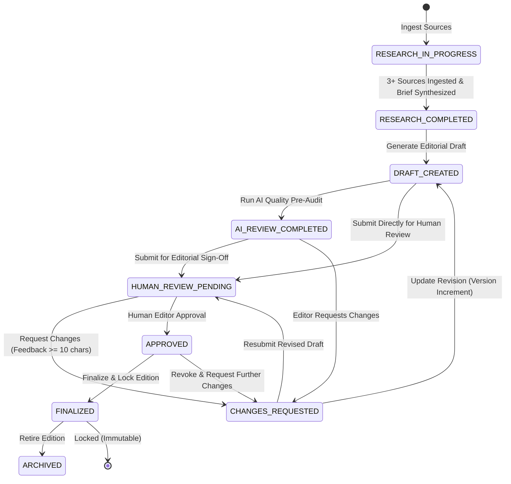

# Editorial Review & Approval Workflow (Phase 23)

## 1. Overview & Architectural Philosophy

In enterprise and high-stakes journalism, AI models should accelerate research synthesis and drafting, but **never possess autonomous publishing authority**. The Human-in-the-Loop Editorial Workflow establishes a strict governance lifecycle where every editorial artifact transitions through structured verification gates.

Key design invariants:
1. **Mandatory Human Verification**: An editorial draft cannot transition to `FINALIZED` without explicit human sign-off (`APPROVED`).
2. **AI Pre-Review as an Advisor, Never an Approver**: Automated quality, length, and citation checks assist editors, but cannot mark content as approved.
3. **Auditability & Traceability**: All review submissions, line-by-line comments, version revisions, and approvals are permanently persisted with timestamps and reviewer attributions.
4. **Post-Finalization Immutability**: Once an editorial reaches `FINALIZED`, all content modification, status mutation, and deletion attempts are rejected with `HTTP 400 Bad Request`.

---

## 2. Editorial Workflow Lifecycle & State Transitions

### 2.1 State Diagram (Mermaid)



### 2.2 Permitted Status Transitions Table

| Current Status | Permitted Next Statuses | Enforced Conditions / Guardrails |
| :--- | :--- | :--- |
| `RESEARCH_IN_PROGRESS` | `RESEARCH_COMPLETED` | Minimum 3 ingested sources required |
| `RESEARCH_COMPLETED` | `DRAFT_CREATED`, `DRAFT` | Research brief must exist |
| `DRAFT_CREATED` / `DRAFT`| `AI_REVIEW_COMPLETED`, `HUMAN_REVIEW_PENDING` | Minimum 50 characters of draft content |
| `AI_REVIEW_COMPLETED` | `HUMAN_REVIEW_PENDING`, `CHANGES_REQUESTED`, `APPROVED` | AI evaluation scored; cannot jump to `FINALIZED` |
| `HUMAN_REVIEW_PENDING` | `APPROVED`, `CHANGES_REQUESTED` | Reviewer name required |
| `CHANGES_REQUESTED` | `DRAFT_CREATED`, `HUMAN_REVIEW_PENDING` | Feedback required ($\ge 10$ chars); revisions create new version |
| `APPROVED` | `FINALIZED`, `CHANGES_REQUESTED` | Unapproved content rejected with `HTTP 400` |
| `FINALIZED` | `ARCHIVED` | Immutable. Content mutations strictly blocked. |
| `ARCHIVED` | *None* (Terminal) | Archived state preserved |

Any invalid status transition triggers an `HTTP 400 Bad Request` with an explicit error detailing the invalid edge:
`"Invalid workflow status transition: '<FROM>' -> '<TO>'."`

---

## 3. Roles and Permissions (Single-Tenant MVP vs Multi-Tenant)

### 3.1 Single-Tenant Implementation (Current)
The current workspace operates in a single-tenant environment without JWT/session authentication overhead.
- **Reviewer Identity**: Supplied via client requests (`reviewer_name`, default: `"Human Editor"` or `"Lead Editor"`).
- **Data Persistence**: Review records and comments are bound by foreign keys to the editorial output and project ID.
- **Authorization Boundary**: Cross-project isolation is enforced at the database query level (`project_id` scoping).
- **Transparency Notice**: In this single-tenant deployment, reviewer attribution is recorded based on the editor's entered name rather than a cryptographic user token.

### 3.2 Enterprise Multi-Tenant Roadmap
In a future multi-tenant deployment:
- **Role-Based Access Control (RBAC)**: Distinct roles for `Writer`, `Fact-Checker`, `Senior Editor`, and `Managing Editor`.
- **Enforced Separation of Concerns**: Writers cannot approve their own drafts (dual-custody approval).
- **Cryptographic Audit Signatures**: Approval transactions signed with OAuth2/OIDC claims.

---

## 4. Automated AI Pre-Review Criteria

The AI Pre-Review engine inspects drafts across 4 deterministic editorial dimensions:

1. **Word Count Compliance**:
   - Optimal Target: 300–500 words.
   - Status: `PASS` (300–500 words), `WARNING` (250–299 or 501–600 words), `FAIL` (<250 or >600 words).
2. **Editorial Section Verification**:
   - Confirms presence of Introduction, Core Thesis/Analysis, and Key Takeaway / Conclusion.
3. **Source Citation Validity**:
   - Detects numbered citations (e.g., `[1]`, `[2]`).
   - Reconciles citations against project ingested sources. Identifies unmapped or orphaned citations.
4. **Writing Quality & Style**:
   - Evaluates readability, active voice, hedge-word density, and analytical tone.
   - Scores quality on a 0–100 index with actionable recommendations.

> [!IMPORTANT]
> The AI pre-review output is strictly advisory. An AI review score of 100/100 does not approve or finalize the editorial.

---

## 5. Revision & Diff Mechanism

### 5.1 Version Tracking
When an editorial is first generated, its initial text is captured in `original_content` and `version` is initialized to `1`.
When an editor updates a draft following change requests:
1. `version` increments by 1.
2. The revised content is saved to `content`.
3. The previous revision and `original_content` are preserved for auditability.

### 5.2 Unified Diff Engine
The backend generates standard unified diffs via Python's `difflib`:
```python
diff_lines = list(difflib.unified_diff(
    original_lines,
    current_lines,
    fromfile=f"v1-original.md",
    tofile=f"v{editorial.version}-current.md",
    lineterm=""
))
```
The frontend visualizes this in the **Version History & Diff Viewer**, color-coding additions in emerald (`+`) and deletions in rose (`-`).

---

## 6. Immutability Guarantee for Finalized Content

Once an editorial transitions to `FINALIZED`:
- Any `PUT /api/v1/editorial/{id}` returns `HTTP 400 Bad Request`: `"Finalized editorials are locked and cannot be edited."`
- Any revision update `PUT /api/v1/editorial/{id}/revision` returns `HTTP 400 Bad Request`: `"Finalized editorials are locked and cannot be revised."`
- Any approval/rejection attempt returns `HTTP 400 Bad Request`: `"Editorial is already finalized and cannot be modified."`
- Deletion requests return `HTTP 400 Bad Request`: `"Finalized editorials cannot be deleted."`

---

## 7. Database Schema Extension

### 7.1 New Tables

#### `editorial_reviews`
| Column | Type | Constraints / Description |
| :--- | :--- | :--- |
| `id` | `VARCHAR(36)` | Primary Key (UUID) |
| `editorial_id` | `VARCHAR(36)` | Foreign Key $\rightarrow$ `editorial_outputs.id` (Indexed) |
| `reviewer_name` | `VARCHAR(255)` | Reviewer identifier (Default: "Human Editor") |
| `review_status` | `VARCHAR(50)` | Status: `HUMAN_REVIEW_PENDING`, `CHANGES_REQUESTED`, `APPROVED` |
| `overall_feedback` | `TEXT` | Summary editorial critique / feedback |
| `reviewed_at` | `DATETIME` | Timestamp of review decision |
| `created_at` | `DATETIME` | Timestamp of creation (Indexed) |
| `updated_at` | `DATETIME` | Timestamp of last modification |

#### `editorial_comments`
| Column | Type | Constraints / Description |
| :--- | :--- | :--- |
| `id` | `VARCHAR(36)` | Primary Key (UUID) |
| `review_id` | `VARCHAR(36)` | Foreign Key $\rightarrow$ `editorial_reviews.id` (Indexed) |
| `author_name` | `VARCHAR(255)` | Comment author |
| `target_section` | `VARCHAR(100)` | Section anchor (e.g., "headline", "body", "takeaway") |
| `comment_text` | `TEXT` | Specific feedback or change instructions |
| `is_resolved` | `BOOLEAN` | Resolution toggle (Default: `False`, Indexed) |
| `resolved_by` | `VARCHAR(255)` | Name of editor who resolved comment |
| `created_at` | `DATETIME` | Timestamp of creation |
| `updated_at` | `DATETIME` | Timestamp of resolution / update |

### 7.2 Updated Columns in `editorial_outputs`
- `original_content` (`TEXT`): Preserves original v1 draft text.
- `version` (`INTEGER`, Default `1`): Tracks revision counter.
- `ai_review_results` (`JSON`): Stores automated audit metrics, scores, and warnings.

---

## 8. API Endpoint Reference

| Method | Endpoint | Description | Permitted Statuses |
| :--- | :--- | :--- | :--- |
| `POST` | `/api/v1/editorial/{id}/ai-review` | Runs automated AI audit (word count, quality, citations) | `DRAFT_CREATED`, `DRAFT`, `CHANGES_REQUESTED` |
| `POST` | `/api/v1/editorial/{id}/submit-review` | Submits draft for human review | Any non-finalized status |
| `GET` | `/api/v1/editorial/{id}/reviews` | Lists all review audits and threaded comments | Any |
| `POST` | `/api/v1/editorial/{id}/request-changes` | Rejects draft with required editorial feedback ($\ge 10$ chars) | `HUMAN_REVIEW_PENDING`, `AI_REVIEW_COMPLETED`, `DRAFT_CREATED` |
| `POST` | `/api/v1/editorial/{id}/approve` | Grants official human editorial sign-off | `HUMAN_REVIEW_PENDING`, `AI_REVIEW_COMPLETED`, `DRAFT_CREATED` |
| `POST` | `/api/v1/editorial/{id}/finalize` | Locks edition into immutable publication state | `APPROVED` only |
| `PUT` | `/api/v1/editorial/{id}/revision` | Submits revised draft content, generating unified diff | Non-finalized |
| `POST` | `/api/v1/editorial/reviews/{review_id}/comments` | Adds inline line/section editorial comment | Non-finalized |
| `PUT` | `/api/v1/editorial/comments/{comment_id}` | Resolves or edits editorial comment | Non-finalized |
| `GET` | `/api/v1/editorial/dashboard/stats` | Aggregated metrics for review statuses and recent activity | All |

---

## 9. User Guide: Using the Review Studio

1. **Open Editorial Studio**: Navigate to `/editorial` and select an active editorial edition.
2. **Switch to Review Tab**: Click the **"Review & Workflow"** tab in the editorial toolbar.
3. **Run AI Pre-Review**: Click **"Run Automated AI Pre-Review"** to inspect word count bounds (300–500 words), section completeness, and source attribution validity.
4. **Inspect Version Diffs**: Click the **"Version History & Diffs"** sub-tab to inspect line-by-line diffs against the original draft.
5. **Add Inline Comments**: In the **"Editorial Review & Comments"** sub-tab, select the target section (Headline, Thesis, Body, Citations) and submit feedback.
6. **Request Changes**: If revisions are required, click **"Request Changes"** and specify required revisions (minimum 10 characters).
7. **Human Approval**: Once verified, enter your reviewer name and click **"Approve Editorial"**.
8. **Finalize**: Click **"Finalize Edition"** to lock the publication. Once locked, the content becomes permanent and immutable.

