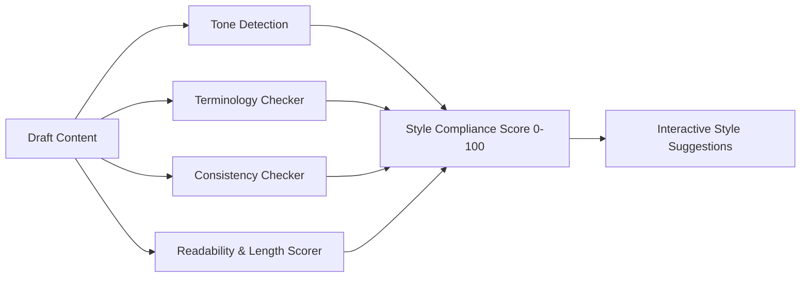

# Editorial Style Guide & Intelligence System

## 1. Editorial Voice & Principles

The AI Editorial Workspace enforces an executive, authoritative, and evidence-first editorial voice. Technology commentary must prioritize empirical findings, verified benchmarks, and architectural trade-offs over promotional hype, corporate press-release summaries, and unsupported speculation.

### Core Stylistic Directives:
1. **Evidence Precedes Interpretation**: Every factual assertion must be directly attributed to a primary source or empirical measurement using inline bracketed notation (`[1]`, `[2]`).
2. **Active, Decisive Phrasing**: Avoid bureaucratic passivity (`"It was determined by the team that..."` -> `"The engineering team demonstrated..."`).
3. **Clarity Over Jargon**: Eliminate corporate buzzwords that obscure technical mechanics.
4. **Transparent Uncertainty**: Clearly distinguish confirmed empirical results from forward-looking extrapolations.

---

## 2. Standard Built-in Style Profile Specifications

When an organization has not configured a custom style profile, the system engages the built-in **Standard Editorial Profile**:

```json
{
  "name": "Standard Editorial",
  "publication_name": "AI Editorial Workspace",
  "tone": "Authoritative, analytical, objective",
  "target_audience": "Founders, engineering leaders, and technical operators",
  "target_flesch_score": 60.0,
  "max_sentence_length": 35,
  "max_paragraph_length": 150,
  "words_to_avoid": [
    "game-changer",
    "disruptive",
    "synergy",
    "paradigm shift",
    "seamless integration",
    "revolutionary",
    "silver bullet",
    "next-gen",
    "cutting-edge",
    "best-of-breed"
  ],
  "preferred_terminology": {
    "AI-powered": "automated or model-driven",
    "utilize": "use",
    "in order to": "to",
    "due to the fact that": "because",
    "a large number of": "many",
    "basically": "(omit)",
    "at the end of the day": "ultimately"
  }
}
```

---

## 3. Style Intelligence Analysis Pipeline

The automated style analyzer (`backend/app/services/style_intelligence/style_analyzer.py`) audits drafts along 4 discrete dimensions:



1. **Tone Detector**: Identifies informal colloquialisms, promotional hyperbole, and speculative framing.
2. **Terminology Checker**: Matches draft tokens against preferred vocabulary and flags prohibited marketing jargon.
3. **Consistency Checker**: Audits sentence length variance, capitalization standards, and paragraph structure.
4. **Style Scorer**: Calculates a normalized 0–100 style compliance score, balancing readability targets against structural constraints.

