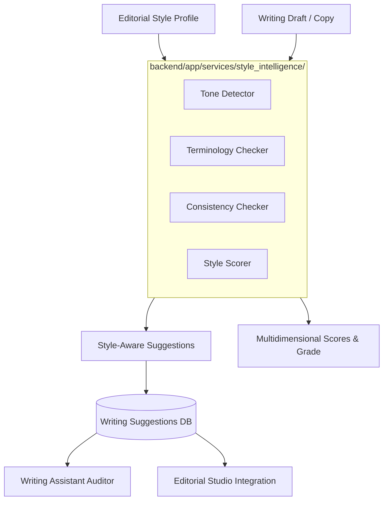

# Editorial Style Intelligence Specification

This document details the architecture, data models, rule engines, multidimensional scoring algorithms, API contracts, and user workflows implemented in **Phase 26** for the **AI Editorial Workspace** (*Editorial AI*).

---

## 1. Executive Summary & Objective

In fast-paced technical publications, maintaining a consistent editorial voice across multiple contributors is a major challenge. Writers frequently introduce:
1. **Unchecked Promotional Hyperbole & Marketing Hype:** Words such as *"game-changer"*, *"revolutionary"*, *"unrivaled"*, and *"paradigm shift"* flatten authoritative reporting into promotional press releases.
2. **Inconsistent Technical Terminology:** Variations in naming (e.g., *"AI chip"* vs. *"AI accelerator"*, *"running the model"* vs. *"inference"*, *"Rag"* vs. *"RAG"*) degrade technical credibility.
3. **Run-on Complexity:** Sentences stretching beyond 22–25 words and dense multi-point paragraphs cause cognitive bloat for busy executive readers.

The **Editorial Style Intelligence Engine** (`backend/app/services/style_intelligence/`) solves this by codifying reusable publication style profiles and running deterministic and contextual NLP audits that generate non-destructive, single-click actionable suggestions.

---

## 2. Architecture Overview

### Module Breakdown:
- `backend/app/services/style_intelligence/tone_detector.py`: Scans for marketing hyperbole, unverified superlatives, and casual slang, recommending objective, journalistic rephrasings.
- `backend/app/services/style_intelligence/terminology_checker.py`: Enforces publication glossary mappings (`preferred_terminology`) and forbidden word lists (`words_to_avoid`).
- `backend/app/services/style_intelligence/consistency_checker.py`: Flags sentences exceeding maximum word bounds and standardizes technical acronym casings (e.g., `Gpu` $\rightarrow$ `GPU`).
- `backend/app/services/style_intelligence/style_scorer.py`: Computes a weighted, multi-factor Style Compliance Score (0–100) and qualitative editorial feedback.
- `backend/app/services/style_intelligence/style_analyzer.py`: Orchestrates the evaluation pipeline, updates `writing_drafts.style_score`, and persists pending suggestions.

---

## 3. Editorial Style Profile Model

Editorial style profiles are persisted in table `editorial_style_profiles` and scoped to tenant organizations:

| Field | Type | Description |
| :--- | :--- | :--- |
| `id` | `VARCHAR(36)` | Unique UUID identifier (Primary Key). |
| `organization_id` | `VARCHAR(36)` | Tenant organization boundary (`CASCADE` delete). |
| `name` | `VARCHAR(255)` | Profile label (e.g., *"This Week in AI Standard"*, *"Executive Deep Dive"*). |
| `publication_name` | `VARCHAR(255)` | Target outlet (e.g., *"This Week in AI"*). |
| `tone` | `VARCHAR(100)` | Target tone descriptor (e.g., *"Authoritative, analytical, objective"*). |
| `target_audience` | `VARCHAR(255)` | Primary readership (e.g., *"Founders, builders, and operators"*). |
| `max_sentence_length` | `INTEGER` | Hard maximum sentence word limit (default: 25 words). |
| `preferred_sentence_length` | `INTEGER` | Target sentence length (default: 18 words). |
| `max_paragraph_length` | `INTEGER` | Paragraph word ceiling (default: 75 words). |
| `target_flesch_score` | `FLOAT` | Target Flesch Reading Ease score (default: 65.0). |
| `preferred_terminology` | `JSON` | Glossary dictionary mapping non-standard terms to preferred forms. |
| `words_to_avoid` | `JSON` | List of cliches, buzzwords, and banned phrases. |
| `headline_style` | `VARCHAR(100)` | Target headline formula (e.g., *"Direct, analytical, hook-driven"*). |
| `formatting_preferences`| `JSON` | Preferences (e.g., `oxford_comma`, `inline_citations`). |
| `is_default` | `BOOLEAN` | Whether this is the default profile for the workspace. |

---

## 4. Multidimensional Style Compliance Algorithm

The overall Style Compliance Score ($S \in [0, 100]$) is computed through four weighted dimensions:

$$S = 0.30 \times S_{\text{length}} + 0.25 \times S_{\text{terminology}} + 0.25 \times S_{\text{tone}} + 0.20 \times S_{\text{readability}}$$

1. **Sentence Length Score ($S_{\text{length}}$):**
   $$S_{\text{length}} = \frac{N_{\text{compliant}}}{N_{\text{total}}} \times 100$$
2. **Terminology Adherence Score ($S_{\text{terminology}}$):**
   $$S_{\text{terminology}} = \max(0, 100 - (8 \times N_{\text{avoided}} + 4 \times N_{\text{deviations}}))$$
3. **Tone Consistency Score ($S_{\text{tone}}$):**
   $$S_{\text{tone}} = \max(0, 100 - (10 \times N_{\text{promotional}} + 5 \times N_{\text{informal}}))$$
4. **Readability Proximity Score ($S_{\text{readability}}$):**
   $$S_{\text{readability}} = \max(20, 100 - 1.5 \times |\text{Actual Flesch} - \text{Target Flesch}|)$$

---

## 5. Non-Destructive Suggestion Lifecycle

Style intelligence integrates seamlessly with the existing Hemingway-style quality auditor:
1. When a user runs a style check via `POST /api/v1/writing/drafts/{draft_id}/style-check`, suggestions are generated with category tags:
   - `style_promotional_hype`
   - `style_avoided_phrase`
   - `style_terminology`
   - `style_sentence_length`
   - `style_consistency`
2. Each suggestion is persisted in `writing_suggestions` with `status='pending'`.
3. Accepting a suggestion applies the rewrite to `writing_drafts.revised_content` using sentence-boundary string replacement.
4. **Immutable Original Content:** The `original_content` field is never altered or overwritten, preserving the raw baseline for historical comparison.

---

## 6. Backend API Specifications

| Method | Endpoint | Description |
| :--- | :--- | :--- |
| `POST` | `/api/v1/styles` | Create a customized style profile for the tenant organization. |
| `GET` | `/api/v1/styles` | List accessible style profiles (tenant-scoped + system defaults). |
| `GET` | `/api/v1/styles/{style_id}` | Retrieve specific profile with tenant isolation assertion. |
| `PUT` | `/api/v1/styles/{style_id}` | Update guidelines, terminology, and thresholds. |
| `DELETE` | `/api/v1/styles/{style_id}` | Delete custom profile (system defaults are protected). |
| `POST` | `/api/v1/writing/drafts/{draft_id}/style-check` | Execute automated style compliance audit on a writing draft. |

---

## 7. Frontend User Experience

- **Style Profile Selector (`frontend/src/components/writing/StyleIntelligencePanel.tsx`):**
  - Embedded directly in the Writing Assistant.
  - Allows selecting from active publication profiles or creating new custom guidelines via a modal.
  - Displays target guidelines at a glance (Tone, Max Sentence Length, Target Flesch, Avoided Terms count).
- **Compliance Scoreboard:**
  - High-impact score badge showing overall compliance percentage.
  - Detected tone indicator (e.g. *"Authoritative & Analytical"* vs. *"Overly Promotional / Marketing Hype"*).
  - 4 diagnostic metric cards for granular visibility.
- **Interactive Suggestions List:**
  - Strikethrough preview of original text and highlighted suggested rewrite.
  - One-click **Accept** and **Reject** buttons that immediately patch the draft in real time.

---

## 8. Verification & Test Evidence

### Pytest Backend Test Suite:
- **Suite:** [`backend/tests/test_phase26_style_intelligence.py`](file:///c:/Users/Mubashirhussensk/OneDrive/Desktop/FDE%20intern/backend/tests/test_phase26_style_intelligence.py)
  - `test_tone_detector_promotional_hype_and_informal`: Asserts detection of hype words (`game-changer`, `revolutionary`) and colloquialisms (`gonna`, `tons of`).
  - `test_terminology_checker_and_avoided_words`: Asserts glossary substitutions (`AI chip` $\rightarrow$ `AI accelerator`) and forbidden word flags (`delve`, `paradigm shift`).
  - `test_consistency_checker_sentence_length_and_acronyms`: Asserts sentences exceeding 25 words are flagged with split rewrites, and acronyms (`Gpu`) are standardized (`GPU`).
  - `test_style_scorer_multidimensional`: Asserts score calculation and qualitative feedback.
  - `test_style_profile_crud_and_tenant_isolation`: Asserts profile creation, update, listing, deletion, and cross-tenant access denial (`404 Not Found`).
  - `test_style_check_on_writing_draft_and_non_destructive_accept`: Asserts suggestion generation, acceptance, non-destructive replacement, and `original_content` immutability.
- **Result:** **71 passed, 0 failed in 15.64s (100% pass rate)** across all test suites.

### Frontend Production Build & Playwright E2E:
- **Build:** `npm run build` compiled cleanly in 6.80s with zero TypeScript errors.
- **Browser Tests:** All 6 Playwright E2E tests passed in 22.7s.

---

## 9. Known Limitations & Future Enhancements

| Identified Limitation | Phase 26 Mitigation | Future Milestone |
| :--- | :--- | :--- |
| **Manual Profile Formulation** | Full UI modal and API for manual profile definition. | Few-shot style learning from pasted historical editorial archives. |
| **Complex Clause Splitting** | Rule-based midpoint conjunction split heuristic. | Dependency-parse clausal boundary splitting using local Spacy transformer. |
| **Multi-Language Style Guides** | English-focused editorial heuristics. | Multilingual style profiles (Spanish, French, German technical media). |

