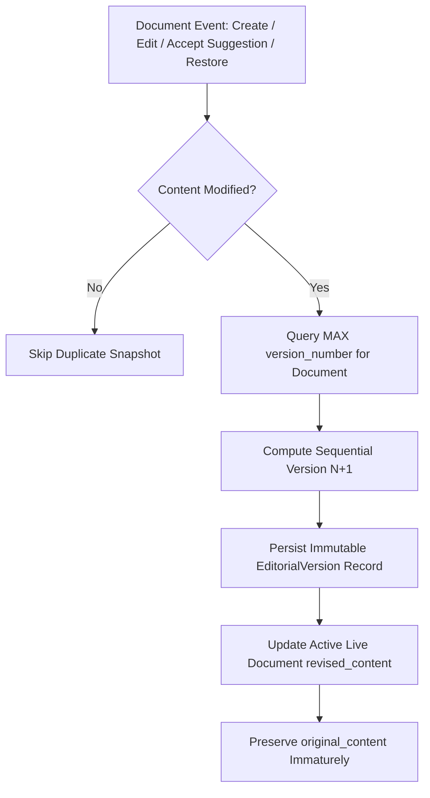

# Editorial Version Control & Change History

## Overview

The **Editorial Version Control & Change History** subsystem provides persistent, non-destructive, and append-only version tracking for core workspace documents: **Writing Drafts (`WRITING_DRAFT`)**, **Research Briefs (`RESEARCH_BRIEF`)**, and **Editorial Outputs (`EDITORIAL_OUTPUT`)**. 

It guarantees complete auditability of human and AI interventions, prevents accidental data loss, visualizes word and line diffs, and permits rollback to any prior state without erasing intervening historical revisions.

---

## Architecture & Database Design

### Data Model: `EditorialVersion`

```sql
CREATE TABLE editorial_versions (
    id VARCHAR(36) PRIMARY KEY,
    organization_id VARCHAR(36),
    document_type VARCHAR(50) NOT NULL,
    document_id VARCHAR(36) NOT NULL,
    version_number INTEGER NOT NULL,
    title VARCHAR(255),
    content_snapshot TEXT NOT NULL,
    change_summary TEXT NOT NULL DEFAULT '',
    change_type VARCHAR(50) NOT NULL DEFAULT 'MANUAL_EDIT',
    created_by VARCHAR(36),
    created_at DATETIME NOT NULL,
    FOREIGN KEY (organization_id) REFERENCES organizations(id) ON DELETE CASCADE,
    FOREIGN KEY (created_by) REFERENCES users(id) ON DELETE SET NULL
);

CREATE INDEX ix_editorial_versions_doc 
    ON editorial_versions (document_type, document_id, version_number);
CREATE INDEX ix_editorial_versions_created 
    ON editorial_versions (document_id, created_at);
```

### Supported Document Types
- `WRITING_DRAFT`: Writing Assistant drafts (`WritingDraft.revised_content`).
- `RESEARCH_BRIEF`: Structured research briefs (`ResearchBrief.executive_summary`).
- `EDITORIAL_OUTPUT`: Publication newsletter articles (`EditorialOutput.content`).

### Supported Change Types
- `INITIAL`: Automatically triggered upon initial creation or generation.
- `MANUAL_EDIT`: Created when an editor saves changes to text.
- `AI_REVISION`: Triggered when an automated agent or AI synthesis refines content.
- `SUGGESTION_ACCEPTED`: Created when an editor accepts writing or style suggestions.
- `SUGGESTION_REJECTED`: Captured during suggestion review audits.
- `RESTORE`: Created when an earlier historical version is restored as the active working copy.

---

## Snapshot Lifecycle & Duplicate Prevention



1. **Automatic Snapshots:**
   - On draft creation $\rightarrow$ Snapshot version 1 (`INITIAL`).
   - On suggestion accepted $\rightarrow$ Snapshot version $N+1$ (`SUGGESTION_ACCEPTED`).
   - On manual editor save $\rightarrow$ Snapshot version $N+1$ (`MANUAL_EDIT`).
   - On restoration $\rightarrow$ Snapshot version $N+1$ (`RESTORE`).

2. **Deduplication:**
   Before persisting, the snapshot engine normalizes and verifies whitespace against the latest recorded version. If `content.strip() == latest.content_snapshot.strip()`, snapshot creation is silently omitted.

3. **Original Content Immutability:**
   In `WritingDraft` and `EditorialOutput`, `original_content` remains strictly read-only and immutable. Edits and restorations only update `revised_content` or `content`.

---

## Deterministic Diff Engine

The comparison engine (`DiffEngine`) uses Python's standard `difflib` without third-party dependencies:
- **Metrics Computation:**
  $$\Delta \text{Words} = \text{WordCount}(B) - \text{WordCount}(A)$$
  $$\Delta \text{Characters} = \text{CharCount}(B) - \text{CharCount}(A)$$
- **Line-Level Diffs:** Generates unified diff chunks with `addition`, `deletion`, and `unchanged` classifications.
- **Word-Level Token Diff:** Tokenizes text preserving delimiters and executes `difflib.SequenceMatcher` to generate inline visual diffs with `<mark>` (green additions) and `<del>` (red strikethrough deletions).

---

## Non-Destructive Restore Semantics

When a user restores version $K$ ($K < N$):
1. Historical records $K+1 \dots N$ are **never deleted**.
2. If the user had unsaved working edits prior to restoring, a pre-restore snapshot captures those edits.
3. A new version $N+1$ is recorded with `change_type='RESTORE'`, referencing the restored version number and user justification note.
4. The active document's `revised_content` is updated to version $K$'s content snapshot.

---

## Backend REST APIs

| Method | Endpoint | Description |
| :--- | :--- | :--- |
| `GET` | `/api/v1/documents/{document_type}/{document_id}/versions` | List all historical snapshots in descending order |
| `GET` | `/api/v1/documents/{document_type}/{document_id}/versions/{version_id}` | Retrieve specific version snapshot by UUID or version number |
| `GET` | `/api/v1/documents/{document_type}/{document_id}/compare?from_version={a}&to_version={b}` | Generate comparison diff with metrics and word chunks |
| `POST` | `/api/v1/documents/{document_type}/{document_id}/restore/{version_id}` | Non-destructively restore target version as new active head |

All endpoints enforce multi-tenant isolation, returning `404 Not Found` if a version belongs to another organization or a foreign document.

---

## Frontend Components

- **`VersionHistoryPanel`**: Slide-out drawer toggleable in Writing Assistant and Editorial Studio.
- **`VersionTimeline`**: Chronological vertical timeline with color-coded badges for Initial, Manual, AI, Suggestion, and Restored edits.
- **`VersionComparison`**: Side-by-side and inline word-diff visualization with metric deltas.
- **`RestoreVersionDialog`**: Explicit user confirmation modal displaying snapshot details, warning, and note input.
- **`VersionMetadata`**: Reusable component presenting snapshot authors, timestamps, and word counts.

---

## Known Limitations

1. **Binary Content:** The diff engine compares textual representations (markdown and plain text). Media assets or embedded attachments are referenced by URL/ID rather than binary blob comparison.
2. **Merge Conflicts:** Restoring is an explicit document-level checkout/reversion rather than an interactive 3-way merge tool.
