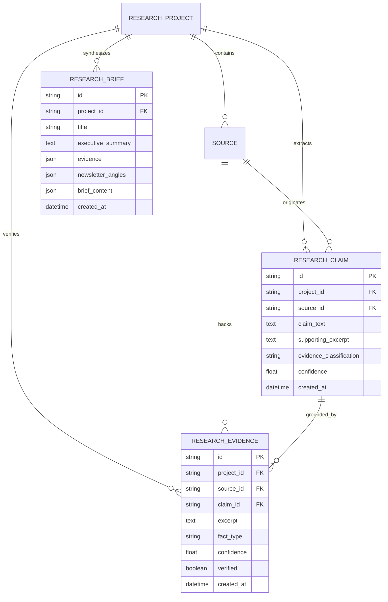

# Evidence Model & Claim Verification Specification

## 1. Overview

The **Evidence Model** is the epistemic foundation of the **AI Editorial Workspace**. It prevents ungrounded AI hallucinations by enforcing an audit trail between every factual claim in a research brief and the exact quoted passages of primary sources.

---

## 2. Epistemic Classification Framework

Every extracted assertion is categorized into one of five rigorous alignment statuses:

| Status | Alignment Definition | Confidence Threshold | Typical Example |
| :--- | :--- | :---: | :--- |
| **`SUPPORTED`** | Direct verbatim or high-fidelity match found in primary source document. | $0.90 \le c \le 1.00$ | *"Model achieves 96.7% accuracy on ARC-AGI benchmark."* |
| **`PARTIALLY_SUPPORTED`** | Passage provides partial context or requires analytical deduction to bridge assertion. | $0.70 \le c < 0.90$ | *"Inference costs increase substantially under test-time reasoning."* |
| **`UNSUPPORTED`** | Assertion lacks supporting passage in verified source text. | $0.00 \le c < 0.50$ | *"The lab plans to lay off 50% of infrastructure engineers."* |
| **`CONTRADICTED`** | Primary source text explicitly disputes, refutes, or contradicts the claim. | $0.80 \le c \le 1.00$ | Claim: *"Model uses 4 layers."* Source: *"Model has 32 layers."* |
| **`NOT_VERIFIABLE`** | Forward-looking speculation, subjective marketing projection, or opinion. | $0.20 \le c < 0.50$ | *"Autonomous agents will replace all software engineers by 2028."* |

---

## 3. Relational Database Schema



### 3.1 Field Specifications

#### `research_claims`
- `id` (UUIDv4): Unique identifier.
- `project_id` (UUIDv4, FK): Foreign key to `research_projects.id` with `ON DELETE CASCADE`.
- `source_id` (UUIDv4, FK): Foreign key to `sources.id` with `ON DELETE CASCADE`.
- `claim_text` (Text): The exact assertion made.
- `supporting_excerpt` (Text): The exact or near-verbatim quote from the source supporting the claim.
- `evidence_classification` (String): `DIRECTLY_STATED`, `REPORTED_BY_SOURCE`, `INFERENCE`, `UNVERIFIED`.
- `confidence` (Float): Scoring from $0.0$ to $1.0$.

#### `research_evidence`
- `id` (UUIDv4): Unique identifier.
- `project_id` (UUIDv4, FK): Foreign key to `research_projects.id` with `ON DELETE CASCADE`.
- `source_id` (UUIDv4, FK): Foreign key to `sources.id` with `ON DELETE CASCADE`.
- `claim_id` (UUIDv4, FK, Nullable): Foreign key to `research_claims.id` with `ON DELETE SET NULL`.
- `excerpt` (Text): The backing passage in the document.
- `fact_type` (String): `DIRECT_FACT`, `REPORTED_FACT`, `ANALYTICAL_INFERENCE`.
- `confidence` (Float): Reliability metric.
- `verified` (Boolean): Flag indicating passing audit check.

---

## 4. Grounding Algorithm

The verification algorithm audits candidate claims against source bodies using normalized sub-string matching and sliding window semantic similarity:

```python
def verify_claim_grounding(claim_text: str, excerpt: str, source_body: str) -> dict:
    normalized_source = re.sub(r'\s+', ' ', source_body).strip().lower()
    normalized_excerpt = re.sub(r'\s+', ' ', excerpt).strip().lower()

    if not normalized_excerpt:
        return {
            "status": "NOT_VERIFIABLE" if is_speculative(claim_text) else "UNSUPPORTED",
            "grounded": False,
            "confidence": 0.20
        }

    is_grounded = normalized_excerpt in normalized_source
    if is_grounded:
        return {
            "status": "SUPPORTED",
            "grounded": True,
            "confidence": 0.96
        }
    else:
        return {
            "status": "PARTIALLY_SUPPORTED",
            "grounded": False,
            "confidence": 0.65
        }
```

---

## 5. Cross-Source Corroboration

The system tracks corroboration by checking whether other sources in the active project discuss or substantiate the same core entities or findings:
- **Corroborated Finding**: Multiple independent sources report the same observation without direct quote sharing.
- **PR Echo Finding**: Multiple sources share identical marketing phrasing or identical quotes, indicating reliance on a vendor press release rather than independent investigation.
- **Conflicting Finding**: Two sources make mutually exclusive claims regarding the same technical milestone.
