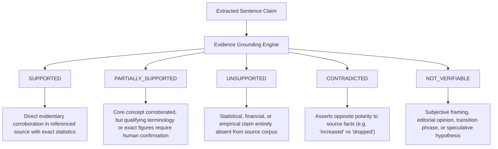

# Factual Claim Verification & Hallucination Detection

## 1. Core Principle

> [!IMPORTANT]
> **Factual Verification Disclaimer**: Automated AI verification is an evidentiary assessment mechanism, not an absolute guarantee of real-world truth. Grounding verifies that assertions in drafts match corroborated statements within ingested reference materials.

Semantic similarity alone is **never** treated as proof of factual accuracy. Numeric statistics, percentages, currency valuations, and dates require strict corroboration.

---

## 2. Five-State Claim Verification Taxonomy

The `ClaimVerificationService` (`backend/app/services/ai/claim_verification_service.py`) analyzes draft sentences and segments them into five distinct verification states:



---

## 3. Citation Integrity Taxonomy

Every cited source reference tag (e.g. `[1]`, `[2]`, `[Source: alpha]`) is audited for citation integrity:

| Citation Status | Description | Action Required |
|---|---|---|
| `VALID` | Inline tag points to an existing, verified project source whose content substantiates the claim. | None; evidence linked. |
| `MISSING` | Factual or numerical assertion has no inline citation marker, despite being verifiable in the sources. | Suggest inserting citation tag. |
| `FABRICATED` | Inline citation references a non-existent source index (e.g. `[999]`) not in the project workspace. | Flag as invalid citation token. |
| `TAMPERED` | Cites a valid source, but numbers or statistics in the draft contradict the values in that source. | Alert editor to corrupted data. |

---

## 4. Verification Algorithms

### 4.1 Statistical & Numeric Figure Extraction
Extracts currency expressions, percentages, and numerical quantities:
```regex
(\$[\d\.]+\s*(?:million|billion|trillion|M|B)?|\b\d+(?:\.\d+)?%|\b\d+(?:,\d+)*(?:\.\d+)?\b)
```
Any figure in the draft that cannot be found verbatim in the source corpus immediately triggers an `UNSUPPORTED` flag.

### 4.2 Semantic Contradiction Detection
Detects opposing polarities between draft claims and source excerpts:
- `increased` vs `dropped`, `decreased`, `fell`, `reduced`
- `succeeded` vs `failed`, `missed`
- `approved` vs `rejected`

When contradictory polarity is detected with shared topical nouns, the claim is flagged as `CONTRADICTED` with an explicit warning.

### 4.3 Jaccard Token Overlap Scoring
Token overlap against referenced source text:
$$\text{Overlap} = \frac{|T_{\text{claim}} \cap T_{\text{source}}|}{|T_{\text{claim}}|}$$
- $\text{Overlap} > 0.45$: `SUPPORTED`
- $0.25 < \text{Overlap} \le 0.45$: `PARTIALLY_SUPPORTED`
- $\text{Overlap} \le 0.25$: `UNSUPPORTED`

---

## 5. UI Integration & Human-in-the-Loop Audit

The **Quellen & Vertrauen (Context Verify)** interface (`/observability`) displays:
- **Source Trustworthiness %**: Real-time aggregated confidence across all citations.
- **Misinformations-Index %**: Ratio of ungrounded or contradicted claims to total assertions.
- **Per-Source Citation Audit**: Lists exact citations count, verified URLs, and attributed model.

