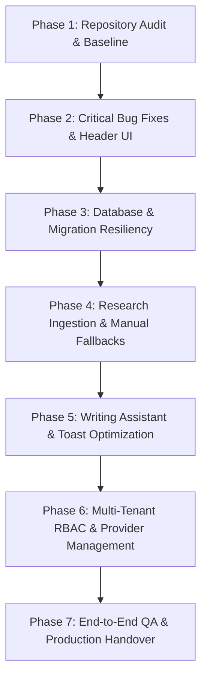

# Implementation Roadmap & System Prioritization

**Project:** AI Editorial Workspace  
**Status:** In Progress & Continuously Verified  
**Baseline Date:** November 2, 2026

---

## Roadmap Phases & Priority Matrix

### Stage 1: Critical Bug Fixes & Top-Right Header User Profile (COMPLETED)
- **Problem**: Header lacked a dedicated user profile avatar and account details dropdown. Rate limiter crashed on missing `import sys` when running outside pytest. Multiple duplicate toast notifications stacked up on writing audits.
- **Action**:
  - Implemented `UserProfileMenu.tsx` with user initials, role indicator, active organization badge, navigation links to Settings & Organization, and sign-out controls.
  - Added `import sys` to `backend/app/main.py`.
  - Added toast deduplication and maximum limit in `Toast.tsx`.
  - Restricted "Writing quality audit completed." toast to explicit user clicks only.

### Stage 2: Database Migration Resiliency (COMPLETED)
- **Problem**: Missing `0d95531a1a07` migration caused `sqlite3.OperationalError: no such column: research_projects.organization_id` in CI.
- **Action**:
  - Built Alembic migration `0d95531a1a07` with dynamic `sa.inspect` table and column checks.
  - Ensures clean execution on both fresh databases and pre-existing local databases without data loss.
  - Seeded default global style profile in migration, lifespan handler, and pytest fixtures.

### Stage 3: Source Extraction Resiliency & Manual Content Fallbacks (COMPLETED)
- **Problem**: Sources failing network extraction (due to SSRF blocks, paywalls, or unreachable domains) locked projects with fewer than 3 verified sources without an in-place recovery path.
- **Action**:
  - Added `PUT /api/v1/sources/{source_id}` in backend routes and schemas.
  - Added "Paste Text / Provide Content" inline editor and "Retry" button directly on failed source cards in `ResearchPage.tsx`.
  - Allows immediate verification of article content without deleting and recreating projects.

### Stage 4: AI Provider Multi-Engine Adapter & Configuration (NEXT IMPLEMENTATION)
- **Goal**: Expand settings view to allow users to toggle between OpenAI, Google Gemini, Anthropic Claude, and Groq with live credential validation.
- **Tasks**:
  1. Verify provider connectivity testing endpoint (`POST /api/v1/integrations/validate`).
  2. Implement bounded retries and exponential backoff for rate-limited requests.
  3. Support user-configurable model temperatures and style constraints.

### Stage 5: Production Deployment & Docker Containerization
- **Goal**: Single-command containerized spin-up.
- **Tasks**:
  1. Optimize multi-stage `Dockerfile` for frontend and backend.
  2. Maintain `docker-compose.yml` with health checks and volume persistence.
  3. Add automated GitHub Actions deployment smoke test.
