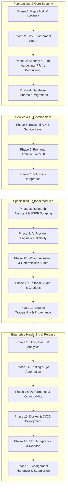

# AI Editorial Workspace — Master Implementation Roadmap (Phases 1–18)

**Project:** AI Editorial Workspace  
**Repository:** [https://github.com/mubashirhussen/AI-Editorial-Workspace](https://github.com/mubashirhussen/AI-Editorial-Workspace)  
**Target:** Forward Deployed Engineer Intern — *This Week in AI*  
**Architecture:** React 18, TypeScript, Python, FastAPI, SQLAlchemy 2.0, PostgreSQL / SQLite, Docker  

---

## 1. 18-Phase Execution Matrix

---

## 2. Phase-by-Phase Roadmap Specifications

| Phase | Title | Primary Objective | Deliverable Documents | Status |
| :---: | :--- | :--- | :--- | :---: |
| **1** | Repository Audit & Baseline Verification | Comprehensive code & config audit, test baseline, PR #1 analysis. | `docs/IMPLEMENTATION_STATUS.md` `docs/FULL_STACK_AUDIT.md` `docs/IMPLEMENTATION_ROADMAP.md` `docs/DATABASE_AUDIT.md` `docs/API_INTEGRATION_MATRIX.md` `docs/KNOWN_ISSUES.md` | **COMPLETED** |
| **2** | Development Environment & Configuration | Clean Windows/PowerShell and Docker setup, template configs. | `docs/DEVELOPMENT_SETUP.md` | **READY** |
| **3** | Security & Authentication Hardening | Resolve PR #1 `JWT_SECRET`/`ENCRYPTION_KEY` coupling, credential rotation. | `docs/SECURITY_AUDIT.md` `docs/AUTHENTICATION_GUIDE.md` `docs/SECRET_MANAGEMENT.md` `docs/THREAT_MODEL.md` | **READY** |
| **4** | Database Architecture & Migrations | 34 relational tables, Alembic chain, data retention policy. | `docs/DATABASE_ARCHITECTURE.md` `docs/ENTITY_RELATIONSHIP_DIAGRAM.md` `docs/DATABASE_MIGRATION_GUIDE.md` `docs/DATA_RETENTION_POLICY.md` | **READY** |
| **5** | Backend API & Service Implementation | Standardized REST error envelopes, route modularization, pagination. | `docs/BACKEND_ARCHITECTURE.md` `docs/API_DOCUMENTATION.md` `docs/API_ERROR_HANDLING.md` | **READY** |
| **6** | Frontend Architecture & User Interface | React 18 SPA, Tailwind tokens, theme toggling, user profile in header. | `docs/FRONTEND_ARCHITECTURE.md` | **READY** |
| **7** | Frontend & Backend Integration | Verification of all 5 critical user journeys, zero mock APIs. | `docs/FULL_STACK_INTEGRATION.md` `docs/API_INTEGRATION_MATRIX.md` `docs/USER_WORKFLOW_MAP.md` | **READY** |
| **8** | Research Assistant Implementation | $\ge 3$ sources, 4-tier scraper, socket DNS SSRF, epistemic separation. | `docs/RESEARCH_ASSISTANT_GUIDE.md` `docs/SOURCE_EXTRACTION_ARCHITECTURE.md` `docs/EVIDENCE_AND_CLAIM_MODEL.md` | **READY** |
| **9** | AI Provider Integration & Reliability | Multi-provider router (Groq/OpenAI/Claude/Gemini) + offline fallback. | `docs/AI_PROVIDER_ARCHITECTURE.md` `docs/AI_RELIABILITY.md` `docs/AI_COST_AND_USAGE.md` | **READY** |
| **10** | Writing Assistant Implementation | 6 deterministic Hemingway checks (< 15ms), Flesch score, safe replacement. | `docs/WRITING_ASSISTANT_GUIDE.md` `docs/EDITORIAL_RULES.md` `docs/DRAFT_VERSIONING.md` | **READY** |
| **11** | Editorial Studio & Content Generation | 300–500-word draft, numbered citations `[1]`, `[2]`, multi-format exports. | `docs/EDITORIAL_STUDIO_GUIDE.md` `docs/ARTICLE_GENERATION_PIPELINE.md` `docs/CITATION_FORMAT.md` | **READY** |
| **12** | Source Traceability & Evidence Verification | Unbroken chain of custody, contradiction handling, citation integrity. | `docs/EVIDENCE_TRACEABILITY.md` `docs/CLAIM_VERIFICATION.md` | **READY** |
| **13** | Dashboard, Analytics & Activity Tracking | DB-backed metrics, audit logs, provider usage events, data isolation. | `docs/DASHBOARD_METRICS.md` `docs/ACTIVITY_TRACKING.md` `docs/ANALYTICS_ARCHITECTURE.md` | **READY** |
| **14** | Testing & Quality Assurance | Automated test execution, code coverage, bug tracker, zero fake tests. | `docs/TEST_STRATEGY.md` `docs/QA_REPORT.md` `docs/TEST_COVERAGE.md` `docs/BUG_TRACKER.md` | **READY** |
| **15** | Performance & Reliability Engineering | Latency profiling, connection pooling, SRE ring buffer, alert thresholds. | `docs/PERFORMANCE_REPORT.md` `docs/RELIABILITY_ENGINEERING.md` `docs/OBSERVABILITY_GUIDE.md` | **READY** |
| **16** | Docker, CI/CD & Deployment | Multi-stage Dockerfiles (non-root `appuser`), Nginx proxy, 4 CI workflows. | `docs/DOCKER_GUIDE.md` `docs/DEPLOYMENT_GUIDE.md` `docs/CI_CD_GUIDE.md` `docs/BACKUP_RECOVERY.md` `docs/PRODUCTION_READINESS.md` | **READY** |
| **17** | End-to-End Acceptance & Release Verification | Clean environment acceptance against all FDE requirements. | `docs/FINAL_RELEASE_AUDIT.md` `docs/END_TO_END_TEST_REPORT.md` `docs/FINAL_SECURITY_CHECKLIST.md` `docs/ASSIGNMENT_ACCEPTANCE_MATRIX.md` `docs/FINAL_RELEASE_REPORT.md` | **READY** |
| **18** | Assignment Documentation & Final Submission | Submission summary, demo script, sample editorial, handover package. | `README.md` `docs/PRODUCT_ENGINEERING_NOTE.md` `docs/SAMPLE_EDITORIAL.md` `docs/BEFORE_AFTER_EDITORIAL.md` `docs/FINAL_PRESENTATION_SCRIPT.md` `docs/SUBMISSION_SUMMARY.md` | **READY** |
