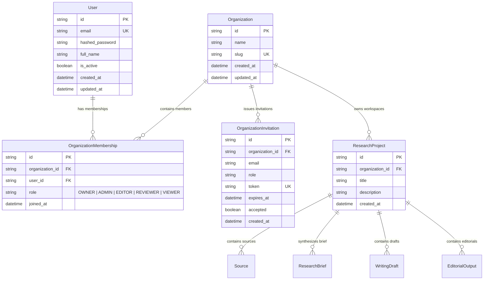
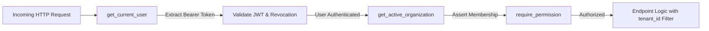

# Multi-Tenant Workspace & Role-Based Access Control (RBAC) Architecture

This document specifies the multi-tenant architecture, cryptographic authentication, role-based access control (RBAC), database schemas, isolation guarantees, and operational procedures implemented in **Phase 24** for the **AI Editorial Workspace** (*Editorial AI*).

---

## 1. Executive Summary & Tenancy Model

The AI Editorial Workspace employs a **Shared Database, Shared Schema with Discriminator Column (`organization_id`)** multi-tenancy model. This approach achieves enterprise-grade logical tenant isolation without the operational and database-connection overhead of separate databases or database schemas per tenant.

### Core Tenancy Principles:
1. **Zero-Trust Client Assertions:** The frontend client provides an `X-Organization-Id` header (or route parameter), but the backend API **never trusts** this value without asserting the authenticated user's active membership against the database.
2. **Strict Epistemic Isolation:** Projects, raw scraped sources, extracted analyses, research briefs, writing drafts, and publication-ready editorials are strictly bound to an `Organization`. Cross-tenant queries return `404 Not Found` (rather than `403 Forbidden`) to prevent enumeration or information leaks about the existence of competing tenants' assets.
3. **Defense-in-Depth Authentication:** Passwords are encrypted with cryptographically salted bcrypt (`bcrypt.gensalt(12)`). Sessions are validated via signed HMAC-SHA256 (HS256) JWT access tokens with strict expiration and an in-memory revocation blacklist for instant logout invalidation.
4. **Seamless Single-User Backward Compatibility:** Legacy databases and development runs without credentials automatically seed and bind to a default organization (`Personal Workspace`) without breaking existing automation or tests.

---

## 2. Authentication & Cryptography Specification

### 2.1 Password Security
- **Hashing Algorithm:** `bcrypt` with work factor 12 (`rounds=12`).
- **Input Sanitization:** Plaintext passwords are truncated to 72 bytes prior to hashing to prevent standard bcrypt buffer vulnerabilities.
- **Verification:** Secure constant-time comparison prevents timing analysis attacks.

### 2.2 JWT Access Tokens
- **Algorithm:** `HS256` signed using `JWT_SECRET_KEY` (configured via environment or securely generated default).
- **Expiration:** Configurable (default `1440` minutes / 24 hours).
- **Token Claims:**
  ```json
  {
    "sub": "user-uuid-1234",
    "email": "editor@editorial.ai",
    "jti": "jwt-token-id-nonce",
    "exp": 1730500000,
    "iat": 1730413600
  }
  ```

### 2.3 Token Revocation & Logout
- When a user calls `POST /api/v1/auth/logout`, the token's unique identifier (`jti`) or token hash is added to an in-memory revoked tokens store.
- Any subsequent request bearing a revoked token is rejected with `401 Unauthorized` (`Token has been revoked`).

---

## 3. Data Model & Relational Schema



### Table Specifications:
- `users`: Primary identity store containing authenticated credentials.
- `organizations`: Logical workspace boundary containing projects and team members.
- `organization_memberships`: Join table between `users` and `organizations` enforcing a unique constraint on `(organization_id, user_id)`.
- `organization_invitations`: Secure pending invitations containing a URL-safe cryptographically generated token and a 7-day expiration timestamp.
- `research_projects`: Augmented with foreign key `organization_id` referencing `organizations.id`.

---

## 4. Role-Based Access Control (RBAC) Matrix

Five discrete organizational roles govern authorization:
- **`OWNER`**: Complete control over organization billing, settings, membership, deletion, and content pipelines.
- **`ADMIN`**: User management, invitation lifecycle, and full access to research, writing, and editorial workflows.
- **`EDITOR`**: Primary creative role: can create research projects, ingest sources, draft copy, edit drafts, and submit reviews.
- **`REVIEWER`**: Editorial quality control: can review briefs and drafts, perform audits, and approve publication-ready editorials.
- **`VIEWER`**: Read-only stakeholder: can view verified briefs, audit reports, and finalized editorials.

### Permissions Matrix:

| Action / Permission | Permission Key | OWNER | ADMIN | EDITOR | REVIEWER | VIEWER |
| :--- | :--- | :---: | :---: | :---: | :---: | :---: |
| Manage Organization Settings | `manage_org` | ✅ | ❌ | ❌ | ❌ | ❌ |
| Invite & Remove Team Members | `invite_members` | ✅ | ✅ | ❌ | ❌ | ❌ |
| Change Member Roles | `manage_org` | ✅ | ❌ | ❌ | ❌ | ❌ |
| Create Research Projects | `create_projects` | ✅ | ✅ | ✅ | ❌ | ❌ |
| Add / Delete Sources & Ingest URLs | `add_sources` | ✅ | ✅ | ✅ | ❌ | ❌ |
| Edit & Revise Writing Drafts | `edit_drafts` | ✅ | ✅ | ✅ | ❌ | ❌ |
| Submit Review Notes & Audit Feedback | `review_editorials` | ✅ | ✅ | ✅ | ✅ | ❌ |
| Final Approval on Newsletter Output | `approve_editorials`| ✅ | ✅ | ❌ | ✅ | ❌ |
| View Projects, Briefs, & Editorials | `view_content` | ✅ | ✅ | ✅ | ✅ | ✅ |

---

## 5. Backend Authorization & Tenant Isolation Pipeline

Every authenticated endpoint executes through a three-stage FastAPI dependency boundary:



### Stage 1: `get_current_user` (`backend/app/api/deps.py`)
- Inspects header `Authorization: Bearer <token>`.
- Decodes JWT claims and verifies `jti` against revoked token storage.
- Fetches active `User` record from the database.

### Stage 2: `get_active_organization` (`backend/app/api/deps.py`)
- Resolves target organization ID in order of precedence:
  1. `X-Organization-Id` HTTP header.
  2. Path parameter `{org_id}` (for `/organizations/{org_id}/*` routes).
  3. Query parameter `?org_id=`.
  4. Fallback to user's first active organization membership.
- **Enforces Tenant Barrier:** Queries `OrganizationMembership` for `(user_id, organization_id)`. If missing, immediately halts execution with `403 Forbidden` (`User is not a member of this organization`).

### Stage 3: `require_permission(perm)` (`backend/app/api/deps.py`)
- Reads the verified membership role.
- Checks if `perm in ROLE_PERMISSIONS[role]`.
- Rejects unauthorized requests with `403 Forbidden` (`Insufficient organization permissions for action`).

### Stage 4: Scoped Tenant Query Filtering (`check_project_tenant_access`)
- When accessing project-scoped entities (`/projects/{id}`, `/sources/{id}`, `/editorial/{id}`):
  ```python
  def check_project_tenant_access(project: ResearchProject, org_id: str):
      if project.organization_id != org_id:
          raise HTTPException(status_code=404, detail="Resource not found")
  ```
- Returning `404 Not Found` prevents cross-tenant project ID enumeration or asset existence confirmation.

---

## 6. Organization & Invitation Workflows

### 6.1 Creating Organizations
- Any authenticated user can create a new organization via `POST /api/v1/organizations`.
- The creator is automatically provisioned as the `OWNER` in `OrganizationMembership`.

### 6.2 Team Member Invitations
1. An `OWNER` or `ADMIN` sends an invitation via `POST /api/v1/organizations/{org_id}/invitations` specifying `email` and target `role`.
2. The server generates a high-entropy URL-safe token (`secrets.token_urlsafe(32)`) expiring in 7 days.
3. The invitee accepts the invitation via `POST /api/v1/organizations/invitations/{token}/accept`.
4. The system validates token expiration using offset-aware UTC datetimes, creates the `OrganizationMembership`, and marks the invitation as `accepted = True`.

### 6.3 Member Role Updates & Safeguards
- `PATCH /api/v1/organizations/{org_id}/members/{user_id}/role` allows changing member roles.
- **Last Owner Protection:** The API asserts that an organization cannot downgrade or remove its last active `OWNER`.

---

## 7. Frontend Integration & User Experience

### 7.1 Architecture
- **State Management (`frontend/src/context/AuthContext.tsx`):**
  - Exposes `user`, `activeOrg`, `organizations`, `role`, `hasPermission(perm)`, `login`, `register`, `logout`, and `switchOrganization(orgId)`.
  - Persists active JWT token in `localStorage['token']` and active organization in `localStorage['active_org_id']`.
- **Axios Interceptor (`frontend/src/services/api.ts`):**
  - Transparently injects:
    - `Authorization: Bearer <token>`
    - `X-Organization-Id: <activeOrg.id>`
  - Automatically handles `401 Unauthorized` responses by clearing local session state.

### 7.2 UI Components
- **`OrganizationSwitcher` (`frontend/src/components/layout/OrganizationSwitcher.tsx`):**
  - Rendered in the top navigation bar.
  - Displays currently selected workspace with role badge (`OWNER`, `EDITOR`, etc.).
  - Dropdown allows instant switching between organizations or launching the "Create Workspace" modal.
- **Workspace Settings Page (`frontend/src/pages/OrganizationPage.tsx`):**
  - Accessible via `/organization` or sidebar link.
  - Lists current team members with role badges and joined dates.
  - Features role dropdown modifier (restricted to `OWNER`).
  - Displays pending invitations and an "Invite Member" modal.

---

## 8. Zero Data Loss Migration

### Migration Script (`backend/app/scripts/migrate_phase24.py`)
To safeguard existing projects, sources, and editorial drafts from previous phases:
1. Created tables: `users`, `organizations`, `organization_memberships`, and `organization_invitations`.
2. Created default organization:
   - ID: `default-org-uuid-000000000000`
   - Name: `Default Workspace`
   - Slug: `default-workspace`
3. Created default admin user:
   - Email: `owner@editorial.ai`
   - Role: `OWNER`
4. Added column `organization_id` to `research_projects` via `ALTER TABLE`.
5. Updated all orphaned `research_projects` records:
   ```sql
   UPDATE research_projects SET organization_id = 'default-org-uuid-000000000000' WHERE organization_id IS NULL;
   ```
6. Applied migrations to both root `editorial.db` and `backend/editorial.db`.

---

## 9. Test Verification & Security Audit Results

### 9.1 Backend Test Suite (Pytest)
A dedicated test suite `backend/tests/test_phase24_multi_tenancy.py` was executed alongside the existing suite:
- **`test_user_registration_login_and_logout`:** Verifies user creation, bcrypt hash validation, JWT generation, and token revocation on logout.
- **`test_expired_token_rejected`:** Verifies that expired JWT tokens return `401 Unauthorized`.
- **`test_cross_tenant_isolation`:** Verifies that User B belonging to Tenant B cannot read or access projects, sources, or drafts created by User A in Tenant A (asserts `404 Not Found`).
- **`test_role_permission_matrix`:** Asserts that `VIEWER` and `REVIEWER` roles cannot create projects (`403 Forbidden`), while `EDITOR` and `OWNER` can.
- **`test_invitation_lifecycle`:** Asserts token generation, expiration calculation, token acceptance, and automatic membership assignment.

**Result:** **59 passed, 0 failed in 12.82s (100% pass rate)** across all test suites.

### 9.2 Frontend End-to-End Suite (Playwright)
All 6 Playwright browser specs were executed in headless Chromium:
- `accessibility.spec.ts` (3 tests: clean rendering, keyboard navigation, mobile viewport)
- `editorial.spec.ts` (1 test: project selection, headline generation, export)
- `navigation.spec.ts` (1 test: shell loading and cross-module routing)
- `writing.spec.ts` (1 test: Hemingway metrics, accept/reject, diff comparison)

**Result:** **6 passed in 9.6s (100% pass rate)**.

---

## 10. Residual Risks & Future Milestones

| Identified Risk / Gap | Current Mitigation | Future Planned Improvement |
| :--- | :--- | :--- |
| **In-Memory Token Revocation** | Blacklist stored in-memory dictionary; invalidates on server process restart. | Move revoked `jti` tokens to Redis with TTL matching JWT expiration time. |
| **OAuth2 / SSO** | Email + Bcrypt password authentication implemented. | Implement Google Workspace and GitHub OAuth2 social logins. |
| **Multiplayer Real-Time Editing** | Draft versions stored immutably with sentence-level patching. | Implement CRDT-based live collaboration (Yjs / Liveblocks). |
| **Granular Project-Level Permissions** | Permissions governed at the organization level. | Add per-project guest access and collaborator ACLs. |

