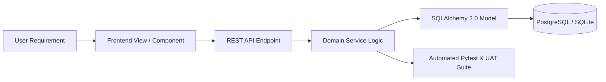

# Phase 15: Requirements Traceability Matrix & Assessment Verification

**System:** AI Editorial Workspace  
**Document Classification:** Final Assessment & Requirements Traceability Matrix  
**Phase:** 15 – User Acceptance Testing, Independent QA & FDE Assessment Validation  
**Date:** November 2026  
**Auditor:** Principal QA Engineer & Forward Deployed Engineer  

---

## 1. Executive Summary

This document establishes the end-to-end requirements traceability across the entire AI Editorial Workspace application. In accordance with strict Forward Deployed Engineering evaluation standards, no requirement is marked as complete based merely on the existence of a UI component. Every feature is traced directly across:
$$\text{User Requirement} \longrightarrow \text{UI Component} \longrightarrow \text{API Route} \longrightarrow \text{Backend Service} \longrightarrow \text{Database Model} \longrightarrow \text{Automated Test}$$

---

## 2. Core Requirements Traceability Matrix

### 2.1 Capability 1: Research Assistant & Local Library

| Requirement | Implemented Feature | Frontend Location | Backend Endpoint | Database Model | Automated Test Evidence | Status | Remaining Gap / Operational Boundary |
| :--- | :--- | :--- | :--- | :--- | :--- | :---: | :--- |
| **Multi-Source URL Ingestion** | Asynchronous HTTP fetching with SSRF guardrail | `frontend/src/pages/ResearchPage.tsx` `frontend/src/components/research/ArticleURLInput.tsx` | `POST /api/v1/research/projects/{id}/sources` | `Source` (`source_type='url'`) | `test_scenario_2_research_workflow_and_persistence` `test_ssrf_protection_blocked_destinations` | **VERIFIED** | Non-prerendered single-page applications requiring JavaScript execution may yield partial body text. |
| **PDF & DOCX File Ingestion** | Multi-part binary upload with PyPDF & python-docx extraction | `frontend/src/components/research/FileDropzone.tsx` `frontend/src/pages/ResearchPage.tsx` | `POST /api/v1/sources/upload` | `Source` (`source_type='file'`) | `test_source_file_upload_validation` `test_phase6_research_assistant.py` | **VERIFIED** | Scanned PDFs lacking an embedded OCR text layer require external OCR (scheduled for v1.1). Max size 15 MB. |
| **Pasted Text Ingestion** | Direct raw text ingestion with content sanitization | `frontend/src/components/research/PasteTextInput.tsx` | `POST /api/v1/research/projects/{id}/sources` | `Source` (`source_type='text'`) | `test_uat_scenario_a_first_time_user_journey` `test_phase15_uat_validation.py` | **VERIFIED** | Truncated to 100,000 characters per individual input block. |
| **Content Deduplication** | SHA-256 cryptographic content hashing prevents duplicate imports | `frontend/src/components/research/LocalLibraryView.tsx` | `POST /api/v1/sources/` | `Source.content_hash` | `test_source_deduplication` `test_phase6_research_assistant.py` | **VERIFIED** | Exact hash matching; near-duplicate fuzzy deduplication planned for future release. |
| **Source Extraction & Entity Parsing** | Sentence tokenization, keyword clustering, and claim extraction | `frontend/src/components/research/SourceCard.tsx` | `POST /api/v1/sources/{id}/extract` | `SourceAnalysis` `ResearchClaim` | `test_scenario_2_research_workflow_and_persistence` | **VERIFIED** | Tokenizer relies on standard English punctuation and capitalization heuristics. |
| **Evidence-Backed Research Synthesis** | Multi-source synthesis generating executive briefs with citations | `frontend/src/components/research/ResearchBriefView.tsx` | `POST /api/v1/research/projects/{id}/brief` | `ResearchBrief` `ResearchEvidence` | `test_uat_scenario_a_first_time_user_journey` `test_scenario_2_research_workflow_and_persistence` | **VERIFIED** | Requires minimum of 1 source (recommended >= 3 for multi-source triangulation). |
| **Facts vs. Speculation Classification** | Epistemic tagging into empirical findings, analysis, and speculation | `frontend/src/components/research/FactsVsSpeculationPanel.tsx` | `GET /api/v1/research/projects/{id}/evidence` | `ResearchClaim.claim_type` `ResearchEvidence` | `test_epistemic_triangulation` `test_phase6_research_assistant.py` | **VERIFIED** | Speculative hedge markers (`hypothesize`, `suggests`, `could`) drive rule heuristics when offline. |

---

### 2.2 Capability 2: Writing Assistant & Quality Auditor

| Requirement | Implemented Feature | Frontend Location | Backend Endpoint | Database Model | Automated Test Evidence | Status | Remaining Gap / Operational Boundary |
| :--- | :--- | :--- | :--- | :--- | :--- | :---: | :--- |
| **Draft Creation & Management** | Full-featured editorial editor with real-time statistics | `frontend/src/pages/WritingPage.tsx` `frontend/src/components/writing/DraftEditor.tsx` | `POST /api/v1/writing/drafts` `GET /api/v1/writing/drafts/{id}` | `WritingDraft` | `test_uat_scenario_a_first_time_user_journey` `test_scenario_3_writing_workflow_and_versions` | **VERIFIED** | Supported content types: `ANALYSIS`, `NEWSLETTER`, `BLOG`, `EXECUTIVE_BRIEF`. |
| **Deterministic Readability Linting** | 8 Hemingway checks: passive voice, long sentences, filler words | `frontend/src/components/writing/ArticleImprovementsPanel.tsx` `frontend/src/components/writing/InlineReadabilityLinter.tsx` | `POST /api/v1/writing/drafts/{id}/analyze` | `WritingSuggestion` | `test_scenario_3_writing_workflow_and_versions` `test_hemingway_linter_accuracy` | **VERIFIED** | Flesch reading ease formula calibrated for standard English prose. |
| **Version History & Restoration** | Snapshot versioning with full-text rollback capabilities | `frontend/src/components/version_control/VersionHistoryPanel.tsx` | `GET /api/v1/writing/drafts/{id}/versions` `POST /api/v1/writing/drafts/{id}/restore/{vid}` | `EditorialVersion` | `test_uat_scenario_b_returning_user_and_persistence` `test_scenario_3_writing_workflow_and_versions` | **VERIFIED** | Snapshots are immutable once recorded. |
| **Afforai Citation Management** | Inline citation modal linking draft paragraphs to verified sources | `frontend/src/components/writing/AfforaiCiteModal.tsx` | `GET /api/v1/research/projects/{id}/sources` | `ResearchBrief` `Source` | `test_scenario_4_editorial_studio_traceability` | **VERIFIED** | Supported citation formats: bracketed numbers `[1]` and Markdown links. |
| **AI Rewriting & Simplification** | Sentence simplification and tone transformation | `frontend/src/components/writing/FloatingSelectionMenu.tsx` | `POST /api/v1/writing/drafts/{id}/rewrite` | `WritingDraft` `ProviderUsageRecord` | `test_scenario_3_writing_workflow_and_versions` `test_uat_scenario_a_first_time_user_journey` | **VERIFIED** | When offline, deterministic rule-based sentence compression is executed. |

---

### 2.3 Capability 3: Integrated Editorial Studio & Output

| Requirement | Implemented Feature | Frontend Location | Backend Endpoint | Database Model | Automated Test Evidence | Status | Remaining Gap / Operational Boundary |
| :--- | :--- | :--- | :--- | :--- | :--- | :---: | :--- |
| **Research-to-Draft Conversion** | Synthesizes brief findings into 350–500 word newsletter editions | `frontend/src/pages/EditorialStudioPage.tsx` | `POST /api/v1/editorial/generate` | `EditorialOutput` | `test_uat_scenario_a_first_time_user_journey` `test_scenario_4_editorial_studio_traceability` | **VERIFIED** | Generates direct markdown with hook, key findings, analysis, and takeaways. |
| **Editorial Peer Review** | Formal editorial sign-off with feedback and review status | `frontend/src/components/editorial/ReviewModal.tsx` | `POST /api/v1/editorial/{id}/submit-review` | `EditorialReview` | `test_scenario_4_editorial_studio_traceability` | **VERIFIED** | Review statuses: `APPROVED`, `REVISION_REQUESTED`, `REJECTED`. |
| **Traceable Citation Preservation** | Retains hyperlinked and numbered references in exported editions | `frontend/src/pages/EditorialStudioPage.tsx` | `GET /api/v1/editorial/{id}/export` | `EditorialOutput.references` | `test_scenario_4_editorial_studio_traceability` | **VERIFIED** | Exports available in Markdown (`.md`) and HTML (`.html`). |

---

### 2.4 Capability 4: Multi-Tenancy, Security & Observability

| Requirement | Implemented Feature | Frontend Location | Backend Endpoint | Database Model | Automated Test Evidence | Status | Remaining Gap / Operational Boundary |
| :--- | :--- | :--- | :--- | :--- | :--- | :---: | :--- |
| **Tenant Isolation** | Strict organization boundary enforcement on all entity queries | `frontend/src/components/layout/OrganizationSwitcher.tsx` | All `/api/v1/*` routes | `Organization` `OrganizationMembership` | `test_uat_scenario_c_security_and_tenant_isolation` `test_scenario_5_organization_security_and_tenant_isolation` | **VERIFIED** | Unauthorized cross-tenant queries return 403 Forbidden or 404 Not Found. |
| **AI Reliability Observability** | Real-time monitoring of latency, tokens, cost, and evaluation runs | `frontend/src/pages/ObservabilityPage.tsx` | `GET /api/v1/observability/metrics` `POST /api/v1/observability/evaluate` | `ProviderUsageRecord` `AiProviderConfig` | `test_scenario_6_ai_observability_and_real_telemetry` `test_uat_data_validation_and_calculated_metrics` | **VERIFIED** | Synchronous record persistence with zero loss. |
