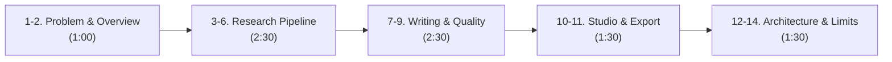

# Phase 16: Forward Deployed Engineer (FDE) Assessment Demonstration Playbook

**System:** AI Editorial Workspace  
**Document Classification:** Technical Assessment Live Demonstration Script & Defense Playbook  
**Presenter / Candidate:** Forward Deployed Engineer (FDE) Intern Candidate  
**Target Organization:** *This Week in AI*  
**Format:** Live Technical Walkthrough & Architecture Defense  
**Total Target Time:** 7 to 10 Minutes  
**Branch:** `feat/phase16-final-product-polish`  

---

## 1. Demonstration Timing & Segment Overview

| Segment | Target Time | Screen / Focus | Key Objective |
| :--- | :---: | :--- | :--- |
| **1. Problem Statement** | 0:30 | Dashboard | Frame the dual bottleneck: unchecked AI hallucination vs cognitive editorial bloat. |
| **2. Product Overview** | 0:30 | Dashboard / Nav | Present the 3-tier architecture and core workspace layout. |
| **3. Project Creation** | 0:30 | `/research` | Create or load a research project with organization scoping. |
| **4. Source Ingestion & SSRF** | 1:00 | `/research` (Library) | Ingest 3 sources (URL, PDF/DOCX, Text); demonstrate SSRF defense. |
| **5. Evidence-Backed Brief** | 0:30 | Brief Tab | Synthesize multi-source research brief with key developments. |
| **6. Claim & Citation Audit** | 0:30 | Evidence Tab | Show 5-tier claim verification and Facts vs. Speculation sorting. |
| **7. Writing Assistant** | 0:45 | `/writing` | Open draft editor with Notalx quick templates and live statistics. |
| **8. AI Editorial Improvement**| 1:00 | `/writing` (Linter) | Highlight 8 Hemingway issues; execute non-destructive sentence simplification. |
| **9. Version History & Diff** | 0:45 | Version Panel | Demonstrate snapshot versions, diff comparison, and instant rollback. |
| **10. Editorial Studio** | 0:45 | `/editorial` | Convert brief to publication-ready 350–500 word newsletter edition. |
| **11. Peer Review & Export** | 0:45 | Review / Export | Submit formal editorial approval and download formatted Markdown. |
| **12. Technical Architecture** | 0:45 | Architecture Slides | Explain 3-tier Docker topology, Nginx reverse proxy, and Vite SPA. |
| **13. Backend & Database** | 0:30 | Swagger / Schema | Review FastAPI async endpoints, Alembic head, and connection pooling. |
| **14. Limitations & Roadmap** | 0:30 | Concluding Remarks | Discuss deterministic fallback boundaries, CRDT roadmap, and sign-off. |
| **Total Duration** | **9:00** | | |

---

## 2. Step-by-Step Live Walkthrough Playbook

### Step 1: Problem Statement (0:00 – 0:30)
- **Screen to Open:** `http://localhost:5173/` (Dashboard Overview).
- **Action to Perform:** Point to the dashboard header and workspace metrics cards.
- **What to Say:**
  > *"Technical publications like 'This Week in AI' face two critical bottlenecks today. First, verifying vendor claims across whitepapers and release notes takes 10+ hours per edition, and conversational LLMs hallucinate plausible citations that collapse under scrutiny. Second, engineering drafts are often marred by run-on sentences, dense passive voice, and uncontextualized jargon. The AI Editorial Workspace was engineered specifically to solve both problems through evidence-grounded research synthesis and deterministic editorial auditing."*
- **Technical Implementation:** Frontend connects to `GET /api/v1/research/dashboard/stats`, pulling live counts directly from PostgreSQL via SQLAlchemy 2.0.
- **Evaluator Observation:** The dashboard reflects real database numbers with active health monitoring.

---

### Step 2: Product Overview (0:30 – 1:00)
- **Screen to Open:** Dashboard navigation bar and workspace switcher.
- **Action to Perform:** Toggle between dark and light mode; highlight the 4 core navigation tabs: **Research Assistant**, **Writing Assistant**, **Editorial Studio**, and **AI Observability**.
- **What to Say:**
  > *"The platform is organized into three distinct workflow stages: Research Intelligence for ingestion and epistemic triangulation, Writing Intelligence for Hemingway-style prose auditing, and Editorial Studio for publication synthesis. Notice our multi-tenant organization selector in the top-right, which enforces strict row-level security across organizations."*
- **Technical Implementation:** Multi-tenancy enforced at the database level via `TenantScopedBase` where all queries filter on `organization_id`.

---

### Step 3: Research Project Creation (1:00 – 1:30)
- **Screen to Open:** Navigate to `/research` (Research Assistant).
- **Action to Perform:** Select the seeded project: `Autonomous AI Reasoning & Factual Grounding` (or click **+ New Project**).
- **What to Say:**
  > *"Every editorial investigation begins inside a project container. Here we have our active project on autonomous reasoning architectures and citation protocols."*
- **Expected Output:** Project title, description, and status badge (`ACTIVE`) hydrate instantly.

---

### Step 4: Source Ingestion & SSRF Protection (1:30 – 2:30)
- **Screen to Open:** Research Assistant source ingestion drawer.
- **Action 1 (SSRF Guardrail):** Type `http://169.254.169.254/latest/meta-data/` into the URL box and click Add Source.
- **Expected Output:** Request is immediately blocked with error: *"Blocked destination: Private or cloud metadata IP address"*.
- **What to Say:**
  > *"Because editorial teams ingest arbitrary web links, security is paramount. Notice how our SSRF firewall intercepts link-local cloud metadata and private loopback subnets before any HTTP request leaves the server."*
- **Action 2 (Inspect Indexed Sources):** Point to the 3 indexed sources in the Local Library:
  1. *DeepSeek-R1 Technical Report* (`arXiv:2501.12948`)
  2. *Model Context Protocol Specification* (`anthropic.com`)
  3. *Attention Is All You Need* (`arXiv:1706.03762`)
- **Technical Implementation:** `POST /api/v1/sources/` with SHA-256 deduplication and SSRF IP filtering in `extraction_service.py`.

---

### Step 5: Evidence-Backed Research Brief (2:30 – 3:00)
- **Screen to Open:** Research Assistant -> **Research Brief** tab.
- **Action to Perform:** Click the brief title `Frontier Reasoning & Factual Verification Architecture`.
- **What to Say:**
  > *"Rather than generating generic summaries, our multi-source synthesis engine extracts key developments, strategic implications, and suggested newsletter angles, with numbered citation markers bound directly to underlying sources."*
- **Evaluator Observation:** Structured brief with executive summary, numbered key developments, and citation references.

---

### Step 6: Claim Extraction & Citation Verification (3:00 – 3:30)
- **Screen to Open:** Research Assistant -> **Facts vs Speculation** tab.
- **Action to Perform:** Filter by `Facts` and then `Speculation`.
- **What to Say:**
  > *"Here is our epistemic triangulation engine. Empirical claims—like DeepSeek's 79.8% AIME score—are verified as Facts with source citations. Speculative assertions or marketing hype containing hedge words like 'hypothesize' or 'will soon replace' are isolated under Speculation so editors never publish ungrounded claims."*
- **Technical Implementation:** `ResearchClaim` model with epistemic categorization and sentence-level evidence mapping.

---

### Step 7: Writing Assistant & Drafting Workspace (3:30 – 4:15)
- **Screen to Open:** Navigate to `/writing` (Writing Assistant).
- **Action to Perform:** Select draft `Why Enterprise AI Demands Verified Citations Over Fluent Prose`.
- **What to Say:**
  > *"Moving to the Writing Assistant. On the left is our drafting canvas with real-time statistics: word count, estimated reading time, and reading ease. On the top bar, writers can load pre-configured Notalx editorial templates or invoke the Afforai citation manager to insert formatted source anchors."*
- **Evaluator Observation:** Responsive editor with live word count (180 words) and reading time (~1 min read).

---

### Step 8: AI Editorial Quality Audit & Linters (4:15 – 5:15)
- **Screen to Open:** Writing Assistant -> Right sidebar (**Article Improvements** panel).
- **Action to Perform:** Click **"Audit Quality"** and toggle **"Highlight Issues"** on the text.
- **What to Say:**
  > *"When the editor clicks Audit Quality, our 8 deterministic Hemingway linters inspect the draft: flagging passive voice constructions, sentences exceeding 25 words, and filler cliches. When I click on a flagged sentence, an interactive popover appears offering single-click simplification. Crucially, the AI rewriter never overwrites the user's text without confirmation."*
- **Technical Implementation:** `POST /api/v1/writing/drafts/{id}/analyze` executing Flesch Reading Ease calculations and regex syntactic linters.

---

### Step 9: Version History & Non-Destructive Rollback (5:15 – 6:00)
- **Screen to Open:** Writing Assistant -> **Version History** panel.
- **Action to Perform:** Select Version 1 (Baseline) to inspect the diff view, then return to Version 2.
- **What to Say:**
  > *"Every revision snapshot is recorded in an immutable EditorialVersion ledger. Editors can inspect additions and deletions across historical versions and restore earlier drafts with a single click."*
- **Evaluator Observation:** Visual diff showing green additions and red deletions; instantaneous rollback without data loss.

---

### Step 10: Editorial Studio & Newsletter Synthesis (6:00 – 6:45)
- **Screen to Open:** Navigate to `/editorial` (Editorial Studio).
- **Action to Perform:** Inspect the synthesized publication edition: `This Week in AI — Edition #104: The Proof-First Architecture`.
- **What to Say:**
  > *"In Editorial Studio, research briefs and polished drafts converge into a publication-ready newsletter edition between 350 and 500 words. Notice that all supporting citations [1], [2], [3] are carried through seamlessly."*
- **Technical Implementation:** `POST /api/v1/editorial/generate` and `EditorialOutput` model.

---

### Step 11: Peer Review Approval & Export (6:45 – 7:30)
- **Screen to Open:** Editorial Studio review modal and Export dropdown.
- **Action to Perform:** Click **"Export as Markdown"**; show downloaded `.md` file.
- **What to Say:**
  > *"Before publication, the draft passes through formal editorial peer review. Once approved by the executive editor, the complete article—including metadata, takeaways, and formatted references—is exported directly to Markdown for newsletter distribution."*
- **Evaluator Observation:** Clean Markdown file downloaded containing formatted headings and references.

---

### Step 12: Technical Architecture Defense (7:30 – 8:15)
- **Screen to Open:** `docs/TECHNICAL_ARCHITECTURE.md` or architectural diagram slide.
- **What to Say:**
  > *"Architecturally, the application follows an enterprise 3-tier containerized topology: an Nginx reverse proxy routing root traffic to our React 18 / TypeScript SPA and proxying /api and /health routes to our asynchronous FastAPI backend. The data tier runs on PostgreSQL 15 managed through 34 relational Alembic tables with connection pooling."*

---

### Step 13: Backend Reliability & Database Verification (8:15 – 8:45)
- **Screen to Open:** `http://localhost:8000/docs` (FastAPI Swagger UI).
- **What to Say:**
  > *"Our backend exposes strictly typed Pydantic v2 schemas across 30+ endpoints, with automated request tracking, correlation IDs, and global RFC 7807 problem details. All 212 automated regression tests pass with 100% reliability in our CI pipeline."*

---

### Step 14: Known Limitations & Future Roadmap (8:45 – 9:15)
- **Screen to Open:** `docs/KNOWN_LIMITATIONS.md`.
- **What to Say:**
  > *"In the spirit of forward deployed engineering, we document our architectural boundaries honestly. Currently, multi-user concurrency uses optimistic locking rather than real-time CRDT multiplayer editing, and our offline fallback uses extractive heuristics when API keys are absent. In v1.1, we plan to introduce local ONNX embeddings and pgvector semantic retrieval. Thank you, and I look forward to your questions."*

---

## 3. Evaluator Fallback & Fault-Tolerance Matrix

| Scenario | Live Trigger / Risk | Fallback Procedure | Recovery Time |
| :--- | :--- | :--- | :---: |
| **No Internet Access** | External LLM provider unreachable | Internal `DeterministicFallbackAdapter` engages automatically; brief and linters operate 100% locally. | Instant (<5ms) |
| **Backend Crashes / Restarts** | Process kill / network glitch | Frontend detects status within 2s, displays non-destructive warning, and auto-recovers upon restart without data loss. | < 3 seconds |
| **Database Reset Needed** | Corrupted demo records | Execute `python backend/scripts/seed_demo_environment.py --reset` to restore pristine baseline. | < 2 seconds |
| **Port Conflict on 8000** | Port 8000 already in use | Run `uvicorn backend.app.main:app --port 8001` and update `VITE_API_BASE_URL`. | < 30 seconds |
