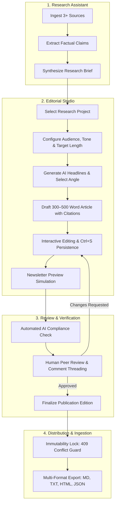

# Phase 21 — Editorial Studio End-to-End Workflow Specification

**Module:** AI Editorial Workspace — Editorial Studio (`/editorial`)  
**Standard:** Enterprise Publication Pipeline & Multi-Tenant Audit Trail  
**Target Word Count:** 300–500 Words (Executive Newsletter Article)  
**Security Model:** Organization Scoping, Strict RBAC, Server-Enforced Identity, Immutability Locking  

---

## 1. Architectural Workflow Diagram

---

## 2. Step-by-Step User Journey Specification

### Step 1: Research Context Ingestion & Synthesis
1. **Source Discovery:** Users ingest minimum 3 credible sources (e.g., technical papers, documentation, transcripts) into a Research Project.
2. **Fact Extraction:** The system identifies claims, metrics, controversies, and entity relationships.
3. **Brief Generation:** The backend synthesizes an executive summary, key findings, and recommended newsletter angles.

### Step 2: Editorial Studio Initialization
1. **Route Access:** User navigates to `/editorial`.
2. **Tenant Scoping:** The frontend verifies active organization context and fetches accessible projects via `GET /api/v1/projects`.
3. **Readiness Verification:**
   - The studio inspects project metadata. If no brief exists, the user is warned and directed back to the Research Assistant.
   - If ready, the project selector loads the active brief and existing draft history (`GET /api/v1/editorial?project_id={id}`).

### Step 3: Parameter Configuration & Headline Selection
1. **Target Parameters:**
   - **Target Audience:** Configurable dropdown (`founders, builders, and operators`, `CTOs and senior software architects`, `AI researchers`, `investors`).
   - **Editorial Tone:** Configurable dropdown (`Newsletter-style`, `Analytical`, `Professional`, `Technical`, `Conversational`).
   - **Target Word Length:** Constrained between 300 and 500 words.
2. **AI Headline Generation:** User triggers `POST /api/v1/editorial/headlines`. The AI model returns tailored headline candidates, each accompanied by an editorial angle and strategic rationale.
3. **Selection:** Selecting a headline populates the editorial workspace and sets the narrative angle.

### Step 4: Article Composition & Citation Grounding
1. **Generation:** User initiates article synthesis via `POST /api/v1/editorial/generate`.
2. **Editorial Structure:**
   - **Lead Hook:** Immediately introduces the operational dilemma or technological breakthrough.
   - **"What Happened":** Concrete factual summary citing verified source documents using bracketed indices (`[1]`, `[2]`).
   - **"Why It Matters":** High-conviction analysis of second-order business and engineering implications.
   - **"The Bottom Line":** Actionable takeaways for decision-makers.
3. **Word Count Compliance:** Automatically tuned to stay within the 300–500 word boundary.
4. **Immediate Persistence:** Backend automatically records the new draft with status `DRAFT_CREATED`.

### Step 5: Interactive Editing & Real-Time Safeguards
1. **Live Markdown Editor:** Users can fine-tune phrasing, refine headers, and update claim citations.
2. **Dirty-State Detection:** An unsaved changes indicator (`● Unsaved Changes (Ctrl+S)`) notifies the user of local deviations from the persisted database state.
3. **Keyboard Shortcut (`Ctrl+S` / `Cmd+S`):** Instantly dispatches a debounced `PUT /api/v1/editorial/{id}` request without requiring UI button clicks.
4. **Navigation Guard:** `window.onbeforeunload` intercepts inadvertent tab closures or page refreshes when uncommitted edits exist.

### Step 6: Multi-View Inspection & Simulation
1. **Newsletter Preview:** Renders the article in an email newsletter template ("This Week in AI • Editorial Edition") showing typography hierarchy, reading time, and interactive source footnotes.
2. **Writing Assistant Handoff:** "Analyze Writing" transfers the draft into the dedicated writing assistant for clarity, tone, and claim verifiability analysis.

### Step 7: Automated Compliance & Peer Review
1. **AI Quality Review:** Dispatches `POST /api/v1/editorial/{id}/ai-review` returning:
   - Word count compliance check (e.g. `385 words / range 300–500` $\to$ `COMPLIANT`).
   - Flesch Reading Ease score and grade level.
   - Citation validation check (verifying every `[n]` corresponds to an ingested project source).
   - Flagged uncertainties and missing structural sections.
2. **Peer Review Submission:** Authenticated reviewers submit feedback (`POST /api/v1/editorial/{id}/reviews`). The reviewer's identity is strictly extracted from the active session (`current_user.full_name or current_user.email`).
3. **Comment Threads:** Reviewers and authors post contextual inline feedback (`POST /api/v1/editorial/{id}/comments`).
4. **Change Request:** If revisions are required, an editor triggers `POST /api/v1/editorial/{id}/request-changes`, setting status to `CHANGES_REQUESTED`.

### Step 8: Publication Approval & Immutability Lock
1. **Approval:** Authorized users (`OWNER`, `ADMIN`, `EDITOR`) trigger `POST /api/v1/editorial/{id}/approve`.
2. **Finalization:** The editor finalizes the edition via `POST /api/v1/editorial/{id}/finalize`.
3. **Immutability Enforcement:**
   - Article status transitions to `FINALIZED`.
   - UI locks the editor to read-only mode and displays a persistent green finalization banner.
   - Database layer rejects any subsequent `PUT` or `DELETE` with HTTP `409 Conflict`.

### Step 9: Multi-Format Distribution & Export
1. **Trigger:** User clicks "Export" in the toolbar (`GET /api/v1/editorial/{id}/export?format={fmt}`).
2. **Supported Formats:**
   - **Markdown (`.md`):** Complete markdown document with publication metadata and reference index.
   - **Plain Text (`.txt`):** Uppercase headings and ASCII bullet points for terminal reading or text messaging.
   - **HTML5 (`.html`):** Inline-styled, responsive HTML designed for Substack, Beehiiv, or custom email templates.
   - **JSON (`.json`):** Structured payload containing headline, word count, status, source citations, and content for automated API pipelines.
3. **Action:** One-click clipboard copy or direct disk download.

