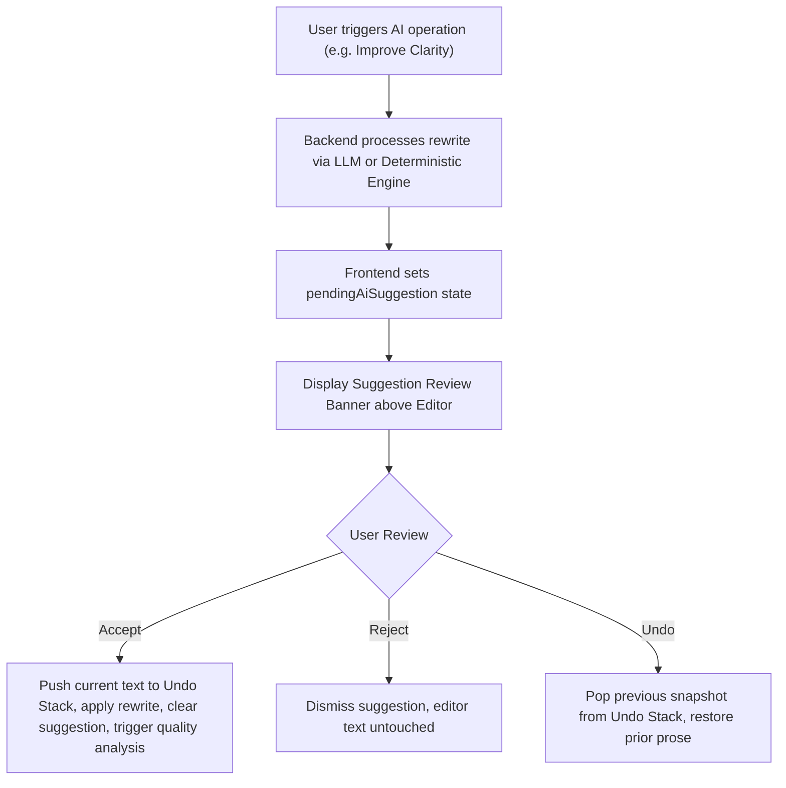

# Phase 23 — AI Writing Assistant & Suggestion Review Architecture

## 1. Overview

The Phase 23 AI Writing Assistant provides surgical, in-context prose optimization across **13 distinct editorial capabilities**. It decouples AI-generated rewrites from editor state, enforcing a non-destructive human-in-the-loop review workflow that protects writers from unintended content loss.

---

## 2. The 13 AI Editorial Capabilities

Every capability is accessible via the top-level capabilities toolbar, the floating contextual selection menu, or custom instructions:

| # | Operation ID | UI Label | Editorial Purpose |
| :- | :--- | :--- | :--- |
| **1** | `improve_clarity` | Improve Clarity | Eliminates ambiguity, simplifies passive phrasing, and clarifies sentence structure. |
| **2** | `fix_grammar` | Fix Spelling & Grammar | Corrects grammatical inconsistencies, typos, subject-verb disagreements, and punctuation. |
| **3** | `improve_readability` | Enhance Readability | Optimizes rhythm and splits overly long sentences for balanced cadence. |
| **4** | `improve_sentence_structure` | Restructure Sentences | Balances compound clauses and converts awkward passive lead-ins into active cadence. |
| **5** | `reduce_repetition` | Remove Repetition | Identifies and removes duplicate phrases, repeated words, and redundant tautologies. |
| **6** | `improve_transitions` | Flow & Transitions | Adds logical connective tissue and connective signposts between ideas. |
| **7** | `adjust_tone` | Adjust Tone | Calibrates voice to authoritative, conversational, analytical, or executive style. |
| **8** | `simplify_language` | Simplify Language | Replaces dense technical jargon and verbose qualifiers with crisp, clear prose. |
| **9** | `summarize_selection` | Make Concise | Condenses passages down to their core thematic thesis without losing meaning. |
| **10** | `expand_content` | Expand Content | Elaborates upon claims with substantive analytical depth and architectural context. |
| **11** | `generate_headlines` | Generate Headlines | Transforms titles into compelling, authoritative journalistic headlines. |
| **12** | `generate_hook` | Intro & Hook | Crafts high-impact introductory hooks and strategic, forward-looking conclusions. |
| **13** | `reorganize_paragraphs`| Reorganize Structure | Evaluates sequence of paragraphs to ensure optimal narrative progression and logic. |

---

## 3. Non-Destructive Suggestion Review Workflow

To eliminate silent overwrites:



### Review Banner Controls
1. **Explanation & Rationale**: Explains the editorial decisions made by the engine.
2. **Side-by-Side Diff Comparison**: Displays original highlighted text on the left and proposed rewrite on the right.
3. **Accept & Apply Rewrite**: Persists the rewrite to editor text.
4. **Reject Suggestion**: Discards the proposal with zero side-effects.
5. **Undo AI Edit**: Restores prior prose from an in-memory snapshot stack if the writer wants to revert.

---

## 4. Citation Safety & Traceability Guarantee

Research-backed writing relies on immutable citation tags (`[1]`, `[2]`, `[3]`).
- Both the AI system prompt (`system_prompt`) and the offline fallback engine (`_deterministic_rewrite_selection`) enforce citation preservation:
  ```python
  citations = re.findall(r'\[\d+\]', text)
  # ... perform rewrite ...
  for cite in citations:
      if cite not in rewritten:
          rewritten += f" {cite}"
  ```
- Ensures that factual citations are never stripped or hallucinated during automated rewrites.
