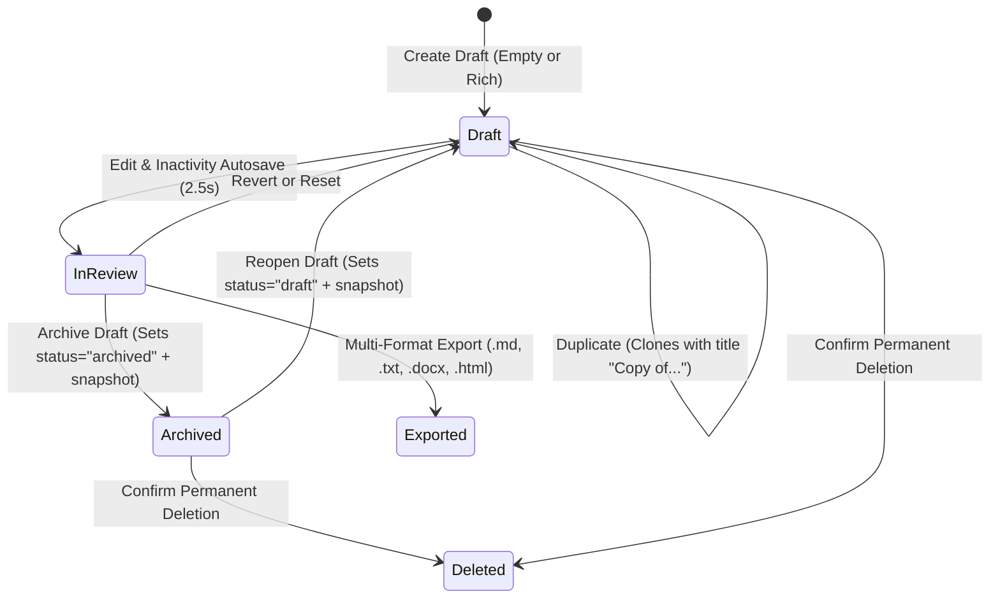

# Phase 23 — Draft Lifecycle & Document Management Architecture

## 1. Overview

Draft management in Phase 23 provides a production-grade document lifecycle for editorial and technical writers. It bridges initial concept synthesis, structured drafting, non-destructive iteration, and long-term archiving with strict multi-tenant isolation.

---

## 2. Document Creation & Rich Metadata

Writers can initialize drafts in two modes:
1. **Empty Workspace Document**: Initialized with clean empty content (`original_content=""`), bypassing legacy empty-text validation errors.
2. **Rich Structured Editorial Draft**: Initialized via the creation modal with comprehensive metadata:
   - `title`: Human-readable identifier.
   - `content_type`: Categorization (`editorial_analysis`, `newsletter`, `technical_explainer`, `op_ed`, `press_release`).
   - `target_audience`: Demographic or technical seniority (`Technical Leaders & Builders`, `Founders & Operators`, `General Public`).
   - `tone`: Publication voice (`authoritative`, `conversational`, `analytical`, `concise`).
   - `desired_length`: Target word count benchmark (e.g. 500, 800, 1200, 2000 words).
   - `project_id`: Optional linkage to an existing research project for evidence grounding and citation retrieval.

---

## 3. Search, Status Filtering & Dynamic Ordering

The backend endpoint `GET /api/v1/writing/drafts` and the frontend **Drafts Library Drawer** provide flexible exploration tools:

### Query Parameters
- `search`: Substring search matching against draft titles.
- `status`: Case-insensitive filter matching lifecycle states (`draft`, `analyzed`, `in_review`, `archived`).
- `sort_by`: Dynamic attribute sorting supporting:
  - `updated_at`: Most recently edited drafts first (default).
  - `created_at`: Chronological creation order.
  - `title`: Alphabetical sorting.
- `sort_order`: Directionality (`asc` or `desc`).

---

## 4. Lifecycle Operations & Non-Destructive Actions

### 4.1 Non-Destructive Duplication (`POST /writing/drafts/{id}/duplicate`)
Clones an existing draft without altering the original. Automatically sets:
- `title = f"Copy of {draft.title}"`
- Inherits `original_content`, `revised_content`, `content_type`, `target_audience`, `tone`, `desired_length`, `project_id`, and `style_profile_id`.
- Records an `INITIAL` version control snapshot for the newly cloned entity.

### 4.2 Archiving (`POST /writing/drafts/{id}/archive`)
Transitions status to `"archived"`, removing it from the active editorial feed while preserving all suggestions, metrics, and version snapshots. Creates a version snapshot with `change_type="STATUS_CHANGE"`.

### 4.3 Reopening (`POST /writing/drafts/{id}/reopen`)
Transitions an archived draft back to `"draft"` status, restoring it to the active workspace.

### 4.4 Permanent Deletion (`DELETE /writing/drafts/{id}`)
Guarded on the frontend by a destructive confirmation modal (`ConfirmDialog`), requiring user confirmation before purging the draft and its suggestions.

---

## 5. Persistence & Inactivity Autosave

To prevent editorial data loss:
- **Debounced Autosave (2.5 seconds)**: Automatically triggers `PUT /api/v1/writing/drafts/{id}` after typing stops.
- **Visual Status Indicator**: Displays real-time state:
  - `SAVING`: Blue spinner indicating active cloud synchronization.
  - `SAVED`: Green badge with exact timestamp of last persistence.
  - `UNSAVED`: Amber pulsating dot indicating local unsaved keystrokes.
  - `OFFLINE`: Fallback storing document state to `localStorage` if connectivity drops.
  - `SAVE_FAILED`: Red indicator with inline one-click retry trigger.
- **Tab Closure Protection (`beforeunload`)**: Intercepts accidental tab navigation or window close while `isDirty` is true.
