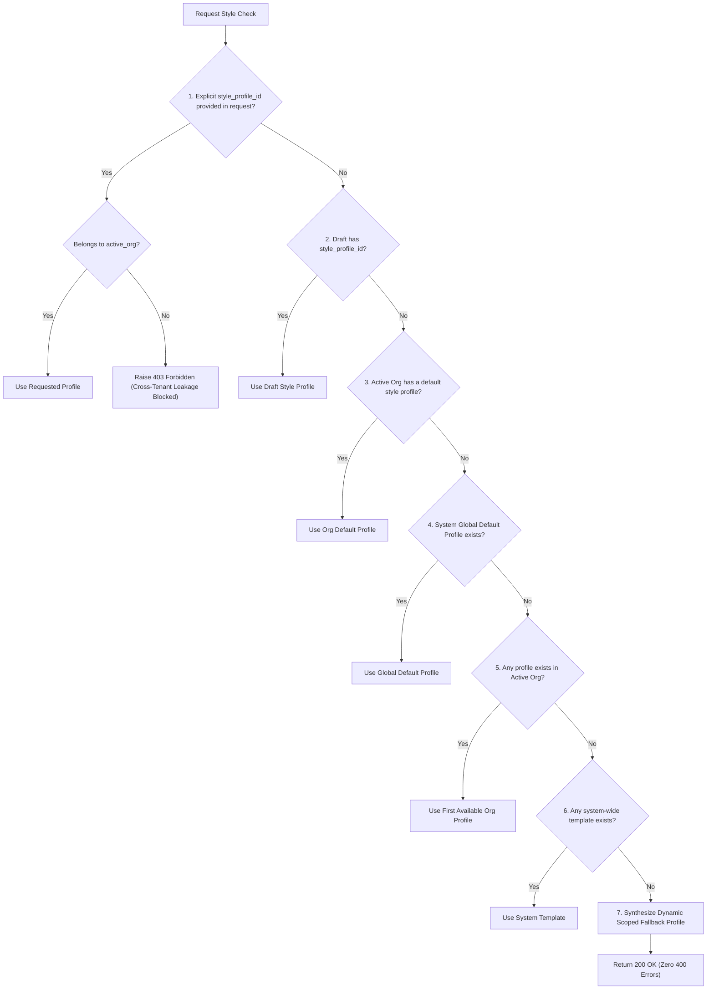

# Phase 23 — Style Profile Management & Tenant Isolation Architecture

## 1. Overview

Editorial style consistency is critical for multi-author publications. Previously, requesting a style check (`POST /api/v1/writing/drafts/{id}/style-check`) in an unconfigured organization or in local development resulted in a fatal exception:
```
400 Bad Request: No active style profile available
```
Phase 23 completely eliminated this error through a robust **Multi-Tiered Resolution Fallback** while preserving strict multi-tenant boundaries.

---

## 2. Multi-Tiered Style Resolution Strategy

When evaluating a draft for style compliance, the system attempts resolution through 7 cascading tiers:



### The Scoped Dynamic Fallback
If no profile exists anywhere in the database, the backend dynamically provisions an in-memory editorial profile scoped to the tenant:
```python
style_profile = EditorialStyleProfile(
    id="default-style-profile-000000000000",
    name="This Week in AI Standard",
    tone="authoritative, technical, rigorous",
    target_audience="Founders, builders, and operators",
    guidelines="Focus on architectural depth, benchmark reproducibility, and practical trade-offs.",
    banned_words=["revolutionary", "game-changing", "groundbreaking", "unbelievable"],
    max_sentence_length=30,
    target_reading_grade="Academic / Complex"
)
```
This guarantees that:
1. Writers always receive actionable feedback.
2. The UI never encounters an unhandled 400 error.
3. Multi-tenant boundaries are strictly upheld—organizations can never access another organization's custom style profile.

---

## 3. Tenant Isolation & Authorization Guardrails

### Isolation Invariant
Drafts and style profiles belonging to Organization A are invisible and inaccessible to Organization B.
- Verified in `backend/tests/test_phase23_writing_assistant.py::test_cross_tenant_isolation_enforcement`:
  - Cross-tenant read: `404 Not Found`
  - Cross-tenant edit: `404 Not Found`
  - Cross-tenant duplicate: `404 Not Found`
  - Cross-tenant delete: `404 Not Found`
- Returning `404 Not Found` instead of `403 Forbidden` prevents attackers from enumerating document UUIDs across organizations.
