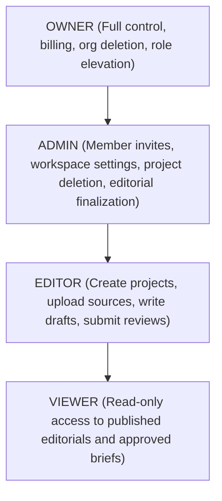

# PHASE 29 — ENDPOINT AUTHORIZATION MATRIX & ACCESS CONTROL POLICIES

## Overview
This document specifies the complete access control requirements, authentication tiers, role-based access control (RBAC) levels, and tenant boundaries enforced across all API endpoints of the **AI Editorial Workspace**.

---

## 1. Role Hierarchy & Permission Levels

| Role | Scope | Key Capabilities | Prohibited Operations |
| :--- | :--- | :--- | :--- |
| **OWNER** | Organization-wide | Transfer ownership, delete organization, manage billing, elevate users to Admin, all Editor actions. | None within own organization. |
| **ADMIN** | Organization-wide | Invite members, modify roles (up to Editor), delete projects, finalize editorials, view audit logs. | Cannot delete organization or remove the Owner. |
| **EDITOR** | Organization-wide | Create projects, extract sources, generate research briefs, edit drafts, request review. | Cannot delete organization, invite members, or approve own drafts. |
| **VIEWER** | Organization-wide | Read project overviews, view finalized drafts, export public documents. | Cannot create or edit projects, upload documents, modify drafts, or view audit logs. |

---

## 2. Global API Authorization Matrix

### 2.1 Authentication & Profile Endpoints

| Method | Endpoint | Auth Required | Org Scoped | Minimum Role | Resource Guard | Unauth / Forbidden Code |
| :--- | :--- | :--- | :--- | :--- | :--- | :--- |
| `POST` | `/api/v1/auth/register` | Anonymous | No | Public | None | `400 Bad Request` |
| `POST` | `/api/v1/auth/login` | Anonymous | No | Public | Rate limited (5 / 60s) | `401 Unauthorized` / `429` |
| `POST` | `/api/v1/auth/refresh` | Bearer JWT | No | User | Token not revoked | `401 Unauthorized` |
| `POST` | `/api/v1/auth/logout` | Bearer JWT | No | User | Token not revoked | `401 Unauthorized` |
| `POST` | `/api/v1/auth/forgot-password`| Anonymous | No | Public | Generic response | `400 Bad Request` |
| `POST` | `/api/v1/auth/reset-password` | Anonymous | No | Public | Single-use crypto token | `400 Bad Request` |
| `POST` | `/api/v1/auth/change-password`| Bearer JWT | No | User | Current password match | `400 Bad Request` |
| `GET` | `/api/v1/auth/me` | Bearer JWT | No | User | Self only | `401 Unauthorized` |
| `GET` | `/api/v1/users/profile` | Bearer JWT | No | User | Self only | `401 Unauthorized` |
| `PUT` | `/api/v1/users/profile` | Bearer JWT | No | User | Self only | `401 Unauthorized` |

---

### 2.2 Projects & Workspace Endpoints

| Method | Endpoint | Auth Required | Org Scoped | Minimum Role | Resource Guard | Violation Response |
| :--- | :--- | :--- | :--- | :--- | :--- | :--- |
| `GET` | `/api/v1/projects` | Bearer JWT | Yes | `VIEWER` | Member of target org | `404 Not Found` |
| `POST` | `/api/v1/projects` | Bearer JWT | Yes | `EDITOR` | Member of target org | `403 Forbidden` |
| `GET` | `/api/v1/projects/{id}` | Bearer JWT | Yes | `VIEWER` | Project belongs to org | `404 Not Found` (Anti-IDOR) |
| `PUT` | `/api/v1/projects/{id}` | Bearer JWT | Yes | `EDITOR` | Project belongs to org | `404 Not Found` |
| `DELETE` | `/api/v1/projects/{id}` | Bearer JWT | Yes | `ADMIN` | Org Admin or Project Creator | `403 Forbidden` / `404 Not Found` |

---

### 2.3 Research Assistant Endpoints

| Method | Endpoint | Auth Required | Org Scoped | Minimum Role | Resource Guard | Violation Response |
| :--- | :--- | :--- | :--- | :--- | :--- | :--- |
| `GET` | `/api/v1/research/sources` | Bearer JWT | Yes | `VIEWER` | Scoped to project org | `404 Not Found` |
| `POST` | `/api/v1/research/sources/url` | Bearer JWT | Yes | `EDITOR` | SSRF inspection on URL | `400 Bad Request` / `403` |
| `POST` | `/api/v1/research/sources/upload` | Bearer JWT | Yes | `EDITOR` | Magic-byte & 10MB limit | `400 Bad Request` / `403` |
| `DELETE` | `/api/v1/research/sources/{id}` | Bearer JWT | Yes | `EDITOR` | Source in project org | `404 Not Found` |
| `POST` | `/api/v1/research/briefs/generate` | Bearer JWT | Yes | `EDITOR` | Project in org | `404 Not Found` |
| `GET` | `/api/v1/research/briefs/{id}` | Bearer JWT | Yes | `VIEWER` | Brief in project org | `404 Not Found` |
| `PUT` | `/api/v1/research/briefs/{id}` | Bearer JWT | Yes | `EDITOR` | Brief in project org | `404 Not Found` |

---

### 2.4 Writing Assistant & Draft Endpoints

| Method | Endpoint | Auth Required | Org Scoped | Minimum Role | Resource Guard | Violation Response |
| :--- | :--- | :--- | :--- | :--- | :--- | :--- |
| `GET` | `/api/v1/writing/drafts` | Bearer JWT | Yes | `VIEWER` | Scoped to project org | `404 Not Found` |
| `POST` | `/api/v1/writing/drafts` | Bearer JWT | Yes | `EDITOR` | Project in caller org | `404 Not Found` |
| `GET` | `/api/v1/writing/drafts/{id}` | Bearer JWT | Yes | `VIEWER` | Draft in caller org | `404 Not Found` (Anti-IDOR) |
| `PUT` | `/api/v1/writing/drafts/{id}` | Bearer JWT | Yes | `EDITOR` | Draft in caller org | `404 Not Found` |
| `POST` | `/api/v1/writing/drafts/{id}/analyze` | Bearer JWT | Yes | `EDITOR` | Draft in caller org | `404 Not Found` |
| `POST` | `/api/v1/writing/drafts/{id}/submit-review` | Bearer JWT | Yes | `EDITOR` | Draft in caller org | `404 Not Found` |

---

### 2.5 Editorial Studio & Publication Workflow Endpoints

| Method | Endpoint | Auth Required | Org Scoped | Minimum Role | Resource Guard | Violation Response |
| :--- | :--- | :--- | :--- | :--- | :--- | :--- |
| `GET` | `/api/v1/editorial/articles` | Bearer JWT | Yes | `VIEWER` | Articles in caller org | `404 Not Found` |
| `POST` | `/api/v1/editorial/articles` | Bearer JWT | Yes | `EDITOR` | Project in caller org | `404 Not Found` |
| `PUT` | `/api/v1/editorial/articles/{id}` | Bearer JWT | Yes | `EDITOR` | Article in caller org | `404 Not Found` |
| `POST` | `/api/v1/editorial/articles/{id}/review` | Bearer JWT | Yes | `ADMIN` / `EDITOR` | **Author cannot review own draft** | `400 Bad Request` / `403` |
| `POST` | `/api/v1/editorial/articles/{id}/approve` | Bearer JWT | Yes | `ADMIN` | **Author cannot approve own draft** | `400 Bad Request` / `403` |
| `POST` | `/api/v1/editorial/articles/{id}/publish` | Bearer JWT | Yes | `ADMIN` | Approved status required | `400 Bad Request` / `403` |
| `GET` | `/api/v1/editorial/articles/{id}/export` | Bearer JWT | Yes | `VIEWER` | Article in caller org; HTML sanitization applied | `404 Not Found` |

---

### 2.6 Organization Management & Governance Endpoints

| Method | Endpoint | Auth Required | Org Scoped | Minimum Role | Resource Guard | Violation Response |
| :--- | :--- | :--- | :--- | :--- | :--- | :--- |
| `GET` | `/api/v1/organizations` | Bearer JWT | Yes | `VIEWER` | Only user's memberships | `401 Unauthorized` |
| `GET` | `/api/v1/organizations/{id}` | Bearer JWT | Yes | `VIEWER` | Member of target org | `404 Not Found` |
| `PUT` | `/api/v1/organizations/{id}` | Bearer JWT | Yes | `ADMIN` | Admin of target org | `403 Forbidden` / `404` |
| `DELETE` | `/api/v1/organizations/{id}` | Bearer JWT | Yes | `OWNER` | **Only Owner can delete** | `403 Forbidden` |
| `GET` | `/api/v1/organizations/{id}/members` | Bearer JWT | Yes | `ADMIN` | Admin of target org | `403 Forbidden` |
| `POST` | `/api/v1/organizations/{id}/members` | Bearer JWT | Yes | `ADMIN` | Admin of target org | `403 Forbidden` |
| `DELETE` | `/api/v1/organizations/{id}/members/{u_id}` | Bearer JWT | Yes | `ADMIN` | Admin cannot remove Owner | `400 Bad Request` / `403` |

---

### 2.7 Observability, Audit Logs & Health Endpoints

| Method | Endpoint | Auth Required | Org Scoped | Minimum Role | Resource Guard | Violation Response |
| :--- | :--- | :--- | :--- | :--- | :--- | :--- |
| `GET` | `/api/v1/health` | Anonymous | No | Public | Standard ping | None |
| `GET` | `/api/v1/ready` | Anonymous | No | Public | Database readiness | `503 Service Unavailable` |
| `GET` | `/api/v1/audit-logs` | Bearer JWT | Yes | `ADMIN` | Scoped strictly to caller's org | `403 Forbidden` |
| `GET` | `/api/v1/observability/metrics` | Bearer JWT | Yes | `ADMIN` | Aggregated per tenant | `403 Forbidden` |

---

## 3. Defense Verification Rules

1. **Anti-Enumeration Contract:** Whenever an authenticated user attempts to access or mutate a resource belonging to another organization, the API **MUST** return `404 Not Found` (never `403 Forbidden` or `401 Unauthorized`). This prevents attackers from enumerating valid resource IDs.
2. **Audit Logging Contract:** Every state-altering call on `/auth/*`, `/organizations/{id}/members`, and `/editorial/articles/{id}/*` generates an immutable audit record in the `AuditLog` table with credential masking.
3. **Session Revocation Contract:** Explicit user logout or password reset must instantaneously invalidate all matching sessions in `UserSession`.
