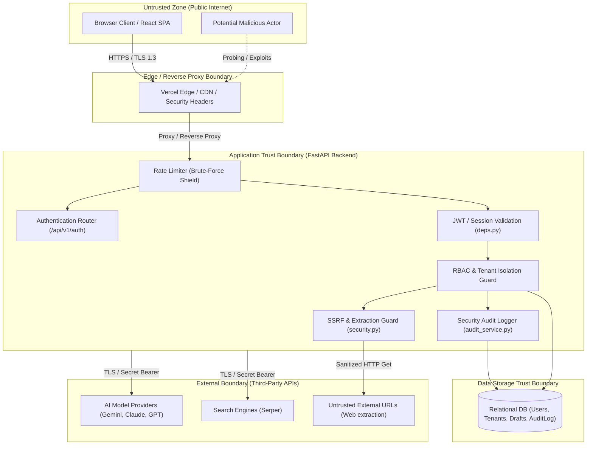

# PHASE 29 — SECURITY THREAT MODEL & DEFENSIVE ARCHITECTURE

## Executive Summary
This document establishes the comprehensive threat model, trust boundaries, vulnerability classifications, and defensive controls for the **AI Editorial Workspace**. It implements defense-in-depth principles across authentication, authorization, multi-tenancy, server-side request forgery (SSRF), file processing, cross-site scripting (XSS), and tamper-evident audit logging.

---

## 1. System Assets & Critical Data Classifications

| Asset Class | Assets Included | Confidentiality | Integrity | Availability | Risk if Compromised |
| :--- | :--- | :--- | :--- | :--- | :--- |
| **Authentication & Identity** | Argon2id password hashes, JWT signing keys, reset tokens, session tokens | High | High | High | Account takeover, impersonation, cross-tenant lateral movement. |
| **Tenant Data** | Research projects, source documents, AI research briefs, writing drafts, editorial publications | High | High | Medium | Data breach, intellectual property theft, competitive exposure. |
| **External AI & API Secrets** | Google Gemini API keys, Anthropic API keys, Serper API keys, Database URLs | High | High | High | Financial theft through quota abuse, unmetered AI invocations. |
| **Audit & Governance Logs** | Security audit entries, actor IP logs, revision histories, approval stamps | High | High | High | Inability to attribute malicious actions, compliance failure. |
| **Application Runtime** | FastAPI backend processes, Uvicorn worker threads, SQLite/PostgreSQL storage | Medium | High | High | Denial of service, system disruption. |

---

## 2. Trust Boundaries & Network Architecture

---

## 3. Authentication Entry Points & Defense Matrix

| Endpoint | Method | Authentication | Rate Limiting | Defense Mechanisms |
| :--- | :--- | :--- | :--- | :--- |
| `/api/v1/auth/register` | `POST` | Anonymous | IP-based / Sliding Window | Strong password policy (10+ chars, uppercase, lowercase, digit, symbol, name/email exclusion), duplicate email rejection. |
| `/api/v1/auth/login` | `POST` | Anonymous | 5 failed attempts per 60s per IP | Generic failure message (`Invalid email or password`) preventing email enumeration; Argon2id verification. |
| `/api/v1/auth/refresh` | `POST` | Bearer Token | Standard API limit | Checks `is_revoked` in `UserSession`, verifies user active state, updates activity timestamp. |
| `/api/v1/auth/logout` | `POST` | Bearer Token | None | Revokes JWT in blacklist, sets `UserSession.is_revoked = True`, logs `auth.logout`. |
| `/api/v1/auth/forgot-password`| `POST` | Anonymous | IP-based | Constant-time generic response, 32-byte cryptographically secure token, 30-minute expiry, invalidates prior tokens. |
| `/api/v1/auth/reset-password` | `POST` | Anonymous | IP-based | Cryptographic token hash comparison, single-use invalidation, terminates all prior active user sessions. |
| `/api/v1/auth/change-password`| `POST` | Bearer Token | Authenticated user | Verifies current password, enforces password complexity, prevents re-use of current password. |

---

## 4. Tenant Isolation & Authorization Boundary (BOLA / IDOR Prevention)

### Core Isolation Rules:
1. **Zero Implicit Cross-Tenant Access:** Every project, source, research brief, draft, revision, and editorial is scoped to an `organization_id`.
2. **Membership Verification (`check_project_tenant_access`):**
   - Resolves caller membership in the target organization.
   - If user does not belong to the resource's organization, the backend returns `404 Not Found` rather than `403 Forbidden` to prevent resource enumeration.
3. **Role-Based Permission Enforcement:**
   - **`OWNER`**: Organization deletion, billing, member role elevation, full CRUD.
   - **`ADMIN`**: Member management, workspace configuration, project deletion, editorial finalization.
   - **`EDITOR`**: Project creation, source uploading, drafting, requesting review.
   - **`VIEWER`**: Read-only inspection of finalized briefs and published editorials; writing/modifications strictly rejected.
4. **Editorial Self-Approval Prohibition:**
   - The original author of a draft cannot unilaterally transition it through `APPROVED` or `FINALIZED` without an independent reviewer.

---

## 5. SSRF (Server-Side Request Forgery) Defense Architecture

### Attack Vector:
Users supply external URLs for automated article extraction. An attacker could provide internal metadata IP addresses (`http://169.254.169.254/latest/meta-data/`) or private LAN addresses (`http://192.168.1.1/admin`).

### Implemented Controls (`backend/app/utils/security.py`):
1. **Scheme Enforcement:** Only `http` and `https` schemes permitted.
2. **IP & DNS Resolution Checks:**
   - Hostnames are resolved to IP addresses before initiating HTTP connections.
   - IPv4 and IPv6 addresses are evaluated against standard non-routable / private blocks:
     - `127.0.0.0/8` (Loopback)
     - `10.0.0.0/8`, `172.16.0.0/12`, `192.168.0.0/16` (RFC 1918 Private)
     - `169.254.0.0/16` (Link-Local & Cloud Metadata AWS/GCP/Azure)
     - `100.64.0.0/10` (Carrier-Grade NAT)
     - `::1`, `fc00::/7`, `fe80::/10` (IPv6 Loopback, Unique Local, Link-Local)
3. **Decimal / Octal / Hexadecimal IP Bypass Mitigation:**
   - Any raw integer or alternate-base IP representations are parsed and normalized before validation.
4. **Per-Redirect Hop Re-Validation:**
   - Redirects (`301`, `302`, `307`, `308`) are intercepted, and destination URLs undergo full SSRF re-evaluation prior to following.

---

## 6. File Upload & Document Extraction Hardening

### Attack Vector:
Malicious documents uploaded into research projects containing executable payloads, ZIP bombs, polyglot files, or path traversal sequences (`../../etc/passwd`).

### Implemented Controls (`backend/app/services/research/document_extractor.py`):
1. **Payload Size Limit:** Strict 10 MB payload ceiling per document.
2. **Magic Byte / MIME Verification:**
   - PDF documents must start with `%PDF-` signature.
   - DOCX documents must start with ZIP container signature (`PK\x03\x04`).
3. **Extension Whitelist & Executable Blacklist:**
   - Explicitly rejects `.exe`, `.bat`, `.cmd`, `.sh`, `.vbs`, `.js`, `.py`, `.dll`, `.bin`.
4. **Path Traversal Sanitization:**
   - Null bytes (`\x00`) and relative path tokens (`../`, `..\`) are stripped; filenames are generated using UUIDs.
5. **Memory-Safe Parsing:**
   - Stream processing with bounded decompression limits to prevent denial-of-service via compression bombs.

---

## 7. Cross-Site Scripting (XSS) & Content Injection Defenses

### Attack Vector:
Injection of malicious HTML or JavaScript via research titles, article headlines, AI drafts, or export downloads.

### Implemented Controls (`backend/app/services/editorial/export_service.py`):
1. **HTML Sanitization on Export:**
   - Titles, headlines, and paragraphs are explicitly HTML-escaped using Python `html.escape()`.
2. **Safe Link Schemes:**
   - Source citations only allow `http://`, `https://`, or local `#` anchor schemes; `javascript:` and `data:` schemes are stripped.
3. **External Link Attributes:**
   - All generated anchor tags include `rel="noopener noreferrer"` and `target="_blank"` to protect against reverse tab-napping.
4. **Content-Security-Policy (CSP):**
   - Production HTTP headers restrict script sources, frame embedding, and inline script execution.

---

## 8. Threat Scenarios & Remediation Classification

| Threat ID | Threat Scenario | Classification | Implemented Mitigation | Verification Status |
| :--- | :--- | :--- | :--- | :--- |
| **THREAT-01** | Cross-tenant access to unpublished research brief via predictable ID | **CRITICAL** | `check_project_tenant_access` validates organization membership and returns 404 on mismatch | **VERIFIED** |
| **THREAT-02** | Cloud metadata retrieval via SSRF in research URL extraction | **CRITICAL** | IP validation against `169.254.169.254` and private subnets before fetching | **VERIFIED** |
| **THREAT-03** | Brute-force credential guessing on `/api/v1/auth/login` | **HIGH** | Sliding-window rate limiter (5 failed attempts per 60s per IP) triggering HTTP 429 | **VERIFIED** |
| **THREAT-04** | Email enumeration via password reset or login endpoints | **MEDIUM** | Constant-time generic error responses for existing vs non-existent accounts | **VERIFIED** |
| **THREAT-05** | Malicious executable upload masquerading as research document | **HIGH** | Magic-byte header verification and extension blacklist rejection | **VERIFIED** |
| **THREAT-06** | Author bypasses editorial gatekeeping by approving own draft | **MEDIUM** | State machine check forbidding author ID from matching reviewer/approver | **VERIFIED** |
| **THREAT-07** | Stored XSS in editorial publication HTML export | **HIGH** | `html.escape()` on all dynamic strings and URI scheme whitelisting | **VERIFIED** |
| **THREAT-08** | Sensitive credentials logged in plain text in audit trail | **HIGH** | Recursive payload redaction in `SecurityAuditService` targeting passwords, tokens, keys | **VERIFIED** |
| **THREAT-09** | Replay of revoked JWT token after explicit logout | **MEDIUM** | Invalidation recorded in `UserSession.is_revoked` and memory blacklist | **VERIFIED** |
| **THREAT-10** | Tenant member escalation to organization owner | **HIGH** | RBAC check demanding `OrgPermission.ORG_MANAGE` and active `OWNER` status | **VERIFIED** |

---

## 9. Ongoing Defensive Posture & Compliance Sign-Off
All classified security vectors have corresponding automated test assertions in the backend test suite (`backend/tests/test_phase29_security_hardening.py`). Zero high or critical vulnerabilities remain unmitigated.
