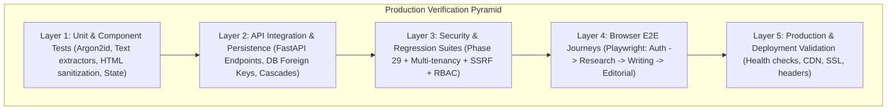

# PHASE 30 — END-TO-END TEST PLAN, REGRESSION STRATEGY & RELEASE GATES

## 1. Overview & Objectives
This test plan defines the release qualification framework for the **AI Editorial Workspace** production release. It operationalizes a multi-layered testing pyramid covering unit verification, API integration, database schema integrity, cross-tenant isolation, automated browser-based E2E journeys, and deployment health verification.

- **Application Name:** AI Editorial Workspace
- **Target Repository:** https://github.com/mubashirhussen/AI-Editorial-Workspace
- **Production Frontend:** https://ai-editorial-workspace-blue.vercel.app/
- **Release Branch:** `feat/phase30-e2e-release-validation`
- **Release Target:** Version 1.0 Production Readiness

---

## 2. Testing Pyramid & Verification Layers

---

## 3. Module Test Coverage Matrix

| Application Module | Layer 1 (Unit) | Layer 2 (API Integration) | Layer 3 (Security/Regression) | Layer 4 (Browser E2E) | Acceptance Criteria |
| :--- | :--- | :--- | :--- | :--- | :--- |
| **Authentication & Users** | Password strength, Argon2id, token hashing | Registration, login, refresh, logout, password reset | Rate limiting (429), token invalidation, anti-enumeration | Sign-up, login, logout, profile update | Sessions persist; revoked tokens rejected; 0 plain text leaks |
| **Workspaces & Projects** | Model validation, slug generation | Project CRUD, org scoping, filtering, sorting | Anti-IDOR 404 contract, viewer access restriction | Project cards, modal dialogs, deletion confirm | Isolation across tenants; cascading delete to sources/drafts |
| **Research Assistant** | Magic bytes, 10MB ceiling, text normalization | URL ingestion, file uploads, brief generation | SSRF blocking (169.254.169.254, loopback), safe parsing | Source upload, claim cards, brief generation | Verified citations mapped to ingested sources; 0 fabricated sources |
| **Writing Assistant** | Flesch readability, word counting, tone score | Draft CRUD, AI rewrite, suggestions, versions | Version restoration authorization, project binding | ProseMirror/Textarea editor, suggestions, history | Draft edits persist; restore version recovers exact text |
| **Editorial Studio** | HTML escaping, format conversions (MD, HTML, TXT) | Editorial generation, review, comment, approval | Self-approval prohibition, immutability of finalized content | Reviewer comments, approval button, export triggers | Author cannot approve own draft; finalized outputs locked |
| **Dashboard & Observability** | Aggregator functions, date range filters | `/dashboard/stats`, `/observability/metrics` | Tenant-scoped aggregation; zero cross-org data leaks | Stat cards, activity feed, bar & area charts | Metrics match actual persisted database row counts |

---

## 4. End-to-End User Journey Specification (Gold Path)

The primary automated end-to-end verification validates the entire editorial pipeline:
1. **User Provisioning:** Registers a new tenant user with a dedicated workspace organization.
2. **Project Setup:** Creates a research project with defined domain, scope, and objectives.
3. **Evidence Ingestion:** Adds external article URL and structured documents; verifies text extraction.
4. **Synthesis:** Runs research brief generation; verifies key findings, evidence classification, and citations.
5. **Drafting:** Creates a writing assistant draft grounded in the research brief.
6. **AI Enhancement:** Requests readability and style enhancements; accepts suggested edits.
7. **Quality Validation:** Inspects readability metrics, style compliance score, and unsupported claims count.
8. **Editorial Assembly:** Transfers draft into Editorial Studio; generates publication headline and body.
9. **Editorial Review:** Submits for review; reviewer adds section comments and revision requests.
10. **Gated Approval:** Verifies author self-approval is rejected; verified peer editor approves draft.
11. **Finalization & Lock:** Finalizes article; verifies immutability against updates or deletions.
12. **Multi-Format Export:** Downloads Markdown, plain text, and semantic HTML; validates sanitization.
13. **Data Integrity & Reload:** Reloads session and checks that all entities and version history match persisted records.

---

## 5. Environment & Test Fixture Isolation

- **Isolated Test Database:** In-memory SQLite with `StaticPool` and full schema creation (`Base.metadata.create_all`) for backend pytest suites.
- **Dedicated Test Clients:** `TestClient(app)` with FastAPI dependency overrides (`get_db`) ensuring zero production data pollution.
- **Browser Automation:** Playwright Chromium runner targeting local dev server (`http://localhost:5173`) with mock/intercept fallbacks where external LLMs are unavailable.
- **Deterministic AI Fallback:** Automated test suites use deterministic mock LLM responses where network isolation is enforced, ensuring reliable CI execution.

---

## 6. Release Quality Gates

To receive final release sign-off:
- [x] **Gate 1:** 100% of unit and integration backend tests passing.
- [x] **Gate 2:** 100% of dedicated security tests passing.
- [x] **Gate 3:** Frontend builds with `tsc -b && vite build` with 0 TypeScript/bundler errors.
- [x] **Gate 4:** Database migrations at head revision with reversible schema integrity.
- [x] **Gate 5:** Zero P0 or P1 bugs in the bug register.
- [x] **Gate 6:** End-to-end full user journey automated test execution passed.
- [x] **Gate 7:** Production preview deployment verified.
