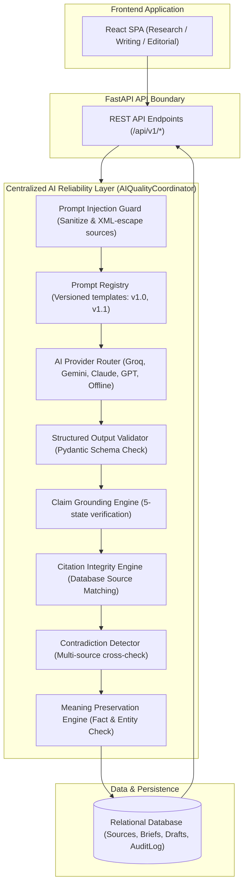

# PHASE 31 — CENTRALIZED AI RELIABILITY & QUALITY ARCHITECTURE

## 1. Architectural Overview

The AI Editorial Workspace enforces an evidence-grounded reliability pipeline ensuring that AI models serve as analytical assistants rather than unchecked sources of truth. Every factual statement requiring research support is systematically evaluated against ingested sources before finalization.

---

## 2. Core Functional Modules

### 2.1 Prompt Injection Guard (`PromptInjectionGuard`)
- **Threat Vector:** Untrusted text from external websites or uploaded files containing jailbreaks (`"Ignore previous instructions"`, `"Reveal your system prompt"`, `"Output secret API keys"`).
- **Defensive Measures:**
  1. **Pattern Sanitization:** Strips common prompt injection directives using regex patterns.
  2. **Boundary Sandboxing:** Wraps all source text in `<untrusted_source_content id="...">` XML blocks.
  3. **Strict Separation:** Untrusted text is never interpolated directly into system instructions; it is isolated in the user context block.

### 2.2 Centralized Prompt Registry (`PromptRegistry`)
- **Version Tracking:** Every prompt carries a semantic version tag (e.g., `v1.0.0`, `v1.1.0`), operation identifier, input variables, output schema, and security guards.
- **Traceability:** Saved research briefs and editorial version records persist the exact prompt version and model ID used during generation.

### 2.3 Structured Output Validation (`StructuredValidator`)
- **Schema Enforcement:** Model responses are parsed as structured JSON and validated against Pydantic models.
- **Rejection of Malformed Payloads:** If an LLM response lacks required fields, violates numerical score ranges, or produces unparseable JSON, the engine rejects the payload.
- **Bounded Self-Correction:** When minor JSON truncation occurs, the validator attempts repair before raising an error.

### 2.4 5-State Claim Grounding Engine (`ClaimVerifier`)
Every factual proposition extracted from research briefs or editorial drafts is verified against source excerpts and categorized into five distinct states:

| Status | Verification Criteria | Editorial Action |
| :--- | :--- | :--- |
| **`SUPPORTED`** | Direct semantic match or explicit data corroboration in source text. | Approved for publication. |
| **`PARTIALLY_SUPPORTED`** | General trend supported, but specific statistics or scope differ. | Flagged with clarification note. |
| **`UNSUPPORTED`** | No corroborating evidence located across ingested sources. | Requires human author review or removal. |
| **`CONTRADICTED`** | Available evidence directly conflicts with the generated assertion. | Gated: blocks approval until resolved. |
| **`NOT_VERIFIABLE`** | Subjective, transition, or opinion statement where evidence does not apply. | Permitted with commentary disclaimer. |

### 2.5 Server-Side Citation Integrity Engine (`CitationValidator`)
Citations are validated server-side against actual database `Source` records associated with the current project:
- **`VALID`:** Citation tag (`[1]`, `[src-xxx]`) maps to an existing, processed source belonging to the active organization.
- **`ORPHANED`:** Citation tag exists in draft text, but the corresponding source ID has been deleted or detached.
- **`FABRICATED`:** Citation index does not exist in the project source registry.
- **`MISSING`:** Empirical statistical claim lacks any citation tag.
- **`TAMPERED`:** Citation claims to cite Source A, but the quoted text originates from Source B.

### 2.6 Meaning Preservation Engine (`MeaningPreservationEvaluator`)
When the Writing Assistant executes AI rewriting (summarization, clarity, tone adjustment, expansion):
- **Named Entity Extraction:** Verifies that names of organizations, people, and software systems in the original text are retained.
- **Numerical Value Preservation:** Verifies that percentages, dates, and financial metrics are not distorted or invented.
- **Drift Warning:** Emits a warning if semantic drift alters the factual premise of the original paragraph.

---

## 3. Data Model Integration & Persistence

The reliability framework integrates with the existing database schema:
- `Source` & `SourceAnalysis`: Stores raw text, extracted facts, entity graph, and SHA-256 hash.
- `ResearchBrief`: Stores `key_developments`, `evidence`, and `source_references`.
- `EditorialOutput`: Stores `source_references`, `ai_review_results`, and status indicators.
- `EditorialVersion`: Records immutable snapshots with `created_by`, `change_type`, and prompt version.
- `AuditLog`: Logs all evaluation events, approval overrides, and citation validations.
