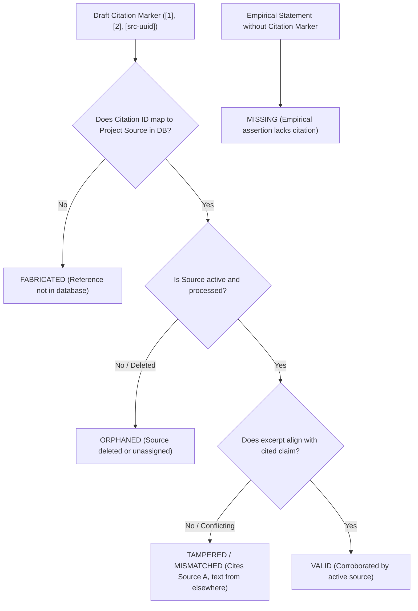

# PHASE 31 — CITATION INTEGRITY & FACTUAL VERIFICATION SPECIFICATION

## 1. Executive Summary
This document specifies the rules, validation algorithms, defect taxonomies, and gatekeeping policies implemented by the **Citation Integrity Engine** within the AI Editorial Workspace. The system guarantees that no generated publication contains hallucinated, orphaned, or fabricated citations.

---

## 2. Citation Defect Taxonomy

The server-side validator inspects all citation markers (`[1]`, `[2]`, `[Source: id]`) in research briefs, drafts, and editorial articles, classifying each into one of five states:



| Classification | Definition | Cause | Gatekeeping Action |
| :--- | :--- | :--- | :--- |
| **`VALID`** | Citation tag maps to an active database `Source` belonging to the current project, and the excerpt corroborates the claim. | Legitimate evidentiary grounding. | **Permit publication.** |
| **`ORPHANED`** | Citation tag references a source ID that previously existed but was deleted or detached from the project. | Source deletion after drafting. | **Block approval** until citation tag is updated or removed. |
| **`FABRICATED`** | Citation marker references an index or ID that never existed in the project database. | LLM hallucination / invented citation. | **Strict blocker:** blocks finalization; flags author for correction. |
| **`MISSING`** | Sentence contains declarative empirical claims (statistics, financial figures, dates) without any citation marker. | Author omitted source attribution. | **Warning issued:** prompts author to attach source or rephrase as opinion. |
| **`TAMPERED`** | Citation claims to corroborate Fact X from Source 1, but the cited text actually discusses unrelated Topic Y. | Context misalignment during rewrite. | **Flagged for editorial peer review.** |

---

## 3. Server-Side Verification Algorithm

```python
def validate_citations_against_database(
    content: str,
    project_sources: List[Source]
) -> CitationValidationResult:
    # 1. Build lookup tables from active database records
    db_source_ids = {s.id for s in project_sources}
    db_indices = {str(i + 1): s.id for i, s in enumerate(project_sources)}
    
    # 2. Extract in-text markers
    markers = extract_citation_markers(content)
    
    # 3. Classify each marker
    for m in markers:
        if m.id in db_source_ids or m.id in db_indices:
            m.status = "VALID"
        else:
            m.status = "FABRICATED"
            
    # 4. Check for ungrounded statistics
    for sentence in extract_empirical_sentences(content):
        if not has_citation_marker(sentence):
            record_missing_citation(sentence)
```

---

## 4. Citation Quality Metrics & Formulas

### 4.1 Citation Validity Rate ($CVR$)
Measures the proportion of cited markers that correspond to real, active database records:
$$CVR = \frac{N_{\text{valid}}}{N_{\text{valid}} + N_{\text{fabricated}} + N_{\text{orphaned}}} \times 100\%$$
- **Target Threshold:** **100%** (zero tolerance for fabricated citations in finalized articles).

### 4.2 Citation Coverage Rate ($CCR$)
Measures the proportion of empirical/factual assertions backed by verified citations:
$$CCR = \frac{N_{\text{grounded\_claims}}}{N_{\text{total\_empirical\_claims}}} \times 100\%$$
- **Target Threshold:** $\ge 85\%$ for analytical research articles.

---

## 5. Review & Finalization Gatekeeping Policies

1. **Self-Approval Guard:** Authors are prevented from unilaterally approving drafts citing unverified claims.
2. **Finalization Hard Block:** The `/api/v1/editorial/{id}/finalize` endpoint executes server-side citation validation; if `N_fabricated > 0` or `N_orphaned > 0`, the endpoint rejects finalization with `409 Conflict`.
3. **HTML Export Sanitization:** Validated citations are rendered as semantic ordered footnotes `<ol class="editorial-references">` with external links carrying `rel="noopener noreferrer"`.
