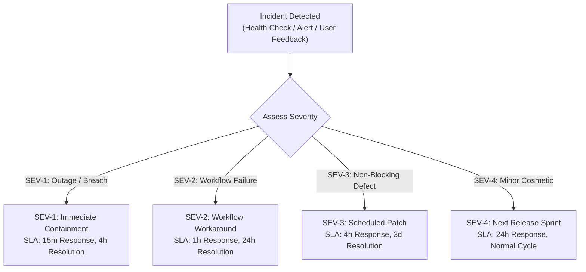

# PHASE 36 INCIDENT RESPONSE PLAYBOOK
## Production Incident Severity Classification, Response Protocols, Containment & Recovery Procedures

**Project:** AI Editorial Workspace — "This Week in AI"  
**Date:** 2026-11-20  
**Target Repository:** [mubashirhussen/AI-Editorial-Workspace](https://github.com/mubashirhussen/AI-Editorial-Workspace)  
**Role:** Senior Forward Deployed Engineer & Production Reliability Engineer  

---

## 1. Incident Severity Definitions & Response SLAs

| Severity Level | Production Impact Scenario | Immediate Escalation Action | On-Call Role |
| :---: | :--- | :--- | :--- |
| **SEV-1 (Critical)** | Application-wide downtime, database corruption, or cross-tenant data leak. | Page on-call FDE, engage fallback mode, freeze deployments. | Lead FDE & Reliability Architect |
| **SEV-2 (Major)** | AI synthesis failing across multiple projects, source ingestion blocked, or authentication degradation. | Enable deterministic offline fallback, investigate provider quotas. | Backend & AI Quality Engineer |
| **SEV-3 (Moderate)** | Export formatting flaw, slow OCR on large PDFs, or readability score anomaly with manual bypass. | Log incident, verify workaround, queue patch in next release. | Full-Stack Engineer |
| **SEV-4 (Minor)** | Minor UI contrast, typo, or non-critical styling defect. | Triage in feedback register, schedule for standard sprint. | QA / Frontend Engineer |

---

## 2. Ten-Step Incident Response Lifecycle

1. **Detection:** Automated probe failure (`/health/ready` returns 503) or critical user feedback submitted via `FeedbackModal`.
2. **Triage & Classification:** Assign severity (SEV-1 through SEV-4) and assign Incident Commander.
3. **Correlation Analysis:** Inspect incoming `X-Request-ID` across structured logs to isolate affected endpoints and tenant scopes.
4. **Immediate Containment:**
   - If AI provider outage: Switch `DEFAULT_AI_PROVIDER=deterministic` in environment.
   - If SSRF attack pattern: Update `is_safe_url` IP blocklist.
5. **Root Cause Analysis (RCA):** Isolate defect in code, database lock, or upstream provider response.
6. **Remediation & Hotfix:** Author targeted fix on isolated hotfix branch.
7. **Regression Validation:** Execute `backend/tests/` and evaluator defense scenarios to confirm zero regressions.
8. **Staged Deployment:** Deploy fix to staging mirror, verify health probes, then release to production.
9. **Post-Recovery Verification:** Perform non-destructive smoke tests in production and verify error rates return to 0%.
10. **Incident Retrospective:** Document root cause, timeline, remediation, and prevention measures in post-mortem report.

---

## 3. Specific Production Outage Playbooks

### Playbook A: Third-Party AI API Outage (OpenAI / Gemini / Groq)
- **Symptom:** AI generation returns 503, 429 rate limit, or timeout exceptions.
- **Automated Response:** The application's `AIRouter` catches the exception and switches dynamically to the local **Deterministic Heuristic Adapter**.
- **Manual Verification Steps:**
  1. Query `curl https://ai-editorial-workspace-blue.vercel.app/api/v1/health`
  2. Inspect `"ai_engine"` block: confirm `"mode": "Deterministic Fallback Engine"` is active.
  3. Verify drafts and briefs continue generating with valid bracket citations.
  4. Once upstream status resolves, verify automatic return to live API mode.

### Playbook B: Database Connection Failure
- **Symptom:** `/health/ready` returns HTTP 503 Service Unavailable (`"database": "disconnected"`).
- **Diagnostics:**
  1. Inspect database file permissions or connection pool limits.
  2. Run `alembic current` to ensure no schema migration lock or mismatch.
  3. Verify disk space on database host.
  4. Restart ASGI process workers (`uvicorn backend.app.main:app`).

### Playbook C: Suspicious SSRF / Malicious URL Ingestion
- **Symptom:** User submits internal network address or cloud metadata endpoint (`169.254.169.254`).
- **Automated Behavior:** `is_safe_url` returns `False`; source extraction is aborted; `source.extraction_status` is marked `"failed"` with explicit security block message.
- **Verification:**
  - Verify that the application made zero outbound network connections to the target IP.
  - Review security audit logs for offending user/IP address.
