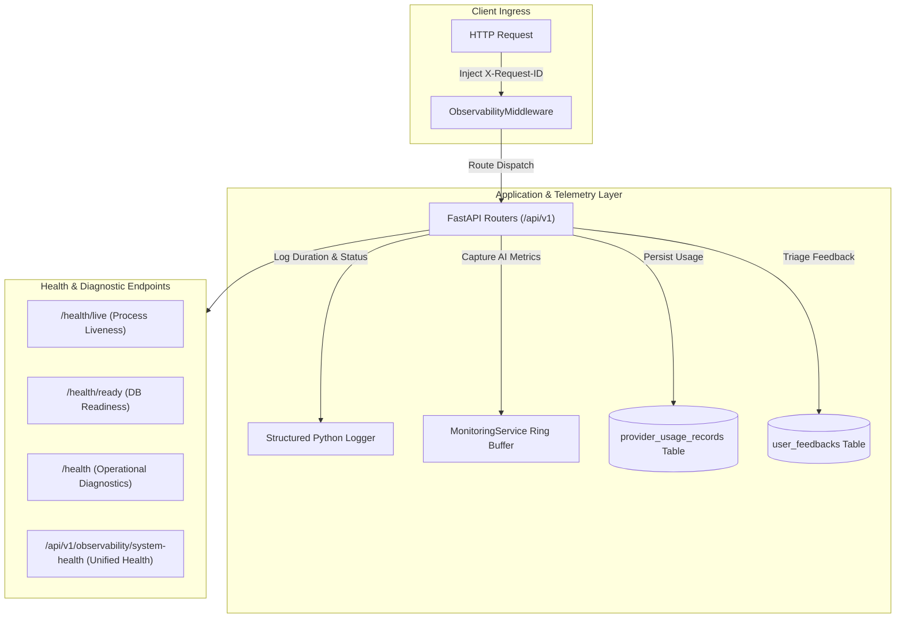
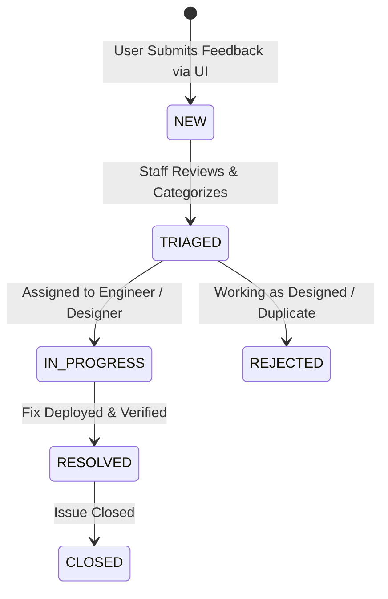

# PHASE 36 MONITORING ARCHITECTURE
## End-to-End System Observability, Centralized Logging, Error Telemetry & Feedback Lifecycle

**Project:** AI Editorial Workspace — "This Week in AI"  
**Date:** 2026-11-20  
**Target Repository:** [mubashirhussen/AI-Editorial-Workspace](https://github.com/mubashirhussen/AI-Editorial-Workspace)  
**Role:** Senior Forward Deployed Engineer & Production Reliability Engineer  

---

## 1. Observability Architecture Overview

The monitoring architecture of the **AI Editorial Workspace** is designed for deep operational visibility without introducing heavy external software dependencies or leaking sensitive editorial text into telemetry logs.



---

## 2. Health Check Specifications

| Endpoint | Target Probe Type | Checks Performed | Success Status | Failure Status | Sensitive Data Safeguards |
| :--- | :--- | :--- | :---: | :---: | :--- |
| **`/health/live`** | Liveness | Verifies that the FastAPI process is active and accepting socket connections. | `200 OK` (`status: "alive"`) | Unreachable / Process Dead | Returns zero host/internal data. |
| **`/health/startup`** | Startup | Verifies initial database connectivity and ORM table availability. | `200 OK` (`status: "started"`) | `503 Unavailable` | Does not reveal database host or password. |
| **`/health/ready`** | Readiness | Executes active `SELECT 1` probe, calculates DB latency, checks optional Redis. | `200 OK` (`status: "ready"`) | `503 Unavailable` (`status: "not_ready"`) | Sanitizes database exception strings to prevent leaking credentials. |
| **`/health`** | Diagnostics | Returns database latency, AI engine mode (Live vs Deterministic Fallback), and recent events. | `200 OK` (`status: "healthy"`) | `200 OK` (`status: "degraded"`) | Excludes user prompts, drafts, or article copy. |
| **`/api/v1/observability/system-health`** | Unified System Health | Cross-subsystem aggregates: project count, source completion/failure ratio, draft count, feedback triage status. | `200 OK` | `500 Internal Error` | Strictly scoped to authenticated organization. |

---

## 3. Centralized Structured Logging & Request Correlation

### Request ID Injection
Every HTTP request passing through `ObservabilityMiddleware` is tagged with an `X-Request-ID` header (UUIDv4):
```python
request_id = request.headers.get("X-Request-ID") or str(uuid.uuid4())
request.state.request_id = request_id
```
The request ID is attached to:
1. Incoming request state.
2. Every structured log entry emitted during request handling.
3. Outgoing HTTP response headers (`expose_headers=["X-Request-ID"]`).
4. Standardized `AppException` error responses, allowing users and frontend error toasts to report the exact correlation ID for support triage.

### Log Hygiene & Privacy Protection
- **Zero Document Leakage:** Raw document excerpts, research notes, and draft bodies are strictly excluded from structured logs.
- **Credential Masking:** Authentication tokens and database passwords are sanitized before log serialization.
- **Log Level Policy:**
  - `INFO`: Normal lifecycle events (user login, brief generation, editorial review status changes).
  - `WARNING`: Handled recoverable edge cases (SSRF rejection, duplicate content hash detected, fallback engine engaged).
  - `ERROR`: Upstream API failures, database connection errors.

---

## 4. AI Reliability & Token Monitoring

The `MonitoringService` and `ProviderUsageRecord` database model track operational performance across all LLM operations:

| Metric | Description | Purpose |
| :--- | :--- | :--- |
| **Operation Type** | `research_synthesis`, `draft_generation`, `headline_generation`, `claim_verification` | Identifies which pipeline stage generated the call. |
| **Provider & Model** | `groq/llama-3.3-70b`, `openai/gpt-4o`, `deterministic_heuristic` | Tracks cost and latency differences across models. |
| **Prompt & Completion Tokens** | Exact token counts parsed from provider response payloads | Provides cost auditing and prevents runaway usage. |
| **Duration (ms)** | Request round-trip time in milliseconds | Detects latency degradation and slow models. |
| **Estimated Cost (USD)** | Calculated via `calculate_estimated_cost(provider, model, prompt_tokens, completion_tokens)` | Real-time budget tracking for enterprise organizations. |
| **Status** | `success`, `fallback`, `failed` | Quantifies failover activation rate. |

---

## 5. User Feedback & Defect Triage System

### Triage Status Lifecycle:


### Feedback Categories:
- `bug_report`: Functional defect or broken UI component.
- `feature_request`: Proposed enhancement or new capability.
- `ux_improvement`: Usability, contrast, or responsiveness suggestion.
- `ai_output_quality`: Hallucination or factual accuracy concern.
- `research_accuracy`: Missing sources or extraction anomaly.
- `citation_issue`: Citation bracket mapping or attribution error.
- `writing_quality`: Readability formula or style guide feedback.
- `editorial_workflow`: Governance review or approval state defect.
- `general`: General commentary or inquiry.

### Data Security & Privacy:
- Scoped to active enterprise organization (`organization_id`).
- Normal users can view only their own submitted feedback; Editors/Admins can triage across their organization.
- Cross-tenant viewing or mutation is rejected with HTTP 403 Forbidden or 404 Not Found.
