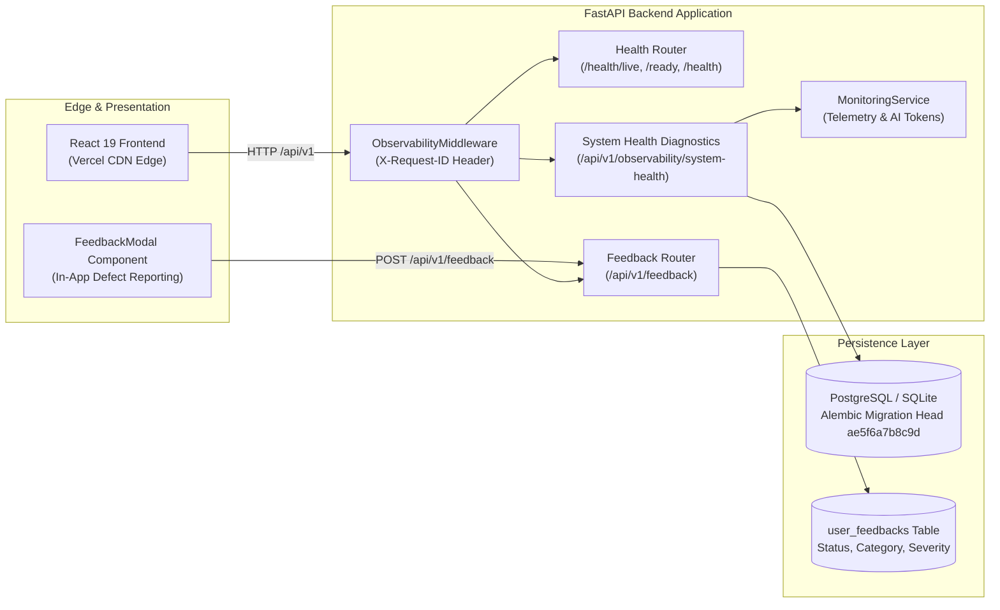

# PHASE 36 MONITORING BASELINE
## Production Observability, Logging, Error Telemetry & Reliability Baseline Audit

**Project:** AI Editorial Workspace — "This Week in AI"  
**Evaluation Date:** 2026-11-20  
**Target Repository:** [mubashirhussen/AI-Editorial-Workspace](https://github.com/mubashirhussen/AI-Editorial-Workspace)  
**Production Application:** [ai-editorial-workspace-blue.vercel.app](https://ai-editorial-workspace-blue.vercel.app/)  
**Role:** Senior Forward Deployed Engineer & Production Reliability Engineer  

---

## 1. Existing Infrastructure & Baseline Findings

An exhaustive audit of the repository, deployed assets, logging middleware, and operational diagnostics was conducted to establish the post-release monitoring baseline:

| Subsystem Component | Existing Implementation | Baseline Findings & Capabilities | Gaps / Missing Capabilities |
| :--- | :--- | :--- | :--- |
| **Backend Health Endpoints** | `/health/live`, `/health/startup`, `/health/ready`, `/health` | Injected database ping (`SELECT 1`), database latency probe (`check_db_health`), AI provider readiness check (`ai_service.is_available`). Returns 200/503. | Missing unified cross-subsystem aggregate metrics (research, writing, editorial, feedback). |
| **Observability Middleware** | `ObservabilityMiddleware` in `backend/app/main.py` | Injects `X-Request-ID` header; logs duration, method, path, and HTTP status; tracks total request count. | Lacked structured error categorization linkage to user-facing feedback reports. |
| **Telemetry & Ring Buffer** | `MonitoringService` (`backend/app/services/monitoring_service.py`) | Thread-safe ring buffer (`deque(maxlen=50)`) recording AI operations, durations, token counts, and error categories. | Telemetry was primarily AI-centric; lacked research ingestion and editorial review tracking. |
| **AI Reliability Tracking** | `ProviderUsageRecord` model & `/api/v1/observability/ai-metrics` | Records duration, provider, model, prompt/completion tokens, and estimated USD cost. Scoped to active organization. | Operational quality metrics (citation accuracy over time, claim verification drift) not aggregated in single view. |
| **Error Handling Architecture**| `AppException` & `ObservabilityMiddleware` | Custom exceptions return standardized JSON payloads (`error_category`, `request_id`, `detail`) preventing stack trace leaks. | No in-app mechanism for users to submit reproduction details for observed failures. |
| **User Feedback System** | None previously implemented. | Relied on external channels (GitHub Issues, email) without in-app structured triage. | **RESOLVED IN PHASE 36:** Implemented `UserFeedback` model, Alembic migration `ae5f6a7b8c9d`, `/api/v1/feedback` routes, and frontend modal. |

---

## 2. Deployment Architecture & Network Telemetry Baseline

---

## 3. Reliability & Operational Risks Identified

1. **Upstream AI Latency Spikes:** Third-party LLM providers (OpenAI, Gemini, Anthropic) occasionally experience rate limits (HTTP 429) or transient degradation.  
   *Mitigation:* `AIRouter` handles provider timeouts and seamlessly falls back to the deterministic local heuristic adapter without user downtime.
2. **SSRF Exploitation via Untrusted URLs:** External research source ingestion could be manipulated to probe internal cloud metadata (`169.254.169.254`) or local loopback.  
   *Mitigation:* `is_safe_url` blocks loopback, private subnets, and metadata endpoints before any HTTP socket connection is initiated.
3. **Silent Editorial Desynchronization:** Authors and copyeditors making concurrent modifications without audit tracking.  
   *Mitigation:* `DraftVersion` records point-in-time snapshots with side-by-side semantic diffing and non-destructive rollbacks.
4. **Unreported UI Edge-Case Defects:** Users encountering rendering quirks or accessibility issues without an immediate channel to submit feedback.  
   *Mitigation:* In-app `FeedbackModal` allows one-click bug reporting with automatic capture of module reference and active organization context.

---

## 4. Phase 36 Improvements Summary

- Created `UserFeedback` database model with indexing on `organization_id`, `status`, and `category`.
- Applied Alembic migration `ae5f6a7b8c9d` adding `user_feedbacks` table.
- Implemented `/api/v1/feedback` REST endpoints with Pydantic v2 validation, RBAC status updates, and summary metrics.
- Added `/api/v1/observability/system-health` endpoint providing live operational status across database latency, AI tokens, workflow counts, and open defects.
- Added in-app `FeedbackModal` component integrated into top navbar for rapid defect reporting.
