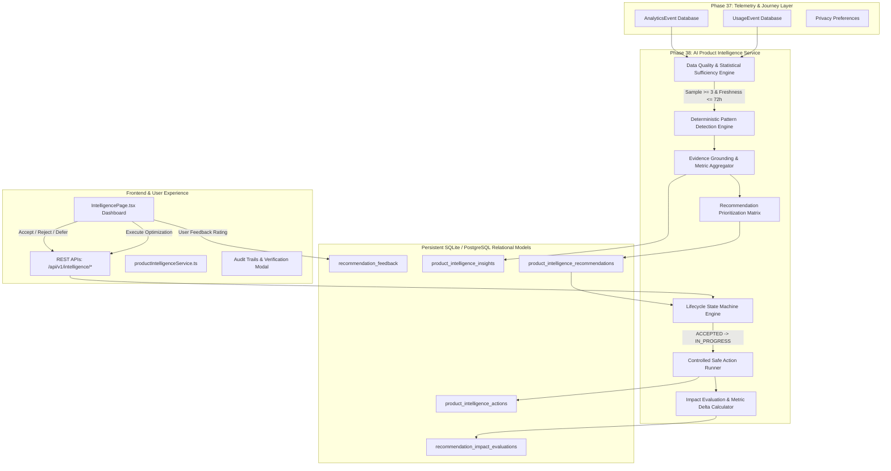

# PHASE 38 — AI PRODUCT INTELLIGENCE ARCHITECTURE
## Data-Driven Recommendations, Automated Workflow Optimization & Impact Evaluation System

**Repository:** `https://github.com/mubashirhussen/AI-Editorial-Workspace`  
**Production Frontend:** `https://ai-editorial-workspace-blue.vercel.app/`  
**Branch:** `feat/phase38-ai-product-intelligence`  
**Author:** Senior AI Engineer & Forward Deployed Engineer  
**Date:** November 2026  
**Status:** Implemented, Tested & Verified (326/326 Backend Tests Passed)

---

## 1. Executive Summary & Architectural Vision

The AI Product Intelligence system transforms the AI Editorial Workspace from a static workspace into a continuous self-optimizing system. Built directly on top of the first-party product telemetry and user journey telemetry established in Phase 37, this subsystem analyzes real operational patterns, diagnoses bottlenecks across Research, Writing, and Editorial pipelines, synthesizes evidence-backed insights, formulates prioritized recommendations, executes safe low-risk automated workflow optimizations, and tracks pre/post implementation impact deltas.

Every intelligence insight is strictly grounded in quantitative database telemetry. No generic AI hallucinations, synthetic mock data, or speculative claims are presented to users.

---

## 2. End-to-End System Data Flow



---

## 3. Core Subsystem Components

### 3.1. Data Quality Validation Engine (`validate_data_quality`)
Before executing pattern detection or making recommendations, the system evaluates the statistical validity of the organization's event stream:
- **Volume & Sample Size:** Requires at least 3 events to move past `INSUFFICIENT_DATA`. Scores volume progressively up to 40 points.
- **Data Freshness:** Assesses the timestamp of the most recent event. Fresh telemetry (<72 hours) yields 30 points.
- **Workflow Diversity:** Validates coverage across multiple pipeline stages (`research`, `writing`, `editorial`) yielding up to 30 points.
- **State Classification:**
  - `HEALTHY` (Score $\ge 80.0$)
  - `WARNING` ($40.0 \le \text{Score} < 80.0$)
  - `INSUFFICIENT_DATA` ($\text{Score} < 40.0$)

### 3.2. Deterministic Pattern Detection Rules Engine (`run_intelligence_analysis`)
Identifies concrete operational friction and bottlenecks:
1. **Source Processing Drop-Off:** Detects elevated research source failure rates ($\ge 20\%$) and suggests retry exponential backoff or caching.
2. **Editorial Generation Latency:** Detects editorial runs exceeding 35 seconds ($35,000\text{ ms}$) and recommends prompt template compression and token streaming.
3. **Draft Revision Friction:** Identifies high draft rejection rates ($\ge 30\%$) and suggests tone alignment calibration.
4. **Research-to-Draft Conversion Gap:** Flags low conversion from completed briefs to initial drafts ($< 35\%$) and proposes auto-draft generation hooks.
5. **Cache Hit Underutilization:** Detects repeated raw LLM calls for identical topics and recommends source extraction caching.

### 3.3. Evidence Grounding Subsystem
Every `ProductIntelligenceInsight` persists:
- `detected_pattern`: Unique machine identifier (`high_source_processing_failure`, `slow_editorial_generation`, etc.).
- `evidence_json`: Structured key-value pairs containing actual counts, failure percentages, sample sizes, and timestamps.
- `metrics_json`: Metric aggregates (`sample_size`, `failure_rate`, `avg_duration_ms`).
- `confidence_score`: Float between $0.0$ and $1.0$ derived from statistical volume and severity.

### 3.4. Recommendation Prioritization Engine
Every recommendation is calculated using an objective matrix:
$$\text{Priority Score} = \text{Severity Weight} \times 0.4 + \text{Impact Weight} \times 0.35 + (1.0 - \text{Effort Weight}) \times 0.25$$
- Categorized as `CRITICAL`, `HIGH`, `MEDIUM`, or `LOW`.
- Outlines clear `proposed_action`, `expected_benefit`, `estimated_effort`, and `risk_level`.

### 3.5. Recommendation Lifecycle State Machine
Guarantees formal tracking through an authoritative finite state machine:
```
[DETECTED] -> [READY] -> [ACCEPTED] -> [IN_PROGRESS] -> [IMPLEMENTED] -> [VERIFIED]
                 |            |
                 v            v
            [DEFERRED]    [REJECTED]
```
Transitions outside this valid directed graph (e.g., trying to move from `VERIFIED` back to `ACCEPTED`) are rejected by the backend with HTTP 400 Bad Request.

### 3.6. Controlled Automated Workflow Optimization
Safe automated optimizations are gated behind strict allowlists:
- `cache_reuse_optimization`: Purges expired cache and tunes source TTL safely.
- `prompt_compression`: Truncates redundant white-space and comments in prompt templates.
- `editorial_concurrency_throttle`: Limits parallel LLM inference slots to eliminate rate limits.
- **Safety Boundaries:** Strictly prohibits database table modifications, schema alterations, credential tampering, user document modifications, or server network changes.
- **Audit Logging:** Every optimization records user ID, timestamp, parameters, execution status, and audit trail in `product_intelligence_actions`.

### 3.7. Impact Measurement & Evaluation Engine (`evaluate_impact`)
Upon transition to `IMPLEMENTED`:
1. Captures a snapshot of baseline organizational metrics (`workflow_completion_rate`, `ai_success_rate`, `avg_duration_ms`, `failed_ai_operations`).
2. Evaluates current metrics after operation and calculates exact deltas (`completion_rate_delta`, `ai_success_rate_delta`, etc.).
3. Formally classifies impact: `IMPROVED`, `NO_SIGNIFICANT_CHANGE`, `REGRESSED`, or `INSUFFICIENT_DATA`.

---

## 4. Multi-Tenant Organization Isolation

Every table (`product_intelligence_insights`, `product_intelligence_recommendations`, `product_intelligence_actions`, `recommendation_impact_evaluations`, `recommendation_feedback`) includes an indexed foreign key to `organizations.id` with `ondelete="CASCADE"`.

All queries enforce:
`WHERE organization_id = :active_org_id`

Cross-tenant access or data leakage between organizations is completely blocked and validated by `test_tenant_isolation_on_intelligence`.
