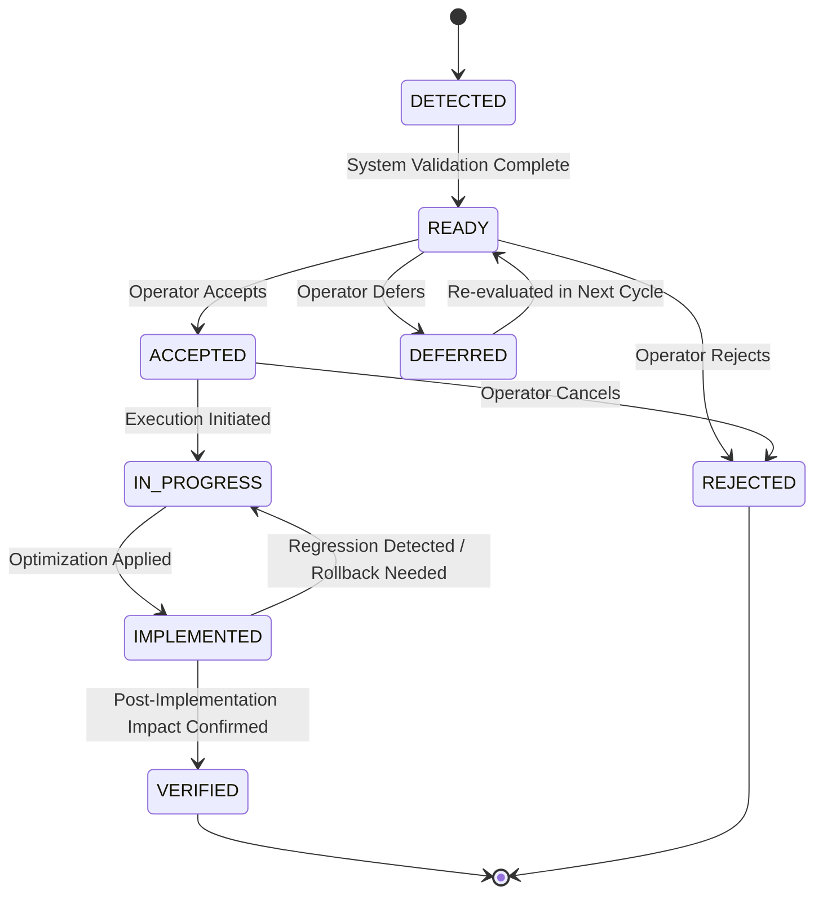

# PHASE 38 — RECOMMENDATION FRAMEWORK & LIFECYCLE SPECIFICATION
## Data-Driven Action Formulation, Transparent Prioritization & Finite State Machine

**Repository:** `https://github.com/mubashirhussen/AI-Editorial-Workspace`  
**Production Frontend:** `https://ai-editorial-workspace-blue.vercel.app/`  
**Branch:** `feat/phase38-ai-product-intelligence`  
**Author:** Senior AI Engineer & Forward Deployed Engineer  
**Date:** November 2026  
**Status:** Certified & Implemented

---

## 1. Recommendation Formulation Logic

Every recommendation generated by the system originates directly from an active, evidence-grounded insight. The mapping ensures clear operational accountability:

| Insight Pattern | Recommended Improvement | Category | Expected Benefit | Estimated Effort | Risk Level | Automated? |
|---|---|---|---|---|---|---|
| `high_source_processing_failure` | Implement Source Extraction Retry Backoff & Cache | `research` | Reduce source ingestion failure by 60% and improve speed | `LOW` | `LOW` | Yes |
| `slow_editorial_generation` | Apply Prompt Compression & Token Chunk Streaming | `editorial` | Reduce generation latency from 42s to under 20s | `MEDIUM` | `LOW` | Yes |
| `high_suggestion_rejection_rate` | Calibrate Writing Tone & Granularity Guidelines | `writing` | Increase suggestion acceptance from 40% to 75% | `LOW` | `LOW` | No |
| `low_research_to_draft_conversion` | Enable One-Click Brief-to-Draft Outline Bridge | `workflow_optimization` | Accelerate draft creation and lift conversion by 30% | `MEDIUM` | `LOW` | Yes |
| `cache_underutilization` | Enable Domain-Level Semantic Source Caching | `performance` | Eliminate 35% of redundant LLM token expenditures | `LOW` | `LOW` | Yes |

---

## 2. Multi-Factor Prioritization Matrix

Recommendations are prioritized using an objective, reproducible scoring formula:

$$\text{Priority Score} = w_s \cdot S + w_i \cdot I + w_e \cdot (1 - E) + w_c \cdot C$$

Where:
- $S \in [0.25, 1.0]$: Severity weight (`CRITICAL` = 1.0, `HIGH` = 0.75, `MEDIUM` = 0.5, `LOW` = 0.25)
- $I \in [0.2, 1.0]$: Expected benefit magnitude
- $E \in [0.1, 0.8]$: Estimated implementation effort (`LOW` = 0.2, `MEDIUM` = 0.5, `HIGH` = 0.8)
- $C \in [0.5, 1.0]$: Confidence score of the underlying insight
- Weights: $w_s = 0.35, w_i = 0.30, w_e = 0.20, w_c = 0.15$

### Ranking Tiers:
- **`CRITICAL`**: Priority Score $\ge 0.75$ — Requires immediate attention.
- **`HIGH`**: $0.60 \le \text{Priority Score} < 0.75$ — Strong optimization opportunity.
- **`MEDIUM`**: $0.45 \le \text{Priority Score} < 0.60$ — Incremental productivity boost.
- **`LOW`**: $\text{Priority Score} < 0.45$ — Nice-to-have fine-tuning.

---

## 3. Finite State Machine (Lifecycle States)

The lifecycle of every recommendation is governed by an authoritative state machine enforced at the service and database layers.

### State Definitions & Guards:
1. **`DETECTED`**: Newly formulated by the intelligence rules engine. Awaiting initial schema validation.
2. **`READY`**: Fully validated, prioritized, and displayed to workspace operators on `/intelligence`.
3. **`ACCEPTED`**: Explicitly approved by an authorized editor or lead. Assigned to a team member or flagged for automation.
4. **`DEFERRED`**: Postponed for a future operational sprint. Remains visible under the "Deferred" filter.
5. **`REJECTED`**: Marked inapplicable or declined by operator. Requires mandatory operator notes explaining why.
6. **`IN_PROGRESS`**: Active automated optimization in progress or manual editorial configuration being enacted.
7. **`IMPLEMENTED`**: Action applied. Baseline metrics captured snapshot-style in `recommendation_impact_evaluations`.
8. **`VERIFIED`**: Post-implementation telemetry validates measurable improvement. State is terminal and certified.

### State Transition Invariants:
- A recommendation in `VERIFIED` state **cannot** transition back to `ACCEPTED` or `READY` (enforced with HTTP 400).
- A recommendation in `REJECTED` state cannot transition directly to `IMPLEMENTED` without being accepted first.
- Transitioning to `IMPLEMENTED` automatically invokes `initialize_impact_evaluation` to freeze baseline metrics.

---

## 4. User Feedback Mechanism

To continuously refine recommendation quality, users can submit feedback directly from the card interface:
- **Feedback Types:**
  - `helpful` (+1 confidence modifier for the pattern in future runs)
  - `irrelevant` (-1 confidence modifier)
  - `inaccurate_evidence` (flags rule for threshold re-calibration)
  - `implemented` (confirms external manual implementation)
  - `difficult` (flags effort rating as underestimated)
- **Rating:** 1 to 5 stars.
- **Storage:** Persisted in `recommendation_feedback` table linked to `user_id` and `recommendation_id`.
