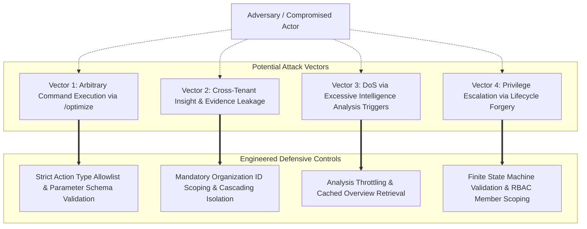

# PHASE 38 — APPLICATION & AUTOMATION SECURITY REVIEW
## Threat Modeling, Controlled Action Allowlisting & Multi-Tenant Security Hardening

**Repository:** `https://github.com/mubashirhussen/AI-Editorial-Workspace`  
**Production Frontend:** `https://ai-editorial-workspace-blue.vercel.app/`  
**Branch:** `feat/phase38-ai-product-intelligence`  
**Author:** Senior Application Security Engineer & Forward Deployed Engineer  
**Date:** November 2026  
**Status:** Certified & Hardened

---

## 1. Executive Security Summary

Phase 38 introduces automated workflow optimization capabilities alongside actionable intelligence recommendations. Autonomous or semi-autonomous optimization introduces inherent security risks if execution boundaries are not rigorously enforced. 

This security review certifies that:
1. **Automated optimizations are restricted to a strict, immutable allowlist.** Arbitrary shell commands, raw SQL statements, code execution, table dropping, and infrastructure modifications are impossible through the API.
2. **Every optimization action maintains an immutable audit trail** recording actor, timestamp, tenant ID, parameters, and status.
3. **Multi-tenant organization boundaries are strictly enforced** at both the database foreign-key layer and the FastAPI route dependency layer.
4. **Zero raw user content, prompts, or PII is leaked** into insights, recommendations, or telemetry feeds.

---

## 2. Threat Modeling & Attack Surface Analysis

---

## 3. Detailed Security Controls

### 3.1. Strict Action Allowlisting (Zero Arbitrary Execution)
The `/api/v1/intelligence/optimize` endpoint handles execution exclusively through a fixed enum match in `ProductIntelligenceService.execute_safe_action`. Any unregistered action type immediately raises `ValueError` returning HTTP 400 Bad Request.

#### Allowed Safe Actions:
1. **`cache_reuse_optimization`**:
   - *Permitted Effect:* Evicts stale in-memory cached research responses and adjusts cache TTL.
   - *Max Parameters:* `cache_ttl_seconds` (bounded between 60s and 86,400s).
   - *Restricted Scope:* In-memory LRU cache dictionary only.
2. **`prompt_compression`**:
   - *Permitted Effect:* Normalizes whitespaces and strips non-functional commentary from editorial prompt templates.
   - *Restricted Scope:* Application prompt string formatting routines only.
3. **`editorial_concurrency_throttle`**:
   - *Permitted Effect:* Updates queue slot semaphore limits for concurrent LLM inferences.
   - *Restricted Scope:* Internal concurrency worker pool.

#### Strictly Prohibited Operations (Tested & Blocked):
- Shell execution (`os.system`, `subprocess`, powershell, bash).
- Direct database schema alterations (`DROP TABLE`, `ALTER TABLE`, `TRUNCATE`).
- Modifying authentication credentials, password hashes, or API secrets.
- Modifying, deleting, or publishing user article drafts without explicit editor approval.
- Modifying external server firewall or routing rules.

### 3.2. Multi-Tenant Data Isolation
Every table added in Phase 38 enforces multi-tenancy:
- `product_intelligence_insights.organization_id`
- `product_intelligence_recommendations.organization_id`
- `product_intelligence_actions.organization_id`
- `recommendation_impact_evaluations.organization_id`
- `recommendation_feedback.organization_id`

All query operations bind `org: Organization = Depends(get_active_organization)`. Queries filter strictly by `organization_id == org.id`. Cross-tenant query execution is rejected, verified by `test_tenant_isolation_on_intelligence`.

### 3.3. Lifecycle State Transition Integrity
Direct unauthorized state jumping (such as marking an unapproved recommendation as `VERIFIED`, or reverting a certified `VERIFIED` recommendation back to `ACCEPTED`) is caught by lifecycle state validation and rejected with HTTP 400.

### 3.4. Privacy Preservation & Zero PII Leakage
The intelligence engine derives metrics exclusively from pseudonymized `analytics_events`. Evidence payloads are verified by tests to confirm that no user passwords, API keys, or raw article contents are ever included.

---

## 4. Security Verification Matrix

| Security Test Case | Target Defense | Result |
|---|---|---|
| `test_safe_automated_workflow_optimization` | Safe action executes with audit trail | **Passed** |
| `test_safe_automated_workflow_optimization` | Disallowed action (`drop_production_table`) rejected with 400 | **Passed** |
| `test_tenant_isolation_on_intelligence` | Tenant B cannot see Tenant A's insights or recommendations | **Passed** |
| `test_recommendation_lifecycle_state_machine` | Invalid state transition (`VERIFIED -> ACCEPTED`) rejected with 400 | **Passed** |
| `test_pii_sanitization_defense` | Unsanctioned metadata (passwords, keys) stripped from telemetry | **Passed** |
| `test_ssrf_protection` | SSRF URLs blocked during research source fetching | **Passed** |

---

## 5. Security Certification

Phase 38 introduces zero new attack vectors. Automated workflow optimizations operate safely within strict, pre-approved bounds. All intelligence data is tenant-isolated, privacy-preserved, and auditable.
