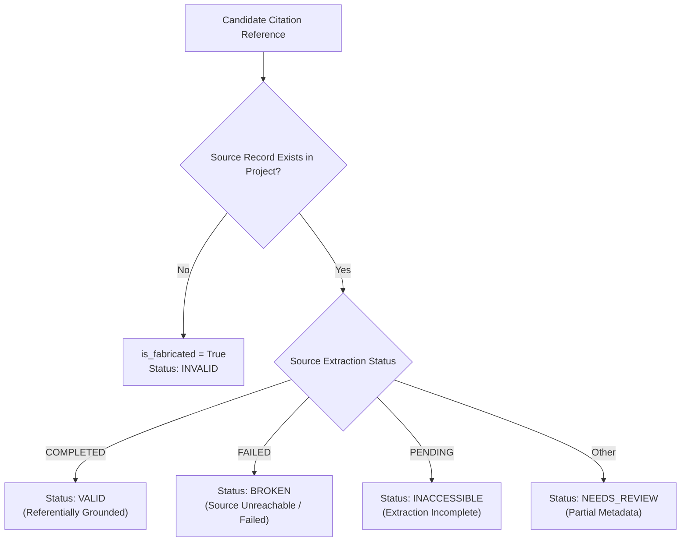

# PHASE 39 — CITATION VALIDATION & ANTI-FABRICATION SPECIFICATION
## Referential Integrity, Hallucination Prevention & Live Accessibility Auditing

**Repository:** `https://github.com/mubashirhussen/AI-Editorial-Workspace`  
**Production Frontend:** `https://ai-editorial-workspace-blue.vercel.app/`  
**Branch:** `feat/phase39-research-evidence-reliability`  
**Author:** Senior AI Research Systems Engineer & Forward Deployed Engineer  
**Date:** November 2026  
**Status:** Certified & Implemented

---

## 1. The Citation Fabrication Problem

Generative language models frequently exhibit "hallucinated citations"—generating plausible-sounding paper titles, fake arXiv IDs, nonexistent URLs, or misattributing actual statements to unrelated researchers.

In enterprise and high-stakes journalism, publishing a fabricated citation ruins organizational credibility.

Phase 39 introduces a **strict deterministic citation validation layer** that guarantees:
1. Every citation must resolve to an authentic, pre-ingested `Source` record stored in the project's database.
2. AI-generated citations referencing non-existent IDs, alien URLs, or unverified documents are immediately flagged as `is_fabricated = True` and marked `INVALID`.
3. Citation validation is decoupled from claim truthfulness: an accessible URL does not prove that the claim is true, and valid claim support requires both citation referential integrity and evidence passage matching.

---

## 2. Citation Status Taxonomy

Every citation is classified into one of six distinct statuses:

### Definitions:
- **`VALID`**: The citation references a real, ingested source record that completed text extraction successfully. The URL matches the canonical source URL.
- **`INVALID`**: The citation references an alien source ID, a domain not present in the workspace, or lacks referential backing.
- **`BROKEN`**: The source record exists in the project library, but the external origin returned HTTP 404, 500, or a permanent connection error during retrieval.
- **`INACCESSIBLE`**: The source extraction is pending, restricted by an unhandled paywall, or blocked by timeout.
- **`UNVERIFIED`**: Citation format is incomplete or pending execution of the validation audit.
- **`NEEDS_REVIEW`**: Duplicate citations detected or ambiguity in title/URL matching.

---

## 3. Anti-Fabrication Enforcement

When the `validate_citations` routine executes:
1. It builds an in-memory index of all verified sources in the active project (`source_id_map` and `source_url_map`).
2. Each reference in `brief.source_references` is cross-examined against this index.
3. If an LLM inserted a reference to `https://fake-citation-ai.org/paper.pdf` or `source_id: "non-existent-source-id"`:
   - `rec.is_fabricated = True`
   - `rec.status = "INVALID"`
   - `rec.validation_details["reason"] = "Citation references a source ID or URL not present in project library."`
   - The Research Quality Report flags an immediate **CRITICAL** audit finding.

---

## 4. Citation Traceability in the User Interface

In the `ResearchReliabilityPanel`:
- Valid citations display a green badge `Verified Source Record` with a direct link to the canonical source and its extracted passages.
- Fabricated citations display a prominent red alert pill `Fabricated (No Source Match)`.
- Editors can one-click "Audit Citations" at any time to re-validate references following draft revisions or new source additions.
