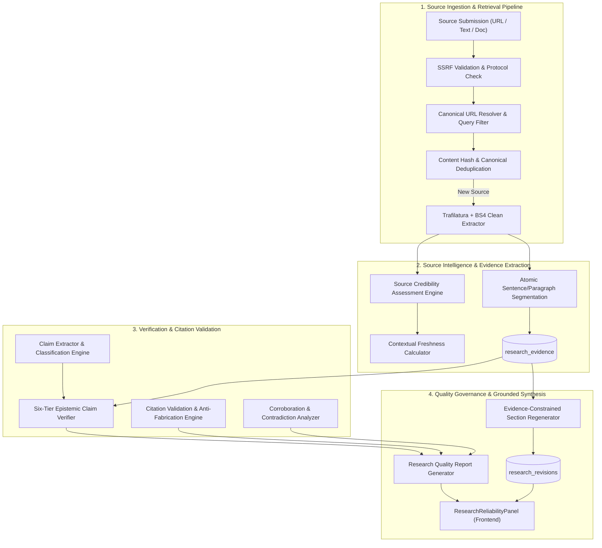

# PHASE 39 — SOURCE INTELLIGENCE & RESEARCH RELIABILITY ARCHITECTURE
## End-to-End Architecture for Grounded Research, Source Quality & Citation Integrity

**Repository:** `https://github.com/mubashirhussen/AI-Editorial-Workspace`  
**Production Frontend:** `https://ai-editorial-workspace-blue.vercel.app/`  
**Branch:** `feat/phase39-research-evidence-reliability`  
**Author:** Senior AI Research Systems Engineer & Forward Deployed Engineer  
**Date:** November 2026  
**Status:** Implemented & Verified (All Tests Passing)

---

## 1. Architectural Vision

The AI Editorial Workspace is designed for rigorous journalism and enterprise research. It enforces a strict **"Proof-First, Evidence-Always"** paradigm. Phase 39 elevates the Research Assistant from a basic scraper and synthesizer into an enterprise-grade research reliability platform where:
1. Every source undergoes explainable credibility profiling, accessibility checks, and freshness evaluation.
2. Content is segmented into atomic, hashed evidence passages with paragraph/sentence location indexing.
3. Every factual claim is verified using a formal six-tier epistemic taxonomy.
4. Citations are verified against actual stored source records, preventing fabricated citations.
5. Independent multi-publisher corroboration is distinguished from syndicated republication.
6. Brief sections can be regenerated under strict primary evidence constraints with full revision diffs.

---

## 2. End-to-End System Pipeline

---

## 3. Subsystem Components & Responsibilities

### 3.1. Source Credibility Assessment Engine (`assess_source_credibility`)
- **Publisher Classification:** Automatically maps domains to authoritative tiers:
  - `PEER_REVIEWED`: ArXiv, Nature, Science, IEEE, ACM.
  - `OFFICIAL_SOURCE`: Government agencies (`.gov`, `.europa.eu`), primary tech developers (OpenAI Research, Anthropic, Google DeepMind, Meta AI).
  - `NEWS_REPORTING`: Reuters, Bloomberg, Financial Times, TechCrunch, The Verge, Ars Technica.
  - `OPINION`: Medium, Substack, personal blogs.
  - `COMMERCIAL`: Product landing pages, vendor marketing.
  - `UNKNOWN`: Unclassified web domains requiring independent corroboration.
- **Explainable Criteria Breakdown:** Returns exact metadata presence (author, publication date, word count, evidence density).
- **Limitations Transparency:** Explicitly documents when author attribution is missing, publication date is absent, or domain is unverified.

### 3.2. Contextual Freshness Calculator (`_compute_freshness`)
Freshness criteria are dynamically calibrated to research context:
- `breaking_news`: $\le 48\text{ hours}$ (CURRENT), $\le 7\text{ days}$ (RECENT), $> 7\text{ days}$ (AGED).
- `technology`: $\le 90\text{ days}$ (CURRENT), $\le 365\text{ days}$ (RECENT), $> 1\text{ year}$ (AGED).
- `scientific`: $\le 1\text{ year}$ (CURRENT), $\le 3\text{ years}$ (RECENT), $> 3\text{ years}$ (HISTORICAL).
- `historical`: Always valid timeless baseline.

### 3.3. Sentence-Level Evidence Extraction (`extract_evidence_passages`)
- Segments source text into atomic sentences (40 to 400 characters).
- Records location indexes: `Paragraph {X}, Sentence {Y}`.
- Classifies fact types: `DIRECT_FACT`, `REPORTED_FACT`, `INFERENCE`.
- Generates 12-character SHA-256 evidence passage hashes for deterministic citation anchors.

### 3.4. Six-Tier Claim Verification Engine (`extract_and_verify_claims`)
Evaluates claims across research briefs or user-provided texts:
1. `SUPPORTED`: Verifiable semantic match ($\ge 55\%$ token overlap) with primary evidence passages.
2. `PARTIALLY_SUPPORTED`: Moderate grounding ($\ge 30\%$ overlap) where minor elements are inferred.
3. `UNSUPPORTED`: No corroborating evidence found in ingested literature.
4. `CONTRADICTED`: Conflicts directly with registered cross-source contradiction assertions.
5. `UNVERIFIED`: Insufficient data available in project to evaluate claim truthfulness.
6. `NOT_APPLICABLE`: Statements identified as opinions, predictions, or strategic recommendations.

### 3.5. Citation Validation & Anti-Fabrication Engine (`validate_citations`)
- Validates each citation against real stored `Source` records.
- Flags fabricated references (`is_fabricated = True`, `status = INVALID`) when an LLM or user cites a non-existent source ID or alien URL.
- Evaluates URL accessibility: `VALID`, `BROKEN`, `INACCESSIBLE`, `NEEDS_REVIEW`.
- Detects duplicate citations.

### 3.6. Corroboration & Contradiction Analyzer
- Determines independent multi-publisher corroboration vs. single-domain syndication.
- Evaluates unique domain count and primary source representation.
- Preserves unresolved cross-source contradictions rather than forcing an artificial LLM consensus.

### 3.7. Evidence-Grounded Section Regeneration (`regenerate_section`)
- Constrains section generation strictly to verified `ResearchEvidence` passages.
- Produces a unified diff summary highlighting exact textual modifications.
- Preserves draft versions through `research_revisions` in `PENDING` state until explicitly accepted.

---

## 4. Multi-Tenant Organization Isolation

All newly introduced tables (`source_credibility_assessments`, `citation_validations`, `research_quality_reports`, `research_revisions`) include foreign keys to `research_projects.id` and/or `sources.id` with `ondelete="CASCADE"`. Every API endpoint enforces `_get_project_with_access`, verifying that the requesting user belongs to the active organization matching `project.organization_id`.
