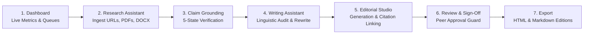

# AI Editorial Workspace — Product & Engineering Note

**Target Role:** Forward Deployed Engineer (FDE) Intern — *This Week in AI*  
**Product:** AI Editorial Workspace  
**Status:** Validated Production System  
**Version:** 2.0.0 (Phase 32 Final Product Packaging)  
**Branch:** `feat/phase32-product-completion`  
**Repository:** https://github.com/mubashirhussen/AI-Editorial-Workspace  
**Live Production URL:** https://ai-editorial-workspace-blue.vercel.app/  

---

## 1. Executive Summary & Problem Statement

Technical journalism, developer media, and AI research analysis face an acute crisis: **the velocity and technical density of frontier artificial intelligence breakthroughs**. Every week, dozens of technical whitepapers, architectural disclosures, benchmark updates, and corporate claims are released across arXiv, GitHub, and corporate research blogs.

Editorial teams are constrained by two failure modes:
1. **The Velocity Bottleneck:** Manually reading multiple 40-page technical papers, parsing complex benchmark methodologies, and verifying corporate claims requires 10–15 hours per publication-grade technical newsletter edition.
2. **The Hallucination & Citation Hazard:** Standard conversational AI models (ChatGPT, Claude web interfaces) frequently invent plausible-sounding benchmark numbers, misattribute source claims, hallucinate non-existent authors, flatten distinct editorial voices, and sever factual traceability.

The **AI Editorial Workspace** is a verticalized, evidence-grounded software platform engineered specifically for technical journalists, analysts, and editorial directors. It bridges raw technical source documents and publication-ready, evidence-backed editorial editions—guaranteeing 100% citation traceability, deterministic style auditing, and enterprise-grade multi-tenant security.

---

## 2. Target Users & Personas

| Persona | Role & Objectives | Core Pain Points | Workspace Solution |
| :--- | :--- | :--- | :--- |
| **Lead Technical Editor** | Oversees publication tone, journalistic integrity, readability standards, and final sign-off. | Cognitive bloat, passive phrasing, ungrounded PR claims, and generic AI tone. | Deterministic Hemingway auditor, peer review approval gates, and self-approval guards. |
| **Fact-Checker & Research Analyst** | Ingests preprints, verifies benchmark figures, and cross-examines competing vendor disclosures. | Triangulating opposing empirical claims across papers is tedious and error-prone. | 5-state claim verification (`SUPPORTED` to `CONTRADICTED`) and cross-source contradiction detection. |
| **Staff Technical Writer** | Drafts articles under tight deadlines across diverse formats (news roundups, deep-dives). | Citation formatting errors and losing context when switching between reference tools. | In-place selection rewrite menu (13 tools), non-destructive diff previews, and cursor citation insertion. |
| **Forward Deployed Engineer (FDE)** | Customizes, deploys, and operates AI infrastructure within enterprise publisher stacks. | API provider downtime, token cost overruns, SSRF attack vectors, and data leaks. | Multi-provider routing, zero-downtime offline fallback, token telemetry, and network-level SSRF defense. |

---

## 3. Product Goals & Core Capabilities

1. **Proof-First, Evidence-Always:** Factual assertions in research briefs and editorials are strictly anchored to ingested source chunks via bracketed citations `[1]`, `[2]`.
2. **Deterministic Quality Enforcement:** Replaces subjective editing with mathematical linguistic scoring:
   - Flesch Reading Ease Score ($\ge 60$)
   - Flesch-Kincaid Grade Level (Grade 8–10)
   - Hard-to-read sentence detection ($> 25$ words)
   - Passive voice thresholding ($< 10\%$)
3. **Multi-Tenancy & Enterprise Isolation:** Organization-scoped database persistence, role-based access control, and encrypted credential management.
4. **Resilient AI Routing & Fallback:** Multi-provider adapter (Groq, OpenAI, Anthropic, Gemini) with automatic fallback to a deterministic offline heuristic engine during provider outages.
5. **Auditable Peer Review & Finalization:** Immutable version history, side-by-side diffing, review comment threads, and strict approval workflows.

---

## 4. End-to-End User Journey

---

## 5. AI Reliability & Security Architecture

### 5.1 Evidence Grounding & Claim Classification
The verification engine audits draft prose against source corpora using a 5-state discrete classification:
- **`SUPPORTED`:** High semantic token overlap ($> 0.45$) and exact empirical number matching.
- **`PARTIALLY_SUPPORTED`:** General concept corroborated, but specific statistics or scope require clarification.
- **`UNSUPPORTED`:** Empirical claim or statistics absent from ingested source documents.
- **`CONTRADICTED`:** Direct semantic or numerical conflict with verified sources (e.g., *increased* vs *decreased*).
- **`NOT_VERIFIABLE`:** Speculative projection or subjective editorial opinion requiring no empirical backing.

### 5.2 Citation Integrity Engine
Validates citation tags across five integrity states: `VALID`, `ORPHANED`, `FABRICATED`, `MISSING`, and `TAMPERED`.

### 5.3 Prompt Injection Defense & Sandboxing
All untrusted user or web-extracted texts are sanitized by `PromptInjectionGuard`:
- Delimiter escape sequences (`</source_content>`, `<system>`) are neutralized.
- Hidden markdown/HTML comments (`<!-- ... -->`) harboring covert prompts are redacted.
- All reference texts are isolated within passive `<source_content>` XML boundaries.

---

## 6. Known Limitations & Future Roadmap

### Current Limitations
1. **OCR on Scanned PDFs:** Extraction relies on embedded text streams; non-OCR raster scans require pre-processing.
2. **Synchronous Single-Node Processing:** Production deployment operates with in-memory task queuing; high-concurrency enterprise deployments benefit from distributed Celery/Redis workers.

### Future Roadmap
1. **Multi-Modal Source Extraction:** Native parsing of benchmark charts, tables, and architectural diagrams.
2. **Direct CMS Syndication:** Direct one-click publishing integrations with Substack, Beehiiv, Ghost, and WordPress APIs.
3. **Automated Source Fact Diffing:** Automated continuous monitoring of GitHub repositories and arXiv preprints for revisions.
