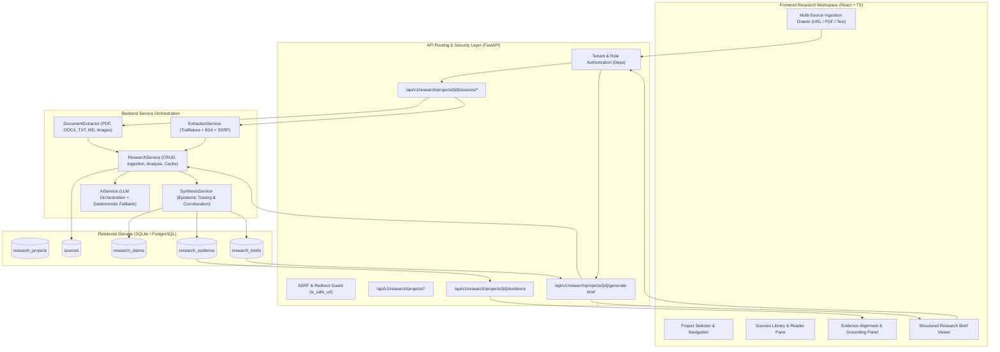

# AI Research Assistant: System Architecture & Design Specification

## 1. Executive Summary

The **AI Research Assistant** is the core investigative intelligence subsystem of the **AI Editorial Workspace**. It transforms unstructured industry sources—such as academic papers (PDFs), enterprise announcements, Word specifications, technical blogs, and verbatim press releases—into structured, factual, and epistemically audited research briefs.

The subsystem enforces strict **zero-hallucination guardrails**, **multi-tenant data isolation**, **cryptographic deduplication**, and **per-claim evidence traceability**.

---

## 2. End-to-End System Architecture

---

## 3. Core Lifecycle Stages

### Stage 1: Project Provisioning & Tenant Isolation
- Each investigation project belongs to an `organization_id` (multi-tenant boundary).
- Roles (`OWNER`, `ADMIN`, `EDITOR`, `REVIEWER`, `VIEWER`) determine create/write/delete permissions.
- State transitions: `draft` $\rightarrow$ `in_progress` $\rightarrow$ `analyzed` $\rightarrow$ `completed` $\rightarrow$ `archived`.
- Comprehensive indexing on `(organization_id, status)` and `(title, description)` provides instant full-text filtering and pagination.

### Stage 2: Ingestion & Invariant Validation
- **Supported Inputs**:
  1. Article / Web URLs
  2. PDF Documents (up to 10 MB)
  3. Word Documents (`.docx`)
  4. Markdown & Plaintext (`.md`, `.txt`, `.csv`, `.json`)
  5. Pasted Verbatim Content
- **Invariants Enforced**:
  - **SSRF Defense**: IP address resolution blocks private networks (RFC 1918), loopback, link-local, and cloud metadata (e.g. AWS `169.254.169.254`).
  - **Redirect Hops**: Each redirect destination is independently validated against SSRF rules.
  - **Cryptographic Deduplication**: Computes SHA-256 of extracted text; duplicate content within the same project is rejected with HTTP 400.
  - **URL Canonicalization**: Strips query tracking parameters (`utm_*`, `ref`, `fbclid`) and normalizes trailing slashes.

### Stage 3: Single-Source Evidentiary Analysis
- When an individual source is processed, the system extracts:
  1. **Key Developments**: Factual announcements, benchmark achievements, technological disclosures.
  2. **Important Claims**: Sentences containing empirical measurements, quotes, or causal relationships.
  3. **Facts vs. Speculation**: Hard numbers and verified disclosures are segregated from predictive hype (`"will"`, `"forecast"`, `"predict"`).
  4. **Founder & Technical Implications**: Architectural shifts, developer API impacts, and operational cost changes.
  5. **Limitations & Uncertainties**: Inherent benchmark limitations, reproducibility gaps, or compute constraints.

### Stage 4: Relational Claim & Evidence Persistence
- Extracted claims are inserted into `research_claims` with `project_id`, `source_id`, `claim_text`, and `evidence_classification`.
- Verifiable passages are persisted into `research_evidence` with foreign keys to `claim_id` and `source_id`, tracking confidence score and grounding status.

### Stage 5: Cross-Source Evidence Synthesis
- Requires a strict **minimum of 3 verified sources** to synthesize.
- Generates Section A through J structured briefs:
  - **Section A**: Executive Summary
  - **Section B**: What Happened?
  - **Section C**: Why Does It Matter?
  - **Section D**: Who Should Care? (Founders, Developers, Operators, AI Researchers)
  - **Section E**: Evidence Alignment & Grounding Verification
  - **Section F**: Epistemic Segregation (Verified Facts vs. Analysis vs. Speculation)
  - **Section G**: Cross-Source Comparison (Common Themes, Differences, Conflicts, PR Echo vs. Corroboration)
  - **Section H**: Newsletter Angles & Editorial Pitches
  - **Section I**: Strategic Implications (Startups, Founders, Product Teams, Engineering)
  - **Section J**: Verifiable Citations and Source References

---

## 4. Key Engineering Invariants

| Invariant | Guarantee | Enforcement Mechanism |
| :--- | :--- | :--- |
| **Multi-Tenant Isolation** | No user can access or mutate projects/sources from another organization. | `check_project_tenant_access` and org-scoped queries in DB layer. |
| **Zero SSRF Vulnerability** | No request to internal services, localhost, or cloud metadata endpoints. | `is_safe_url` socket/IP check + per-hop redirect validation in `extraction_service`. |
| **Content Deduplication** | No duplicate content allowed within the same project workspace. | SHA-256 content hash check in `add_source` and `upload_project_source_file`. |
| **Minimum Sources Guard** | Cross-source briefs cannot be synthesized with fewer than 3 sources. | HTTP 400 validation in `synthesize_research`. |
| **Evidence Traceability** | Every claim in a synthesized brief links to an excerpt in source text. | `validate_and_trace_evidence` verifying verbatim or near-verbatim grounding. |

