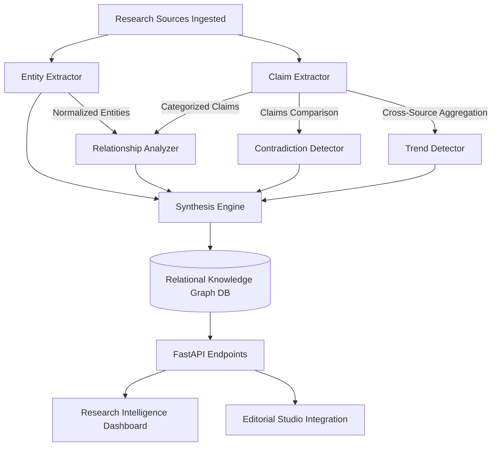

# Advanced Research Intelligence & Knowledge Graph Specification

This document details the cross-source research intelligence, entity extraction, epistemic claim classification, semantic relationship discovery, contradiction detection, trend analysis, and relational knowledge graph architecture implemented in **Phase 25** for the **AI Editorial Workspace** (*Editorial AI*).

---

## 1. Executive Summary & Core Philosophy

The primary failure mode of contemporary LLM workflows in investigative research and journalism is **epistemic conflation**—the failure to distinguish between:
1. Grounded empirical facts directly stated by primary sources.
2. Unverified rumors reported by second-hand publications.
3. Speculative forward-looking predictions.
4. Spurious correlations inferred merely because two companies or products are mentioned in the same paragraph.

The **Research Intelligence Engine** (`backend/app/services/research_intelligence/`) resolves this by enforcing strict epistemic provenance:
- **Zero Hallucination Tolerance:** No entity, claim, relationship, contradiction, or trend is ever created without a verbatim or near-verbatim supporting excerpt from an ingested source.
- **Syntactic Evidence Requirement:** Two entities co-occurring in the same article are never linked in a relationship unless explicit grammatical connective predicates (`announced`, `invested in`, `developed`, `competes with`, `uses`) are present between them.
- **Neutral Contradiction Equipoise:** The engine identifies factual discrepancies (such as conflicting funding figures or contradictory release dates) without arbitrarily declaring which publication is "correct," leaving the editorial judgment to human journalists.
- **Corroboration Threshold for Trends:** Themes must be independently corroborated by at least $\ge 2$ distinct sources before being recognized as a systemic trend.

---

## 2. Architecture Overview



### Module Organization:
- `entity_extractor.py`: High-precision canonical and pattern-based entity extraction across 9 target categories with normalization.
- `claim_extractor.py`: Extracts evidentiary statements and assigns 4-level epistemic classifications.
- `relationship_analyzer.py`: Identifies validated semantic edges between entities backed by specific sentence evidence.
- `contradiction_detector.py`: Cross-examines statements across disparate sources to highlight financial, timeline, or benchmark discrepancies.
- `trend_detector.py`: Discovers recurring industry themes requiring multi-source corroboration and segregates observed patterns from predictions.
- `synthesis_engine.py`: Orchestrates atomic execution, builds knowledge graph nodes and edges, and persists records to PostgreSQL/SQLite.

---

## 3. Entity Extraction & Normalization

### 3.1 Supported Entity Categories:
1. `COMPANY`: Tech firms, hyperscalers, chipmakers (OpenAI, Anthropic, Google, Microsoft, Meta, Nvidia, TSMC, DeepSeek).
2. `PERSON`: Founders, executives, researchers (Sam Altman, Dario Amodei, Demis Hassabis, Jensen Huang).
3. `AI_MODEL`: Foundational LLMs and vision models (GPT-4, Claude 3.5 Sonnet, Gemini 1.5 Pro, Llama 3, DeepSeek-V3).
4. `PRODUCT`: Commercial platforms and hardware (ChatGPT, Microsoft Copilot, Cursor, Nvidia Blackwell B200, H100).
5. `TECHNOLOGY`: Architectural paradigms and physical systems (Two-Phase Immersion Cooling, SMRs, RAG, MoE, LoRA, HBM3e).
6. `INVESTOR`: Venture capital and institutional backers (Sequoia Capital, a16z, Y Combinator, SoftBank).
7. `FUNDING_ORG`: Public grants and standards bodies (NSF, DARPA, EU AI Office).
8. `INDUSTRY`: Broad industrial verticals (AI Infrastructure, Semiconductor Industry, Enterprise Software).
9. `MARKET`: Specific addressable sectors (Generative AI Market, AI Hardware Acceleration).

### 3.2 Canonical Normalization:
Corporate suffixes (`Inc.`, `Corp.`, `Corporation`, `LLC`, `Ltd.`, `PBC`, `SAS`) and trailing punctuation are automatically stripped to achieve entity deduplication across sources, while strictly preserving distinctive identities:
- `OpenAI, Inc.` $\rightarrow$ `OpenAI`
- `NVIDIA Corp.` $\rightarrow$ `Nvidia`
- `Microsoft Corporation` $\rightarrow$ `Microsoft`
- `Google` and `Google Cloud` remain distinct entities.

---

## 4. Claim Extraction & Epistemic Classification

Every extracted claim is tagged with an epistemic category:

| Classification | Meaning & Criteria | Example Text |
| :--- | :--- | :--- |
| `DIRECTLY_STATED` | Direct announcement or empirical benchmark stated unequivocally by the author or company. | *"OpenAI announced GPT-4o with multimodal reasoning capabilities."* |
| `REPORTED_BY_SOURCE` | Statement attributed to unnamed insiders, external publications, or third-party reporting. | *"According to reports by Bloomberg, hyperscaler capex reached $120B."* |
| `INFERENCE` | Deductive conclusion, projection, or interpretation derived by the author. | *"This indicates a shift towards power density as the primary datacenter bottleneck."* |
| `UNVERIFIED` | Rumors, unconfirmed leaks, or speculative industry chatter. | *"Rumors suggest an unconfirmed partnership with regional nuclear operators."* |

Every claim records its `supporting_excerpt`, linked `entity_references`, confidence score (0.70 to 0.95), and publication date if available.

---

## 5. Semantic Relationship Analysis

The system supports 8 semantic edge types:
- `ANNOUNCED`: Subject launched, revealed, or unveiled object.
- `DEVELOPED`: Subject engineered, built, or trained object.
- `INVESTED_IN`: Subject deployed capital or acquired a stake in object.
- `COMPETES_WITH`: Subject rivals or provides an alternative to object in the market.
- `USES`: Subject integrates or depends on object as a core component.
- `REPORTED_BY`: Claim or entity was surfaced by a specific source.
- `SUPPORTS`: Claim corroborates or reinforces another claim or trend.
- `CONTRADICTS`: Claim conflicts with another claim.

### Strict Non-Co-occurrence Invariant:
```python
# A relationship is asserted ONLY if an explicit relational predicate connects the two entities
if re.search(pattern, intervening_text) or re.search(pattern, sentence):
    record_relationship(source_entity, target_entity, rel_type, evidence=sentence)
```
Co-occurrence of two entities in the same article or paragraph without explicit relational predicates is intentionally discarded to eliminate spurious graph connectivity.

---

## 6. Contradiction Detection

Contradiction detection cross-examines claims across distinct sources sharing common entities to identify three classes of disagreement:
1. **Financial Discrepancies:** Different reported funding amounts, valuations, or capex numbers (e.g., "$500M" vs "$650M").
2. **Timeline Discrepancies:** Conflicting deployment dates (e.g., "Q2 2026" vs "late 2026").
3. **Benchmark Polarity Conflicts:** Opposing evaluations on performance (e.g., "surpassed GPT-4" vs "lagged behind GPT-4").

### Neutrality Guarantee:
The system never automatically decides which source is accurate. Instead, it provides:
- Verbatim excerpts from `Source A` and `Source B`.
- `disagreement_nature`: Concise description of the delta.
- `possible_explanations`: Contextual hypothesis (e.g. pre-money vs post-money funding, general preview vs general availability).
- `unresolved_questions`: Targeted question guiding follow-up reporting (e.g. "What was the officially filed SEC Form D?").

---

## 7. Trend Detection & Evidence Thresholds

Trend detection monitors cross-source topic clusters across six categories:
- `EMERGING_TECHNOLOGY`
- `MARKET_DEVELOPMENT`
- `DEVELOPER_ADOPTION`
- `FUNDING_PATTERN`
- `PRODUCT_LAUNCH`
- `REPEATED_ANNOUNCEMENT`

### Threshold Invariant:
A theme is rejected unless $\ge 2$ distinct sources corroborate the pattern:
```python
if len(distinct_source_ids) < 2:
    continue  # Insufficient cross-source corroboration
```

### Observation vs. Prediction Differentiation:
Trends containing predictive modal markers (`predicts`, `forecasts`, `expected to reach by 2028`) are explicitly flagged with `is_prediction = True`, preventing speculative industry projections from masquerading as observed historical facts.

---

## 8. Relational Knowledge Graph Design

The knowledge graph is modeled relationally in PostgreSQL / SQLite:
- `research_entities`: Entity nodes (id, project_id, name, normalized_name, entity_type, source_id, supporting_excerpt, confidence).
- `research_claims`: Claim nodes (id, project_id, source_id, claim_text, supporting_excerpt, evidence_classification, entity_references).
- `research_relationships`: Semantic edges between entity nodes (id, project_id, source_entity_name, target_entity_name, relationship_type, supporting_evidence).
- `research_contradictions`: Conflict edges between claims (id, project_id, claim_a_id, claim_b_id, disagreement_nature, possible_explanations, unresolved_questions).
- `research_trends`: High-level aggregated thematic clusters (id, project_id, theme, category, supporting_source_ids, is_prediction).

API endpoint `GET /api/v1/projects/{project_id}/intelligence/graph` serializes this relational structure into `{ nodes: [...], edges: [...], stats: {...} }` for interactive front-end rendering.

---

## 9. Integration with Editorial Studio

Editorial writers can incorporate intelligence findings directly into newsletter drafts:
- In the **Research Intelligence Dashboard**, every claim, contradiction, and trend provides a **"Copy for Studio"** action.
- The clipboard receives a formatted citation tag, for example:  
  `[Hardware Analysis 2026]: "Microsoft invested heavily in Blackwell clusters using immersion cooling."`
- In the **Editorial Studio**, inline citation brackets `[1]`, `[2]` resolve directly to these verified excerpts, ensuring that final newsletters retain end-to-end auditability.

---

## 10. AI Limitations & Future Milestones

| Current Limitation | Mitigation in Phase 25 | Future Enhancement |
| :--- | :--- | :--- |
| **Heuristic Relation Coverage** | Catalog covering top 50 entities and common relational verbs. | Introduce local cross-encoder relation extraction models (e.g. REBEL / DeBERTa). |
| **Complex Temporal Discrepancies** | Regular expressions for quarters and calendar years. | Formal Allen's interval algebra temporal reasoning engine. |
| **Graph Visualization Scale** | Grouped card layout and sub-tab filtering. | 3D WebGL force-directed graph renderer (Cytoscape.js or 3d-force-graph). |
| **Multi-Hop Inference** | 1-hop semantic relationships. | Multi-hop graph path finding for investigative supply chain tracing. |

